# MLZ Security Lab Starter Kit — Implementation Guide (Azure Commercial)

Step-by-step, from an empty **Azure Commercial** subscription to a running MLZ Security Lab with
Microsoft Sentinel connectors, analytics rules and UEBA enabled — using only the Azure portal, Cloud Shell
and the **Deploy to Azure** button in the repository README.

This is the Commercial counterpart of the Azure Government guide (`IMPLEMENTATION-GOV.md`). The kit is the
same; the portal, the endpoints, the region choice, the VM sizes and several pitfalls are not, so the
steps are written out in full here rather than as a list of differences.

Everything in this guide was performed for real in a Commercial test subscription (`westus2`, tenant
`contoso.onmicrosoft.com`) on 27 October 2026. The screenshots are from those runs. Three deployment runs
were needed to shake out the Commercial-specific defects listed in section 8 (#48–#63); every fix is on
`main`, so a fresh run of the kit follows the clean path described here.

Repository: <https://github.com/lee-aguilar-msft/Azure-MLZStarterKit-Security>

| Section | What you do | Time |
|---|---|---|
| 1. Before you start | Gather the inputs the form asks for | 10 min |
| 2. Subscription prerequisites | Register features and providers, **find a region the subscription can deploy VMs in**, confirm quota | 20 min |
| 3. Entra ID prerequisites | VM-login security group, break-glass account | 10 min |
| 4. Deploy from the portal | Blue button → 7 form tabs → Review + create | 15 min form, ≈ 55 min deploy |
| 5. Post-deploy | `Post-Deploy.ps1 -Cloud Global`: Sentinel content, rules, UEBA, connectors; then the identity chain (Prepare-Tenant, Entra Connect, hybrid join, Intune, MDE) | 35 min + ≈ 1 h identity |
| 6. Verify | VMs, Sentinel, Defender plans, Intune / MDE, hydration | 15 min |
| 7. Teardown | `destroy.ps1` (includes NetworkWatcherRG flow logs and workspace purge) | 20–40 min |
| 8. Troubleshooting | Every Commercial error hit while writing this guide, with its fix | — |

## What gets deployed

The kit sits on a standard Mission Landing Zone: the upstream `mlz.json` module builds the network hub
and the T0/T1/T2 spokes, and the kit adds a Tier 3 security-lab spoke plus the subscription- and
tenant-level security layer. The Commercial deployment is functionally identical to the Government one;
only the endpoints (`.com`) and the Defender plan list differ.


| Layer | Resources |
|---|---|
| MLZ hub | Hub VNet, Azure Firewall (Premium) with the lab rule collection groups, Bastion, hub Log Analytics, NSG flow logs |
| Tier-3 workload | `mca-dev-usw2-seclab-rg-network`: VNet `10.60.0.0/24`, NSG, route to the firewall |
| Identity | `lab-dc01` (new forest `corp.contoso.lab`), `lab-ms01` / `lab-ms02` member servers, `lab-cl01`–`lab-cl03` Windows 11 clients, all domain-joined; Entra VM login role for one security group |
| Linux | `lab-rhel01`, `lab-ubu01`, `lab-sles01` (RHEL 9, Ubuntu 22.04, SLES 15 SP6) with Entra SSH login and Azure Monitor Agent |
| Security | Sentinel workspace `law-mca-lab`, DCE + Windows/Linux data collection rules, Defender for Cloud plans (all plans, including App Service — APIs optional), MLZ policy set + NIST SP 800-53 R5 + Microsoft cloud security benchmark, Arc Private Link Scope + private DNS zones, CSPM coverage samples (SQL, Key Vault, App Service) |
| Post-deploy | Sentinel Content Hub solutions, analytics rules, UEBA, Defender XDR connector, Entra ID + Azure Activity log routing |
| Data hydration | `LAB-Hydration` scheduled task on every Windows VM and a `lab-hydrate` systemd timer on every Linux VM: hourly benign user/admin activity so Sentinel and MDE have data to hunt over (section 5.3) |

---

## 1. Before you start — inputs checklist

Collect these before opening the form; the portal form does **not** save progress if you navigate away,
and changing anything on the Basics tab later resets the Compute tab.

| Input | Form tab | Value used in this guide |
|---|---|---|
| Subscription | Basics | the Commercial test subscription (`<subscription-id>`) |
| Region | Basics | `(US) West US 2` — **chosen in step 2.4, not by habit** |
| Resource naming identifier / environment | Basics | `mca` / `dev` (identifier is 1–3 characters) |
| Workload name / short name | Basics | `seclab` / `sec` |
| Resource prefix | Basics | `lab` (VM names `lab-dc01`, `lab-cl01`, …) |
| Security contact e-mail | Security and Compliance | a monitored tenant mailbox |
| New Sentinel workspace name | Security and Compliance | `law-mca-lab` |
| Verified Entra UPN suffix | Lab Options | `contoso.onmicrosoft.com` |
| Lab user sAMAccountName | Lab Options | `lab.user` |
| AD domain name / NetBIOS | Identity | `corp.contoso.lab` / `CORP` (**type** `CORP` — the field only shows it as a placeholder) |
| Admin username + two passwords (admin, DSRM) | Identity | `labadmin` (passwords are typed by the operator only) |
| Entra security group **object ID** for VM login | Identity | `<entra-group-object-id>` |
| VM sizes | Compute | `Standard_D2as_v7` for servers, clients and Linux (what step 2.4 showed to be deployable) |

Password rules: 12+ characters, 3 of 4 character classes, no part of the username. The same rules apply
to the DSRM password. Nothing in this kit stores or echoes the passwords.

Roles you need: **Owner** on the subscription (the template assigns RBAC and Defender plans at
subscription scope); in the tenant **Global Administrator** (or Security Administrator + Intune
Administrator + Cloud Application Administrator + License Administrator) for step 5 — UEBA, the Entra ID
log routing, the Intune settings and the Conditional Access exclusion are tenant-level — and **Hybrid
Identity Administrator** for the Entra Connect wizard. Activate them through PIM before step 5.

Licensing in the tenant (not deployed by the kit): Entra ID P1/P2 + Intune for the lab user (any
Microsoft 365 E3/E5-class SKU — `Prepare-Tenant.ps1 -LabUserUpn` assigns the first one it finds) and
Defender for Endpoint P2 for the clients; the servers are covered by Defender for Servers P2.

---

## 2. Subscription prerequisites

### 2.1 Sign in to the Azure portal and pick the subscription

Open <https://portal.azure.com>, sign in with the Owner account, open **Subscriptions** and confirm the
subscription you will deploy into. If you have several (a *Dev*, *Prod* and *Test* subscription in the
same tenant, say), note the exact name — the form defaults to the first one alphabetically.

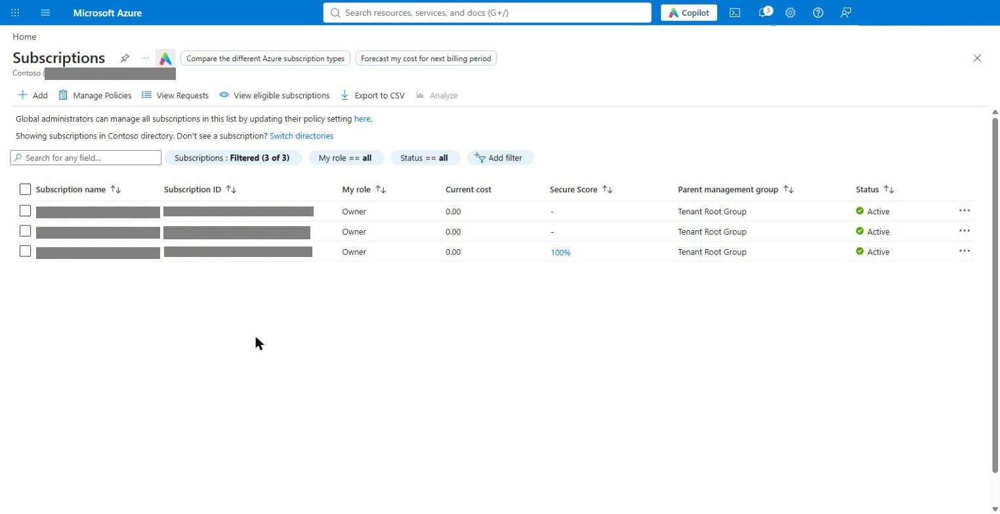

### 2.2 Open Cloud Shell (Bash)

Click the Cloud Shell icon in the top bar. On first use choose **Bash**, pick the subscription, and
select **No storage account required** — the session is ephemeral, which is fine: everything the guide
runs in Cloud Shell is re-downloadable from the repository. Bash is used for the checks in sections
2.3–2.4; **step 5 needs the shell switched to PowerShell** (toolbar → *Switch to PowerShell*): the
kit's post-deploy scripts use the `Az` sign-in that only the PowerShell-mode shell carries (#53).

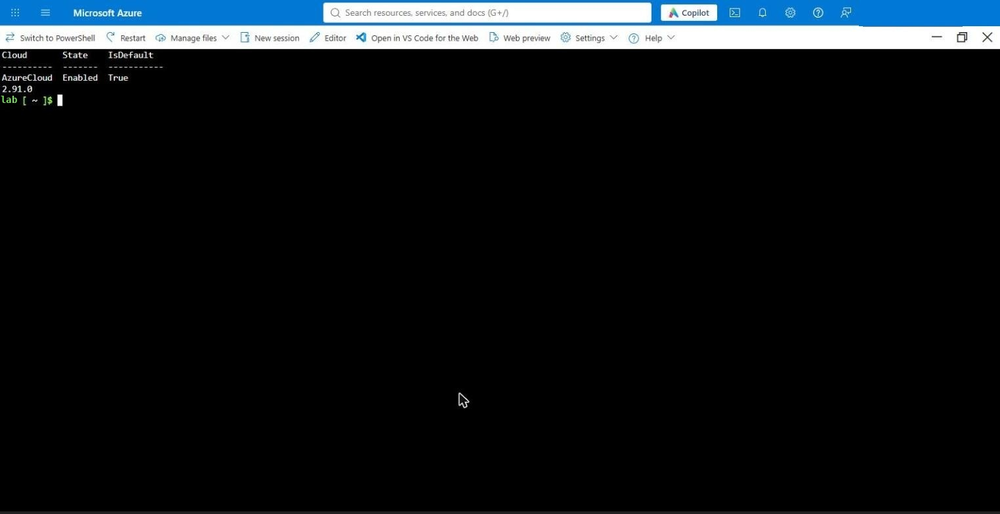

> Cloud Shell disconnects after about 20 minutes of inactivity. If the pane shows *Cloud Shell
> disconnected*, click **Restart** in its toolbar and re-run the `git clone` from step 5.1 — the home
> directory is not kept when you chose *No storage account*.

### 2.3 Register the features and resource providers

Paste the block below into Cloud Shell. It is idempotent — re-running it is harmless. The second
feature, `AllowBringYourOwnPublicIpAddress`, is the Commercial-specific one: some subscriptions
(Microsoft-internal ones, and any subscription with a policy that adds IP tags to public IPs) refuse the
MLZ firewall and Bastion public IPs without it (troubleshooting #48).

```bash
az account set --subscription <subscription-id>

# Encryption-at-host for the MLZ VMs and the public-IP feature (both take a few minutes to flip to Registered)
az feature register --namespace Microsoft.Compute --name EncryptionAtHost
az feature register --namespace Microsoft.Network --name AllowBringYourOwnPublicIpAddress

# Auto-shutdown schedules, Arc private link, DNS, Sentinel, Defender, policy, CSPM samples
for p in Microsoft.Compute Microsoft.Network Microsoft.DevTestLab Microsoft.HybridCompute \
         Microsoft.ContainerInstance Microsoft.ApiManagement Microsoft.Web Microsoft.KeyVault \
         Microsoft.Security Microsoft.OperationalInsights Microsoft.SecurityInsights Microsoft.PolicyInsights \
         Microsoft.Insights Microsoft.Storage Microsoft.Sql Microsoft.ContainerRegistry \
         Microsoft.OperationsManagement Microsoft.ManagedIdentity; do az provider register --namespace $p; done

# Poll until both print "Registered", then propagate the features into the providers
az feature show --namespace Microsoft.Compute --name EncryptionAtHost --query properties.state -o tsv
az feature show --namespace Microsoft.Network --name AllowBringYourOwnPublicIpAddress --query properties.state -o tsv
az provider register --namespace Microsoft.Compute --wait
az provider register --namespace Microsoft.Network --wait
```

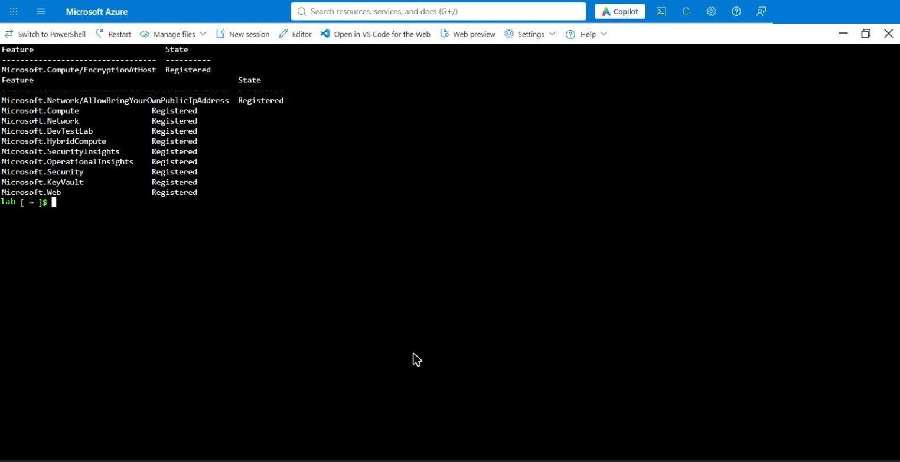

If `AllowBringYourOwnPublicIpAddress` stays `Pending`, the subscription needs approval through a support
request (days) — use another subscription meanwhile.

### 2.4 Pick the region: where can this subscription actually create VMs?

This is the step that does not exist in the Government guide and that cost the first Commercial run.
Commercial subscriptions (trial, internal, sponsorship, new pay-as-you-go) commonly have **entire regions
restricted** for VM creation, and the picture changes from day to day. On the test subscription, on
the day of the first run, East US, Central US, West US and North Central US offered **zero** deployable
VM sizes, East US 2 and South Central US only one, and West US 2 everything; by the evening East US 2
and South Central US had opened up (421 and 538 sizes) while East US and Central US were still at zero. `az vm list-skus` hides
this (it is slow and returns `[]`); ask the SKU API directly and count the unrestricted sizes per region
right before you deploy:

```bash
SUB=$(az account show --query id -o tsv)
for l in eastus eastus2 westus2 westus3 southcentralus centralus; do
  az rest --method get --url "https://management.azure.com/subscriptions/$SUB/providers/Microsoft.Compute/skus?api-version=2021-07-01&\$filter=location%20eq%20%27$l%27" -o json > /tmp/s-$l.json
  python3 -c "import json,sys;d=json.load(open('/tmp/s-'+sys.argv[1]+'.json'))['value'];vm=[s for s in d if s['resourceType']=='virtualMachines'];ok=[s['name'] for s in vm if not s.get('restrictions')];print(sys.argv[1],len(ok),'deployable sizes;',' '.join(w for w in ['Standard_D2as_v7','Standard_D2s_v5','Standard_D2ads_v6'] if w in ok))" $l
done
```

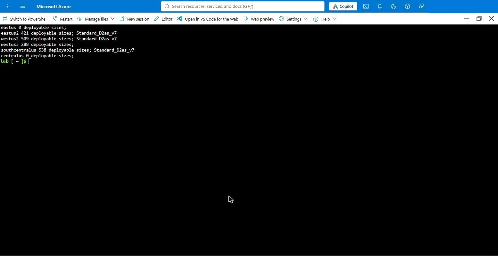

Pick a region that lists `Standard_D2as_v7` (or another of the three lab sizes), then confirm the vCPU
family quota there — the lab needs 18 vCPUs for 9 × 2-vCPU VMs, and a family that is *deployable* can
still have no quota (on the test subscription Dadsv6 was deployable in West US 2 but had no quota entry,
while Dasv7 and Dsv5 had 100; the screenshot below was taken with the lab running, 18 of 100 Dasv7 vCPUs
in use):

```bash
az vm list-usage -l westus2 --query "[?contains(name.value,'asv7') || contains(name.value,'DSv5') || contains(name.value,'adsv6') || name.value=='cores'].{family:name.value,used:currentValue,limit:limit}" -o table
```

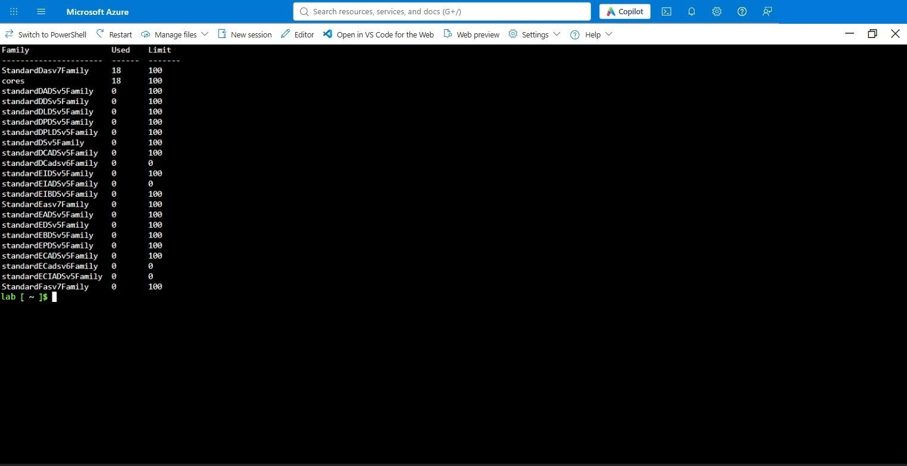

The Compute tab (step 4.7) only offers sizes the subscription can deploy in the chosen region, so after
this step the size question is settled.

---

## 3. Entra ID prerequisites

### 3.1 Security group for Entra VM login

The kit assigns **Virtual Machine Administrator Login** to one Entra security group on every VM, so
members can sign in with Entra credentials through Bastion (RDP and SSH). Create (or reuse) a group,
add the operators to it, and copy its **Object ID** — the Identity tab asks for it.

Microsoft Entra ID → Groups → **New group** (Security, e.g. *Lab VM Login*) → add yourself as a member →
Overview → copy **Object Id**.

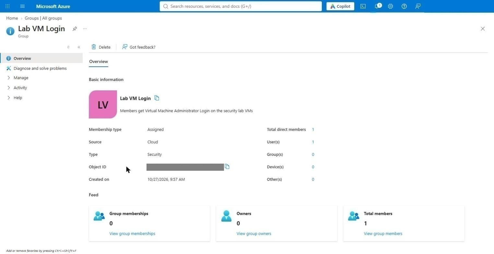

### 3.2 Break-glass (emergency access) account

Create a cloud-only Global Administrator break-glass account in the tenant **before** you enable any
Conditional Access or Entra-login enforcement in the lab, and exclude it from every CA policy. This is a
tenant task outside the template; the kit does not create it. `Post-Deploy.ps1` prints the same reminder.

### 3.3 Verified domain for the lab user

The lab user's UPN suffix must be a domain the tenant has verified (otherwise Intune enrollment fails
with `0xCAA9001F`, troubleshooting #45). On a fresh tenant that is only `<tenant>.onmicrosoft.com` —
Microsoft Entra ID → Custom domain names. Use it on the Lab Options tab.

---

## 4. Deploy from the portal (Deploy to Azure button)

### 4.1 Open the form

In the repository README click **Deploy to Azure** (the button without *Gov*). It opens
`portal.azure.com` with the kit's `solution.json` and `uiDefinition.json` loaded straight from GitHub (the
form title reads *MLZ Security Lab Starter Kit*).

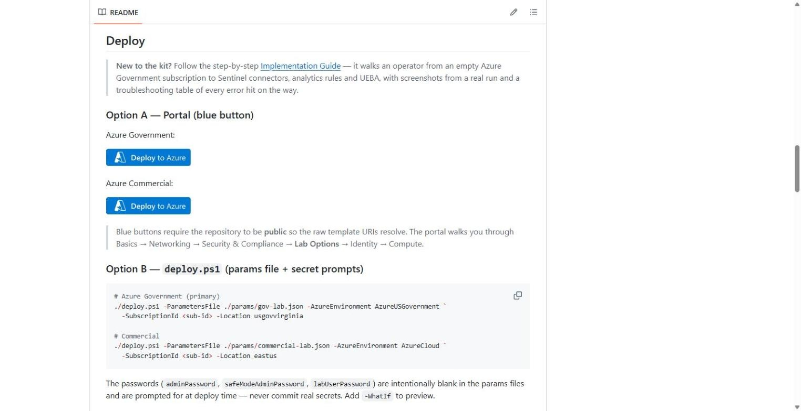

The form is **cloud-aware**: for any region that is not `usgov*` / `usdod*` it shows the full Commercial
Defender plan list (App Service and APIs included), uses the portal's live VM size picker, and derives the
`.com` cloud endpoints for the firewall rules, Intune, MDE and Arc.

> GitHub's raw-file CDN caches `main` for up to five minutes. If you have just pushed a change and the
> form still shows the old one, replace `main` in both URLs of the button link with the commit hash.

### 4.2 Basics

Pick the **subscription** first (the form defaults to the first one in the tenant — check it), then the
**region from step 2.4**, then the naming inputs. The resource prefix is derived from identifier +
environment + region + workload: `mca` / `dev` / `seclab` / `sec` in West US 2 produce resource groups
`mca-dev-usw2-hub-rg-network`, `mca-dev-usw2-seclab-rg-network`, …; the *Resource Prefix* `lab` names
the VMs. The identifier accepts 1–3 characters only.

Fill Basics **completely before** the other tabs and do not come back to it: changing the region or
subscription later resets the Compute tab's image and size selections.

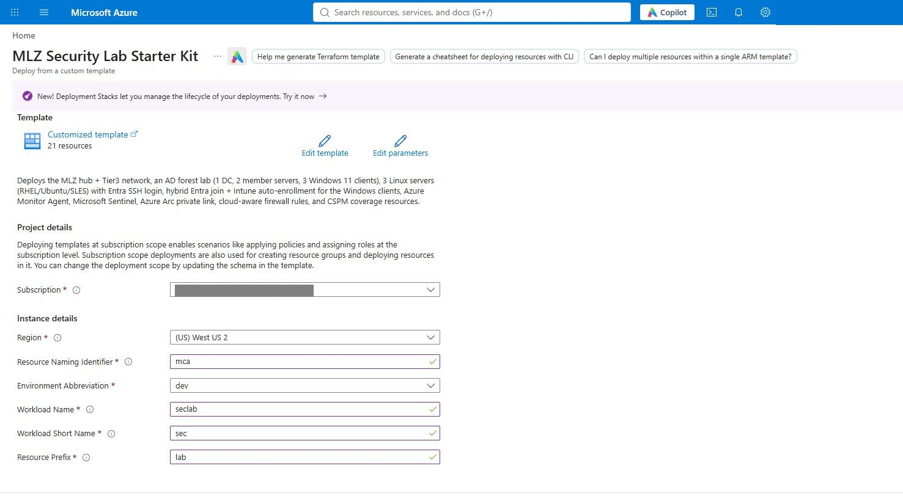

### 4.3 Networking

Leave Bastion on. The Tier-3 VNet is `10.60.0.0/24`; set the **subnet** to `10.60.0.0/25` so the
`10.60.0.128/28` resolver subnet can be added later without re-addressing. Domain controller IP
`10.60.0.10`.

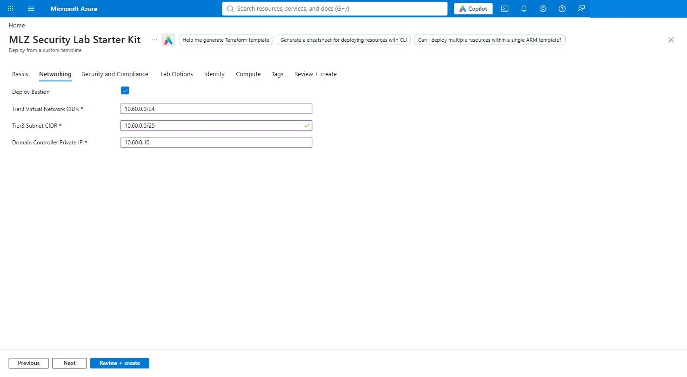

### 4.4 Security and Compliance

Enter the security contact e-mail, then enable the Defender for Cloud base plan and the plans you want.
This guide turned on everything the form offers except APIs: CSPM, Servers (P2), Storage, SQL,
Containers, **App Service** (Commercial only), Key Vault, Resource Manager, open-source relational
databases, Cosmos DB. Each plan is billed separately. The template creates the plans **one at a time**
— Commercial rejects concurrent plan updates (troubleshooting #49) — so they appear in the deployment
list one after another over the first two minutes.

Policy: check **Apply MLZ built-in policy set** first (the NIST box is greyed out until it is on), then
**NIST SP 800-53 Rev. 5**; keep **Microsoft cloud security benchmark** (default on). All initiatives are
assigned in audit-only mode. Enable **Send Activity Log to Log Analytics** and **Microsoft Sentinel** with
a **new** workspace named `law-mca-lab`.

CSPM coverage samples: SQL, Key Vault and App Service on; API Management off (adds ~45 minutes and
~$50/month).

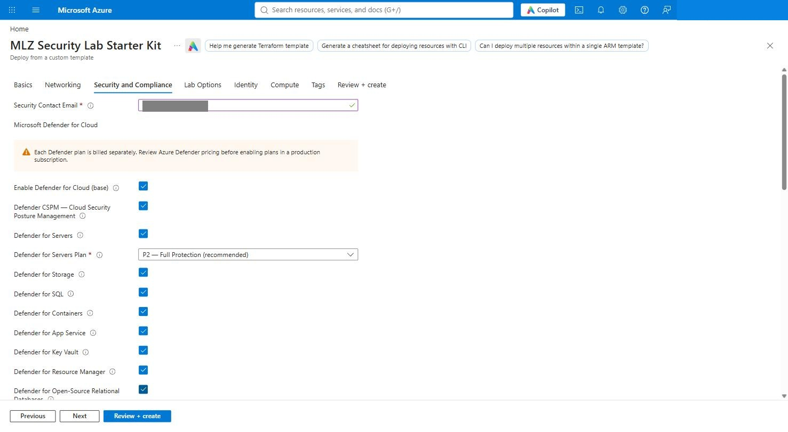
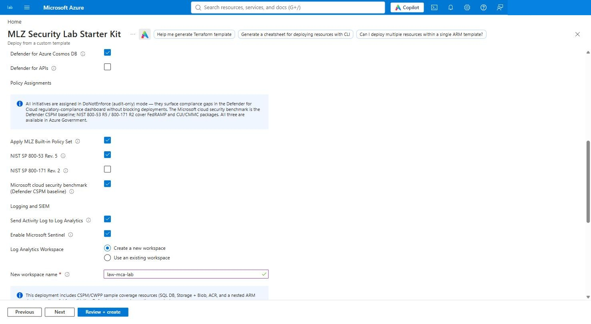

### 4.5 Lab Options

Enter the verified UPN suffix (`contoso.onmicrosoft.com`) and the lab user name. Keep the three Linux
servers, the lab firewall rules, the AzureCloud service-tag allowance and **Enable all matching built-in
Sentinel analytics rules + UEBA** on. Leave *Run the Sentinel content enablement inline* off — section 5
runs it from Cloud Shell, where you can watch it. Turn on **Azure Arc Private Link Scope**; leave the DNS
resolver off.

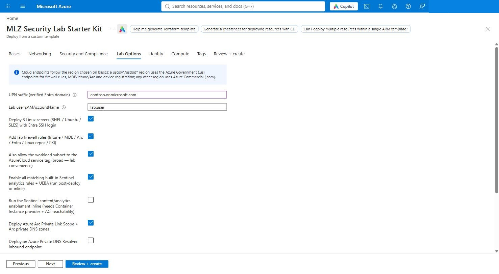

### 4.6 Identity

Admin username, the admin and DSRM passwords, the optional lab user password, AD domain and NetBIOS
name, and the Entra group **object ID** from step 3.1. Keep *Assign Virtual Machine Administrator Login
role* checked. **Type `CORP` into the NetBIOS field** — it shows `CORP` as a placeholder, and Review +
create fails with *The value must not be empty* if you leave it.

Which account signs in where:

| VM | Account | Password |
|---|---|---|
| `lab-dc01` | `labadmin@corp.contoso.lab` — the DC's local admin becomes the domain admin at promotion | Admin password |
| `lab-ms01`, `lab-ms02`, `lab-cl01`–`03` | `labadmin@corp.contoso.lab` (Domain Admins); local `.\labadmin` also exists | Admin password |
| `lab-rhel01`, `lab-ubu01`, `lab-sles01` | `labadmin` (local), or your Entra account through Bastion *Microsoft Entra ID* | Admin password / Entra sign-in |
| Clients, as a normal user | `lab.user@corp.contoso.lab` or `lab.user@contoso.onmicrosoft.com` | Lab user password |
| AD recovery mode | — | DSRM password |

If you leave the lab user password blank, the user is created with a random password; reset it on
the DC with `Set-ADAccountPassword lab.user -Reset -NewPassword (Read-Host -AsSecureString)`.

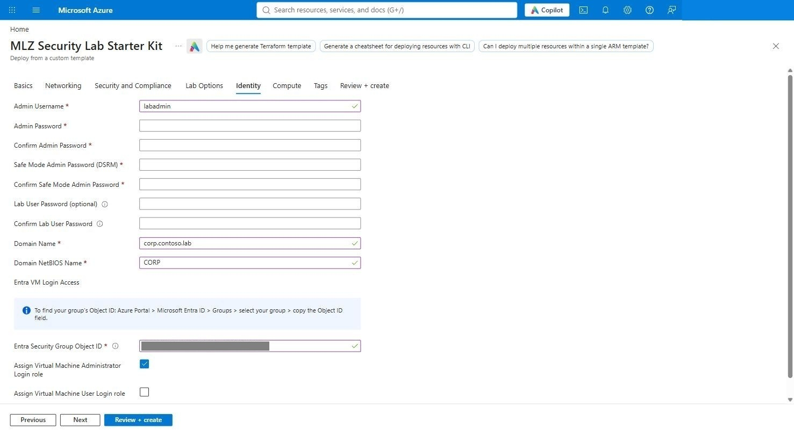

### 4.7 Compute

Server image Windows Server 2022 Gen2, client image **Windows 11 → Enterprise 24H2** (pick the offer,
then the SKU), and the VM sizes. On Commercial the three size fields are the portal's own **size
picker**: it lists only the sizes this subscription can deploy in the region chosen on Basics and
pre-selects the first available one (`Standard_D2as_v7` where offered — exactly what step 2.4
found). If the pre-selected size is what you want, there is nothing to click. To change it: **Change
size** → search the name → expand the series → select the row → **Select**.

The Linux picker can stay greyed out (*Change size* disabled) for a few seconds after the tab opens
while the portal resolves the image; wait, or leave the tab and come back.

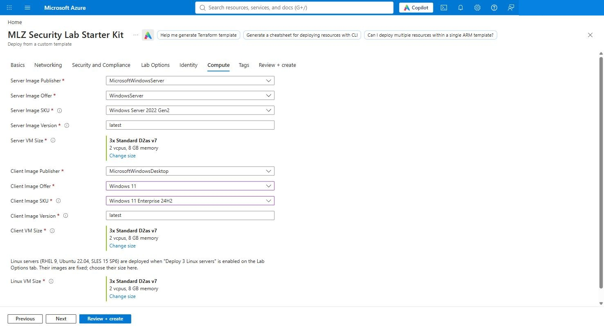
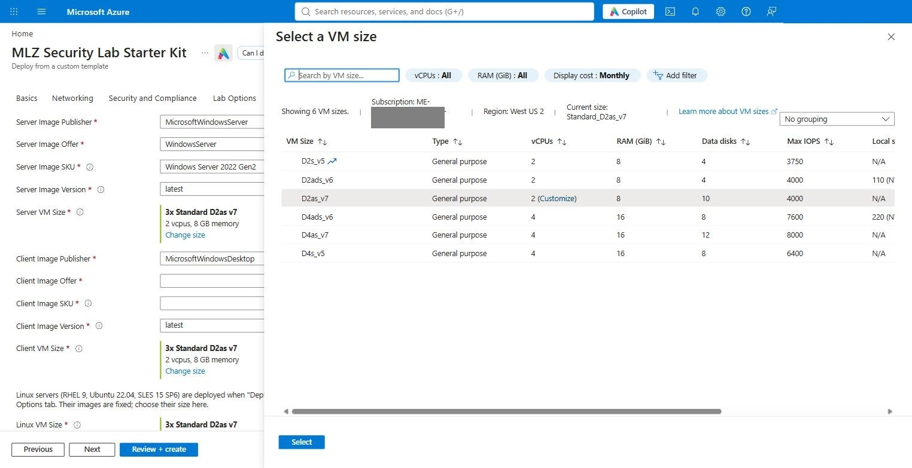

### 4.8 Review + create

Validation runs the whole subscription-scope template. When it passes, check the parameter summary
(region, sizes, workspace name, UPN suffix) and click **Create**. (If it fails with *Required information
is missing or not valid* and the Identity tab carries a red mark, a password field is empty or the two
copies differ.)

### 4.9 Watch the deployment

The top-level deployment is `CustomDeployment-<timestamp>`. It fans out into nested deployments:
the Defender plans and policy assignments at subscription scope, `deploy-mlz-core` (hub),
`deploy-tier3`, `deploy-cspm-coverage`, `deploy-ad-entra-vms` (DC promotion, joins, Linux),
`deploy-security-lab` (workspace, DCRs, Sentinel onboarding) and `deploy-arc-pls`.

Timing on the successful Commercial run (West US 2):

| Phase | Duration | Notes |
|---|---|---|
| Defender plans + policy assignments | 3 min | 10 plans, sequential |
| MLZ core (hub firewall Premium, spokes, Bastion, monitoring, diagnostics) | ≈ 32 min | firewall ≈ 12 min, Bastion ≈ 10 min |
| Tier-3 spoke + CSPM coverage | ≈ 2 min | after the core |
| VM module (DC promotion, 5 joins, 3 Linux with Entra SSH + AMA, every extension `Succeeded`) | 12 min 38 s | |
| security-lab (workspace, DCRs, Sentinel onboarding) | 31 s | |
| Arc private link scope | 1 min 46 s | |
| **Total** | **52 min 26 s** | the two failed attempts before it (section 8) took 40 and 45 min to fail |

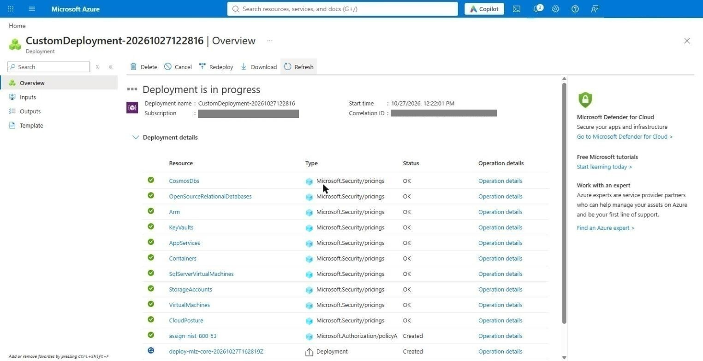
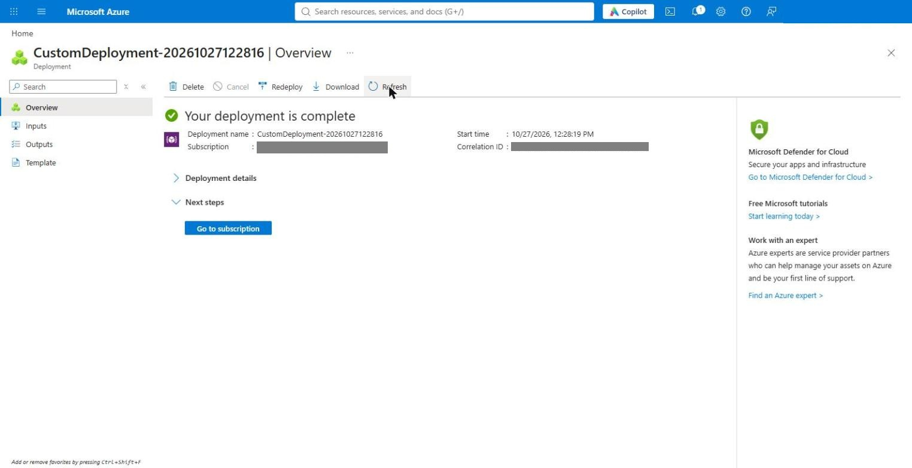

A quick way to follow it from Cloud Shell:

```bash
D=CustomDeployment-<timestamp>
az deployment sub list --query "[?properties.provisioningState=='Running'].name" -o tsv
az deployment group list -g mca-dev-usw2-seclab-rg-network --query "[?properties.provisioningState!='Succeeded'].{n:name,s:properties.provisioningState}" -o table
```

> If a nested deployment fails, open its **Error details**. For a *resource* that ended in a failed
> provisioning state (a firewall with `InternalServerError`, a VM with `OSProvisioningTimedOut`) do not
> use **Redeploy** — it reuses the faulted instance. Tear down with `destroy.ps1` (section 7), fix the
> cause (section 8) and deploy again; a clean run is about 55 minutes.

---

## 5. Post-deploy — Sentinel content, connectors, analytics rules, UEBA

The template onboards the workspace to Sentinel and creates the data collection rules; the Content Hub
solutions, the analytics rules, UEBA, the Defender XDR connector and the tenant-level log routing are
done by `templates/scripts/Post-Deploy.ps1`, run from Cloud Shell under your own (Global
Administrator) sign-in. On Commercial every script takes **`-Cloud Global`**.

### 5.1 Clone the kit in Cloud Shell and run the orchestrator

Cloud Shell toolbar → **Switch to PowerShell** (a `pwsh` started from the Bash shell is not signed in
to Azure — #53), then:

```powershell
git clone -q https://github.com/lee-aguilar-msft/Azure-MLZStarterKit-Security.git ~/kit
cd ~/kit/templates/scripts
./Post-Deploy.ps1 -Cloud Global -SubscriptionId <subscription-id> `
  -ResourceGroupName mca-dev-usw2-seclab-rg-network -WorkspaceName law-mca-lab -EnableXdrConnector `
  *>&1 | Tee-Object -FilePath ~/postdeploy.log
```

The script needs **Global Administrator or Security Administrator** on the tenant for the UEBA step
(activate it through PIM first — #56); everything else works with Owner on the subscription. It is
idempotent: re-run it after fixing anything and it skips what is already in place.

Results of the Commercial run (about 35 minutes, most of it the analytics-rule loop):

| Step | Result |
|---|---|
| Content Hub solutions | 7 installed: Microsoft Entra ID, Azure Activity, Microsoft Defender XDR, Windows Security Events, Syslog, Threat Intelligence (TAXII), UEBA Essentials |
| Analytics rules from the installed templates | **263 enabled**, 35 rejected by the API (templates that need a data type the lab does not have — the script lists them) |
| Defender XDR connector | created (`-EnableXdrConnector`), incidents and alerts flow into Sentinel |
| Entra ID sign-in / audit logs and Azure Activity | routed to the workspace (tenant-level diagnostic setting + subscription Activity log) |
| UEBA | enabled — entity provider Entra ID; data sources AuditLogs, AzureActivity, SigninLogs, SecurityEvent |
| Defender for Cloud plans | re-asserted: Servers P2, Storage (DefenderForStorageV2), Key Vault, Resource Manager, App Service, SQL on VMs, open-source DBs, Cosmos DB, Containers, CSPM; the plans the lab does not need stay Free |

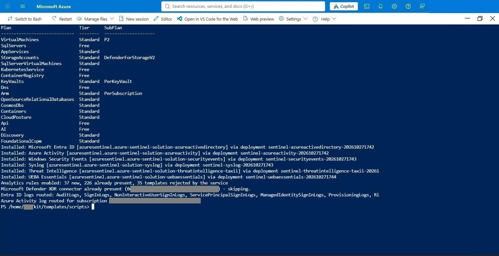

### 5.2 Identity, hybrid join, Intune and Defender for Endpoint

Most of the identity chain is automated. The deployment and two scripts do everything except two
clicks that have no API (Entra Connect's wizard needs your MFA; the Defender portal's Intune connection
toggle has no Graph endpoint).

| What | Done by | When |
|---|---|---|
| AD forest, OUs (`Users`, `Workstations`, `MemberServers`), lab user, groups | template (`configure-forest-baseline`) | deployment |
| Member servers and clients moved into their OUs | template (`configure-forest-baseline`) | deployment |
| GPO *<OU root> - Intune Auto-Enrollment* (MDM auto-enrollment with the signed-in user's Entra credential) linked to `Workstations` | template | deployment |
| GPO *<OU root> - Security Auditing and Logging* | template | deployment |
| Hybrid-join **Service Connection Point** (tenant ID + domain) written to AD | template — tenant ID comes from the subscription | deployment |
| Gate: deployment fails if any of the above is missing (`verify-forest`) | template | deployment |
| TLS 1.2 prerequisites and `C:\LabTools\README-EntraConnect.txt` on `lab-ms01` | template (`configure-member`) | deployment |
| Clients retry hybrid join every 30 min and Intune enrollment hourly, for 7 days | template (scheduled tasks `LAB-HybridJoin-Retry`, `LAB-IntuneAutoEnroll-Retry`) | deployment |
| Intune MDM user scope (the `.com` MDM URLs are already the Commercial defaults) | `Prepare-Tenant.ps1 -Cloud Global` | once per tenant |
| *Microsoft Intune Enrollment* service principal; CA exclusion report (or `-ExcludeIntuneEnrollmentFromCa`) | `Prepare-Tenant.ps1` | once per tenant |
| Intune ↔ MDE connector (Windows), dynamic device group, EDR policy *Auto from connector* | `Prepare-Tenant.ps1 -ConfigureMde` | once per tenant |
| License for the synced lab user | `Prepare-Tenant.ps1 -LabUserUpn` | after the first sync |
| **Defender portal → Intune connection = On** | you (one toggle) | once per tenant |
| **Entra Connect wizard** on `lab-ms01` | you (needs MFA) | once per deployment |

#### 5.2.1 Prerequisites

1. A **break-glass Global Administrator** (cloud-only, excluded from all Conditional Access policies).
2. **Licences**: Entra ID P1/P2 + Intune for the lab user (hybrid join's PRT and MDM auto-enrollment
   are licensed features), and Defender for Endpoint P2 for the clients (included in Microsoft 365 E5;
   the servers are covered by Defender for Servers P2).
3. Your account: **Global Administrator** (or Intune Administrator + Cloud Application Administrator +
   License Administrator + Security Administrator) for `Prepare-Tenant.ps1` and the Defender toggle,
   and **Hybrid Identity Administrator** (or Global Administrator) for the Entra Connect wizard.
4. Optional: the **MDE onboarding package** — only if you want a GPO-based onboarding path in addition
   to Intune. Defender portal (`security.microsoft.com`) → Settings → Endpoints → **Onboarding** →
   Windows 10 and 11 → *Group Policy* → Download; paste the `OnboardingInfo` JSON into **MDE onboarding
   blob** on the Lab Options tab before deploying.

#### 5.2.2 Run `Prepare-Tenant.ps1` (MDM scope, enrollment app, MDE connector)

On a Commercial tenant the Intune *Automatic Enrollment* page already carries the `.com` MDM URLs, so
the script only has to set the MDM user scope and the MDE pieces. From the same Cloud Shell session:

```powershell
cd ~/kit/templates/scripts
./Prepare-Tenant.ps1 -Cloud Global -ConfigureMde
```

It signs in to Microsoft Graph with a **device code** (open `https://microsoft.com/devicelogin`, enter
the code, complete MFA — you have 15 minutes; the kit runs the device-code grant itself because the Graph
SDK gives up after 120 seconds, troubleshooting #54), then:

| Setting | Value written (Commercial) |
|---|---|
| MDM user scope | **All** (or **Some** with `-MdmScopeGroupId <group id>`) |
| MDM URLs | left at the `.com` defaults (`enrollment.manage.microsoft.com`, `portal.manage.microsoft.com`) |
| *Microsoft Intune Enrollment* (`d4ebce55-015a-49b5-a083-c84d1797ae8c`) | service principal created if missing; CA policies that would block it are listed |
| Intune ↔ MDE connector | Windows devices **On** |
| Device group `LAB-Intune-Devices` | dynamic: `device.displayName -startsWith "lab-cl"` |
| EDR policy *LAB - Defender for Endpoint onboarding (auto from connector)* | Endpoint security → EDR, onboarding package **Auto from connector**, assigned to the group |

A successful run ends with `PREPARE-TENANT-STATUS: Success`. On the test tenant the run (after the
Defender toggle was already on) came back with the MDM scope moved from *none* to *All*, the enrollment
service principal created, the MDE connector `windowsEnabled=True partnerState=enabled`, the device
group and the EDR policy created, and three warnings for the Microsoft-managed Conditional Access
policies *… for Microsoft partners and vendors*: they target all users and all apps without
excluding Intune Enrollment. On this tenant they did block the silent enrollment (#59), so the fix was a
second pass with the exclusion switch:

```powershell
./Prepare-Tenant.ps1 -Cloud Global -SkipMdm -ExcludeIntuneEnrollmentFromCa
```

Run it as the tenant admin (it changes Conditional Access, so it is a deliberate, separate step).

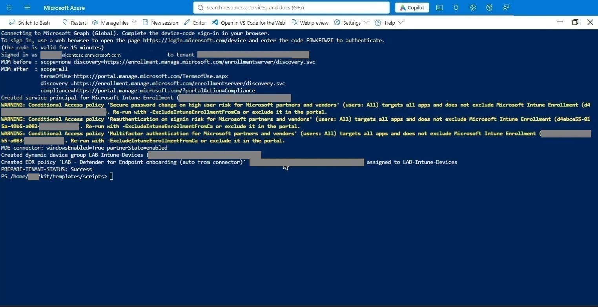

**The one Defender toggle.** Microsoft Defender portal (`security.microsoft.com`) → Settings →
Endpoints → **Advanced features** → **Microsoft Intune connection = On** → Save. Do it before or after
the script; the EDR policy starts onboarding as soon as both sides are on.

#### 5.2.3 Entra Connect on `lab-ms01` (the one wizard)

1. `lab-ms01` → **Connect → Bastion** → authentication type *VM password*; username
   `labadmin@corp.contoso.lab` (UPN form — Bastion rejects `CORP\labadmin`) and its password.
2. In Edge on `lab-ms01` open `https://entra.microsoft.com` → **Identity → Hybrid management →
   Microsoft Entra Connect → Connect Sync → Download Connect Sync Agent**, and run it (notes in
   `C:\LabTools\README-EntraConnect.txt`). In the wizard choose **Customize** (not Express).
3. Sign-in method **Password Hash Synchronization**.
4. Connect to Entra ID with a Hybrid Identity Administrator / Global Administrator (MFA prompt).
5. Add the forest `corp.contoso.lab` with `CORP\labadmin` and let the wizard create the AD DS Connector
   account.
6. **Domain/OU filtering**: the lab root OU only (it contains the lab user and the `Workstations` OU with
   `lab-cl01`–`lab-cl03`).
7. **Device options**: nothing required — the deployment already wrote the hybrid-join SCP.
8. Finish with **Start the synchronization process when configuration completes**.

After the first sync, license the synced user (PowerShell Cloud Shell, new device code):

```powershell
./Prepare-Tenant.ps1 -Cloud Global -SkipMdm -LabUserUpn lab.user@contoso.onmicrosoft.com
```

Check that the sync has landed first — from the same shell, with the Cloud Shell's own Graph token:

```powershell
$t = (Get-AzAccessToken -ResourceTypeName MSGraph).Token
if ($t -is [securestring]) { $t = [Net.NetworkCredential]::new('', $t).Password }
$h = @{ Authorization = "Bearer $t" }
(Invoke-RestMethod -Headers $h -Uri 'https://graph.microsoft.com/v1.0/organization?$select=onPremisesSyncEnabled,onPremisesLastSyncDateTime').value
(Invoke-RestMethod -Headers $h -Uri 'https://graph.microsoft.com/v1.0/users?$filter=onPremisesSyncEnabled eq true&$select=userPrincipalName,onPremisesLastSyncDateTime').value
```

`onPremisesSyncEnabled = True` with a recent `onPremisesLastSyncDateTime`, and `lab.user` / `lab.churn`
in the user list, means the wizard's initial sync is done. On the test tenant the licensing pass
assigned the first available Intune-capable SKU it found (`MICROSOFT_365_E7_NO_TEAMS`) and ended with
`PREPARE-TENANT-STATUS: Success`.

#### 5.2.4 Hybrid join, Intune enrollment and MDE onboarding

**What happens on its own.** Every client has a `LAB-HybridJoin-Retry` task (runs `dsregcmd /join` as
SYSTEM every 30 minutes for 7 days) and Entra Connect runs a delta sync every 30 minutes, so within about
an hour of the first sync each client becomes *Microsoft Entra hybrid joined*. Once the lab user has
signed in to a client, the Intune auto-enrollment task enrolls it, and the EDR policy then onboards it to
Defender for Endpoint.

**What you must do once:**

1. The lab user's UPN must use a **verified tenant domain** — the *UPN suffix* Lab Option
   (`contoso.onmicrosoft.com`).
2. The lab user registers **MFA** once: sign in at `https://myaccount.microsoft.com` (or
   `aka.ms/mfasetup`) and add the Authenticator app.
3. Sign in once to each client as the lab user (Bastion → *VM password* →
   `lab.user@contoso.onmicrosoft.com`) so the user gets a Primary Refresh Token — after the licence
   (5.2.3) and the Conditional Access exclusion (5.2.2) are in place. The kit uses user-credential
   auto-enrollment, the only kind Microsoft supports for ordinary hybrid-joined PCs (device-credential
   enrollment is limited to co-management, Autopilot and Azure Virtual Desktop), so every client needs
   this one sign-in; a password sign-in is enough, no MFA prompt.

**To speed up the hybrid join**, trigger the join on the clients from the same PowerShell Cloud Shell
(Run command executes as SYSTEM on the VM, which is what `dsregcmd /join` wants):

```powershell
$rg = 'mca-dev-usw2-seclab-rg-network'
foreach ($vm in 'lab-cl01','lab-cl02','lab-cl03') {
  $r = Invoke-AzVMRunCommand -ResourceGroupName $rg -VMName $vm -CommandId RunPowerShellScript `
    -ScriptString 'dsregcmd /join | Out-Null; Start-Sleep 20; (dsregcmd /status) -match "AzureAdJoined|DomainJoined|TenantId|AzureAdPrt"'
  "== $vm"; $r.Value[0].Message
}
```

If a client answers `AzureAdJoined : NO`, its computer object has not reached Entra yet: on `lab-ms01`
run `Start-ADSyncSyncCycle -PolicyType Delta`, wait 2–3 minutes and run the block again
(`C:\LabTools\Invoke-HybridJoinCycle.ps1` on `lab-ms01` automates that loop over WinRM).

On the test tenant no second pass was needed — the wizard's initial sync had already carried the
`Workstations` OU up, the first `dsregcmd /join` completed on all three clients, and the Entra device
list showed them (and `lab-ms02`) as `trustType = ServerAd` within four minutes. (Entra also reported
`isManaged = True` on them at that point; do not read that as an Intune enrollment — Intune listed no
devices until the user-credential enrollment below went through.)

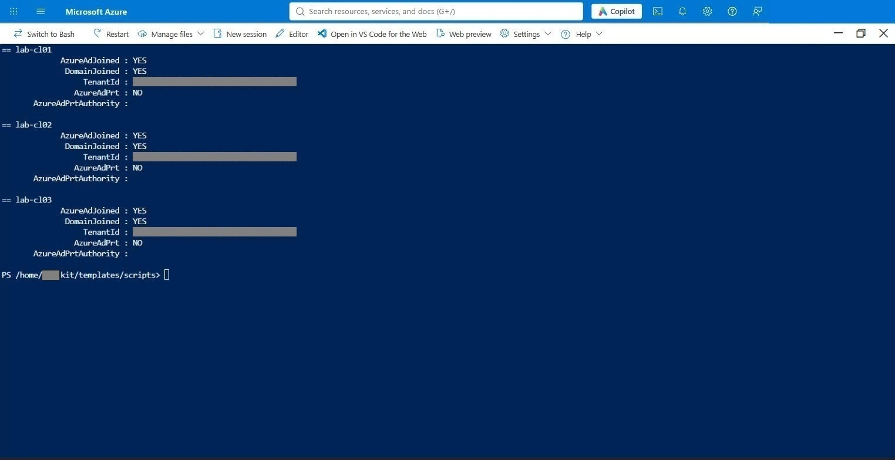
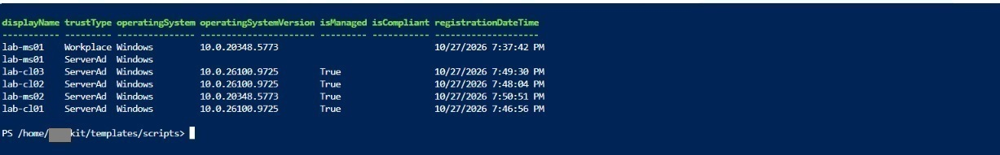

**What happened on the test tenant.** After the lab user's first sign-in on `lab-cl01` the client's own
enrollment task kept failing with `0x8018002A` until the Conditional Access exclusion (5.2.2, #59) was in
place; the next run of the task enrolled the device, Intune listed it as *Managed by Intune, Corporate,
Compliant* and the Defender device inventory showed `lab-cl01.corp.contoso.lab` **Onboarded**, managed
by Intune, two minutes later. `lab-cl02` and `lab-cl03` followed with no further action after one
lab-user sign-in each (MDM enrollment state 1 on both). The servers were already onboarded through
Defender for Servers.

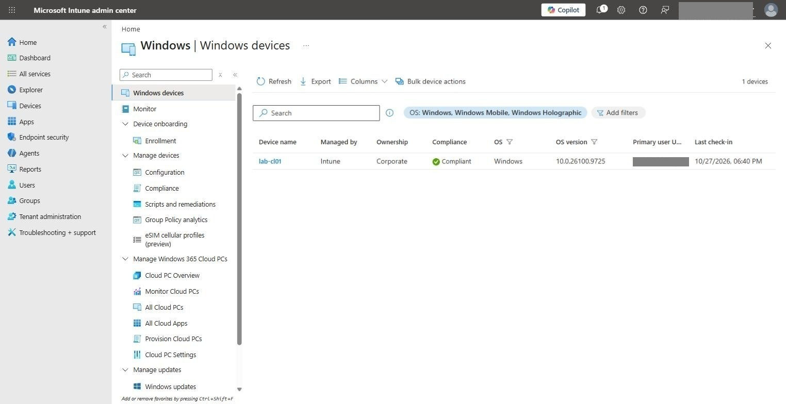

| Check | Where | Expected |
|---|---|---|
| Hybrid join | `dsregcmd /status` on the client | `AzureAdJoined : YES`, `DomainJoined : YES`, `AzureAdPrt : YES`; `MdmUrl` `https://enrollment.manage.microsoft.com/…`, `AzureAdPrtAuthority` `https://login.microsoftonline.com/<tenant>` |
| Entra device | Entra admin center → Devices → All devices | `lab-cl01`–`03`, join type *Microsoft Entra hybrid joined* |
| Intune | Intune admin center (`intune.microsoft.com`) → Devices → Windows | `lab-cl01`–`03`, managed by Intune, compliance evaluated |
| MDE | Defender portal → Assets → Devices | `lab-cl01`–`03` *Onboarded* (plus the servers, via Defender for Servers) |

**If automatic enrollment does not happen**, enroll the client by hand — signed in as the lab user,
**Win+R** → `ms-device-enrollment:?mode=mdm&username=lab.user@contoso.onmicrosoft.com` → sign in
(MFA). *Settings → Accounts → Access work or school* then shows the MDM connection; **Info → Sync**
pushes the first check-in. About 15 minutes later the client is listed in Intune and the EDR policy has
onboarded it to Defender for Endpoint.

#### 5.2.5 Signing in through Bastion — which credentials work where

| VM | Bastion authentication type | Credentials |
|---|---|---|
| Linux (`lab-rhel01`, `lab-ubu01`, `lab-sles01`) | **Microsoft Entra ID** (SSH) | your Entra account — member of the step 3.1 group |
| Windows (DC, member servers, clients) | **VM password** (RDP) | `labadmin@corp.contoso.lab`, or a domain user such as `lab.user@corp.contoso.lab` — **UPN form**; Bastion does not accept `CORP\user` |
| Windows client, after hybrid join | **VM password** (RDP) | `lab.user@contoso.onmicrosoft.com` — the synced user's UPN and password (same in AD and Entra through password hash sync) |

Bastion's *Microsoft Entra ID* option for **Windows RDP** only works for Entra-joined VMs, which
conflicts with the AD domain join and hybrid join this lab is built on, so the kit does not install it on
Windows. Linux Entra SSH is unaffected.

### 5.3 Data hydration — automatic, nothing to run

Identical to the Government guide: the `LAB-Hydration` task on every Windows VM and the `lab-hydrate`
timer on every Linux VM start during the deployment and run hourly. Section 6.5 shows how to confirm it
is reaching the workspace, and section 6.6 how to make the lab raise real alerts and incidents on demand
(hydration itself is meant to stay below detection thresholds).

**Hydration only runs while the VMs are on.** The kit gives every lab VM a DevTest auto-shutdown at
03:00 UTC (23:00 Eastern) and nothing starts them again, so after the first night the workspace goes quiet
until someone starts the lab. Start it with
`az vm start --ids $(az vm list -g <tier3-rg> --query "[].id" -o tsv)` (the domain controller first, if you
start them one by one); the next hourly run picks up from there.

---

## 6. Verify

### 6.1 Virtual machines

Portal → **Virtual machines**: nine VMs, all *Running* in West US 2 on `Standard_D2as_v7` — `lab-dc01`,
`lab-ms01`, `lab-ms02`, `lab-cl01`–`lab-cl03` (Windows) and `lab-rhel01`, `lab-sles01`, `lab-ubu01`
(Linux). None has a public IP: everything is reached through Bastion in the hub.

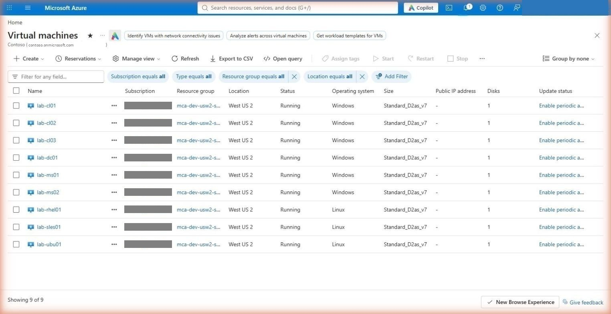

The resource group `mca-dev-usw2-seclab-rg-network` holds the same inventory as on Government (VMs,
NICs, disks, workspace, DCE/DCRs, Arc Private Link Scope with its private endpoint and the three
`privatelink.*.azure.com` DNS zones, the CSPM samples and the content-script identity).

### 6.2 Microsoft Sentinel

On Commercial the workspace is onboarded to the **unified Defender portal**, so some Sentinel pages in
the Azure portal are only a redirect:

| Page | Where it lives now |
|---|---|
| **Analytics**, Incidents, Hunting, Workbooks, Entity behavior | still in the Azure portal (Microsoft Sentinel → the workspace) |
| **Content hub**, **Data connectors** | `security.microsoft.com` → Microsoft Sentinel → Content management / Configuration — the Azure page just shows *This page has been moved to the Defender portal* |

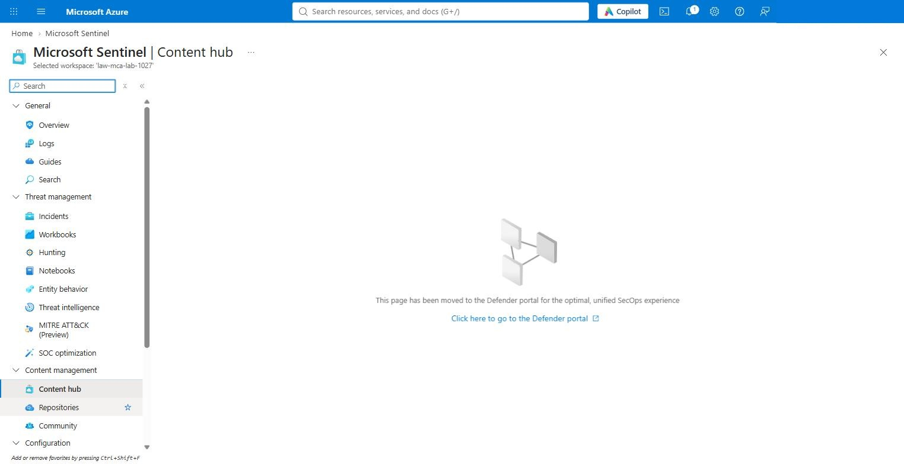

**Analytics** — 263 active rules (75 High, 158 Medium, 30 Low) created from the installed solutions'
templates:

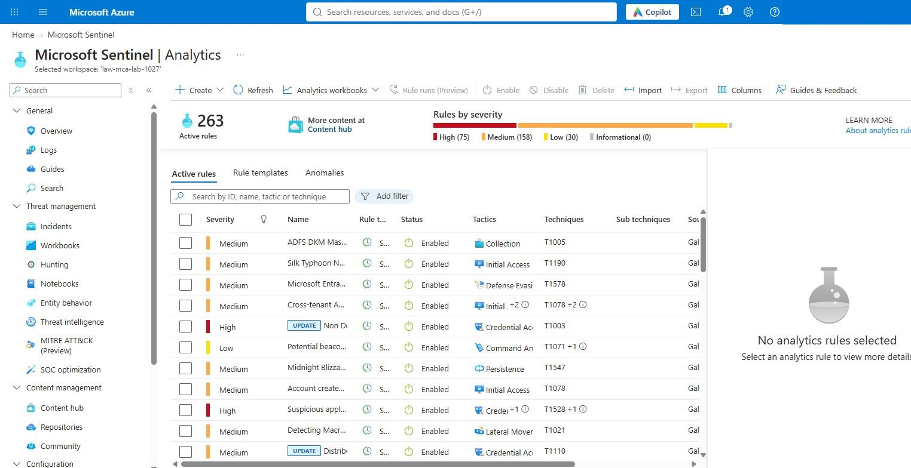

**Content hub** (Defender portal) — 7 solutions *Installed*: Microsoft Entra ID, Azure Activity,
Microsoft Defender XDR, Windows Security Events, Syslog, Threat Intelligence, UEBA Essentials.

**Data connectors** (Defender portal) — Windows Security Events via AMA and Syslog via AMA connect as
soon as the VMs report; Microsoft Defender XDR is connected by the post-deploy script; Microsoft Entra
ID and Azure Activity show *Connected* 10–30 minutes after step 5, when their first logs arrive.

**Entity behavior** — Settings show UEBA **On**, Microsoft Entra ID as the entity provider, with Audit
Logs, Azure Activity, Signin Logs and Security Events selected.

### 6.3 Bastion sign-in

Linux: open `lab-ubu01` → **Connect → Bastion** → *Microsoft Entra ID* → Connect; members of the
step 3.1 group get an administrator SSH session with their Entra account. Windows: *VM password* with
`labadmin@corp.contoso.lab` (see 5.2.5 for why Entra RDP does not apply to domain-joined VMs).

### 6.4 Defender for Cloud plans

Microsoft Defender for Cloud → Environment settings → the subscription → **Defender plans**. Expected on
Commercial: Defender CSPM, Servers (**Plan 2**), Databases (SQL on VMs, open-source relational, Cosmos
DB), Storage, Containers, Key Vault, Resource Manager and — unlike Government — **App Service** all
**On**; SQL servers on machines' sibling *Azure SQL*, Kubernetes/Container registry (legacy), DNS, APIs
and AI are left Off. The post-deploy script prints the same table from the API:

```powershell
az security pricing list --query "value[?pricingTier=='Standard'].{plan:name,subPlan:subPlan}" -o table
```


### 6.5 Data hydration reaching the workspace

About an hour after the deployment, run this in the Sentinel workspace (Logs):

```kusto
union
  (SecurityEvent | where EventID in (4728, 4729) and MemberName has "churn"
     | summarize Events = count(), Last = max(TimeGenerated) by Signal = "AD group churn (4728/4729)", Computer),
  (SecurityEvent | where EventID in (4625, 4771) and TargetUserName has "churn"
     | summarize Events = count(), Last = max(TimeGenerated) by Signal = "failed sign-in lab.churn", Computer),
  (SecurityEvent | where EventID == 4688 and CommandLine has "nltest" and CommandLine has "dsgetdc"
     | summarize Events = count(), Last = max(TimeGenerated) by Signal = "Windows user activity (nltest)", Computer),
  (Syslog | where ProcessName == "lab-hydrate" or SyslogMessage has "lab-hydrate"
     | summarize Events = count(), Last = max(TimeGenerated) by Signal = "Linux lab-hydrate", Computer)
| order by Signal asc, Computer asc
```

Expect one row per signal and computer with *Last* within the past hour: group churn and failed
sign-ins on the domain controller, user activity on every Windows VM, `lab-hydrate` on the three Linux
servers. The same query runs from a Bash Cloud Shell without opening the Logs blade (save it as
`hydration.kql` first; the CLI asks once to install its `log-analytics` extension — answer `Y`):

```bash
WS=$(az monitor log-analytics workspace show -g mca-dev-usw2-seclab-rg-network -n law-mca-lab --query customerId -o tsv)
az monitor log-analytics query -w $WS --analytics-query "$(cat hydration.kql)" -t P1D -o table
```

Ten hours after the Commercial deployment all four signals were present on every machine: 7 group-churn
and 14 failed-sign-in events on the DC, 5–7 `nltest` activity events on each of the six Windows VMs and
18 `lab-hydrate` entries on each Linux server — hourly, as designed (the Government lab had needed
troubleshooting #46/#47 for the last two signals; the fixes carried over).

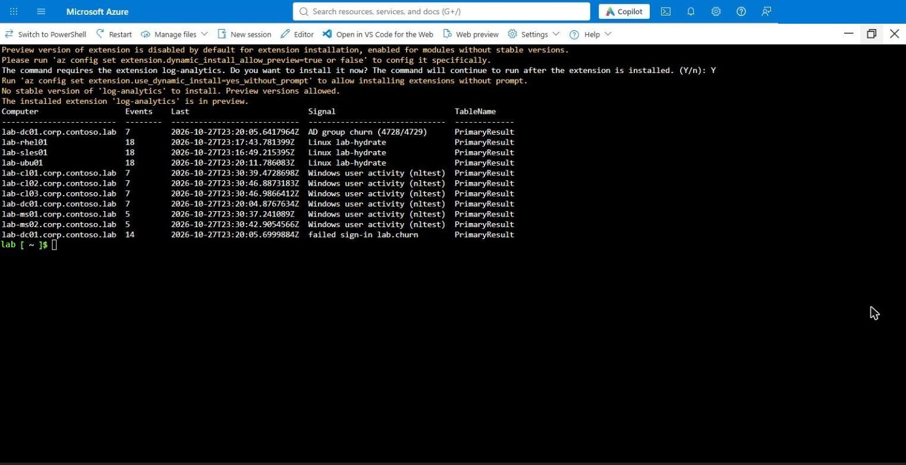

### 6.6 Detection test — prove alerts and incidents fire

Hydration (5.3) is background activity for hunting and is deliberately quiet: in normal operation it raises
almost nothing. On the test lab the only incident traced to it was a one-off *AD user enabled and password
not set within 48 hours*, raised when the domain controller's first hydration run created `lab.churn`. To
prove the detection chain (VM → agent → workspace → analytics rule or Defender → incident), run the
detection test from the same PowerShell Cloud Shell as step 5, with the VMs running:

```powershell
cd ~/kit/templates/scripts
./Test-LabDetections.ps1 -SubscriptionId <subscription-id> -ResourceGroupName mca-dev-usw2-seclab-rg-network `
  -WorkspaceName law-mca-lab -Cloud Global
```

It runs ten safe, documented test actions through Run command and then lists, per test, the alert and
incident each one raised. On the domain controller the AD changes are made by a temporary admin
(`lab.detop`), because several rules ignore changes made by SYSTEM, which is what Run command runs as.
That account and the disposable test user both get random passwords that never leave the DC, and both
are deleted at the end.

| Test | Action | Expected Sentinel alert | Rule runs |
|---|---|---|---|
| AD-1 | `lab.dettest` added to *Backup Operators*, removed 20 s later | User account added to built in domain local or global group; Account added and removed from privileged groups | daily |
| AD-2 | `lab.dettest` disabled and re-enabled | User account enabled and disabled within 10 mins | daily |
| AD-3 | *Password never expires* set | AD account with Don't Expire Password | daily |
| AD-4 | 6 bad passwords, then the right one | SecurityEvent - Multiple authentication failures followed by a success | every 2 h |
| AD-5 | 25 bad passwords inside a minute | Failed logon attempts by valid accounts within 10 mins | every 10 min |
| AD-6 | `lab.dettest` deleted minutes after creation | User account created and deleted within 10 mins; AD user enabled and password not set within 48 hours | daily |
| LNX-1 | 20 SSH password attempts for a non-existent user, `lab-ubu01` → `lab-rhel01` | SSH - Potential Brute Force; Failed logon attempts in authpriv | daily |
| MDE-1 | Microsoft's documented Defender for Endpoint detection test on `lab-cl02` | Defender alert → incident | minutes |
| MDE-2 | EICAR antivirus test file on `lab-cl03` | *'EICAR_Test_File' malware was prevented* → incident | minutes |
| MDE-3 | EICAR file + on-demand scan on `lab-ubu01` | Defender alert for EICAR | minutes |

The script waits up to 25 minutes for the fast detections and prints the table every 5 minutes. A rule
marked *daily* runs once every 24 hours from when it was created (the moment Post-Deploy enabled it), so
re-run the same command with `-VerifyOnly` the next day; it remembers when the test ran. `-Only AD`,
`-Only LNX` or `-Only MDE` repeats one group. Every alert also shows up as an incident in the Defender portal
(`security.microsoft.com` → *Incidents & alerts*) and in Microsoft Sentinel → *Incidents*.

**Result on the test lab (28 Oct 2026).** The three fast detections fired within minutes of the test
actions and each one opened an incident: MDE-1 (*Suspicious RunCommandExtension.exe behavior* on
`lab-cl02`) and MDE-2 (*'EICAR_Test_File' malware was prevented* on `lab-cl03`) about 10 minutes after the
run, and AD-5 (*Failed logon attempts by valid accounts within 10 mins*) at the rule's next 10-minute run.
The daily and 2-hourly rules (AD-1 to AD-4, AD-6, LNX-1) show *pending* until they next evaluate; re-run
with `-VerifyOnly` the next day. MDE-3 stayed *pending* on the test lab: the Linux scan found and reported
the EICAR file, but with real-time protection off on the Linux VMs no Defender alert followed
(troubleshooting #63).

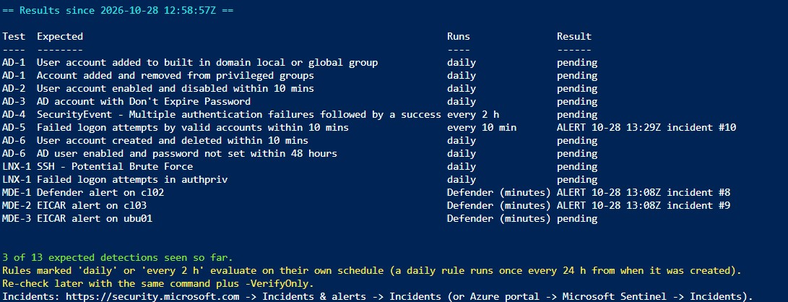

---

## 7. Teardown

`destroy.ps1` discovers every resource group by the naming prefix and deletes them in parallel. It also
force-deletes and purges the Log Analytics workspaces, purges the Key Vaults, removes the policy
assignments, resets the Defender plans, and deletes the NSG flow logs the MLZ hub left in
**NetworkWatcherRG**.

```bash
curl -sO https://raw.githubusercontent.com/lee-aguilar-msft/Azure-MLZStarterKit-Security/main/destroy.ps1
pwsh -NoProfile -File ./destroy.ps1 -SubscriptionId <subscription-id> -Identifier mca -EnvironmentAbbreviation dev \
  -Location westus2 -RemoveDefenderPlans -RemovePolicyAssignments -Force
```

Expect 20–40 minutes (the Azure Firewall and Bastion are the slow deletes; a firewall in a *Failed*
state takes longest). Check afterwards that **Resource groups** shows none with the `mca-dev-usw2-`
prefix. Run it from a Cloud Shell session you keep active — or in the background with
`nohup pwsh … > ~/destroy.log 2>&1 &` and `tail ~/destroy.log` — if the shell drops mid-run, simply run
it again; it is safe to repeat.

The tenant-level Entra ID diagnostic setting (`sentinel-lab`) is not removed by `destroy.ps1`: delete it
under Microsoft Entra ID → Diagnostic settings if you are not redeploying.

---

## 8. Troubleshooting — every Commercial error hit while writing this guide

The Government guide's troubleshooting table (#1–#47) applies to the kit as a whole; these are the
entries that only showed up on Azure Commercial. All fixes are on `main`.

| # | Where | Error | Cause | Fix (in the kit) |
|---|---|---|---|---|
| 48 | MLZ core | *Subscription … is not registered for feature Microsoft.Network/AllowBringYourOwnPublicIpAddress required to carry out the requested operation* on a firewall or Bastion public IP | The MLZ public IPs are plain Standard IPs; the requirement comes from the subscription (Microsoft-internal subscriptions, or a policy that adds IP tags to public IPs) | Register the feature (section 2.3), wait for `Registered`, `az provider register -n Microsoft.Network --wait`, then tear down and redeploy. If it stays `Pending`, the subscription needs approval through a support request (days) — use another subscription meanwhile |
| 49 | Deployment | Four of the eleven `Microsoft.Security/pricings` resources end in `Conflict` — *Another update operation is in progress. Please retry in a few minutes* | Commercial's Defender pricing API serialises plan changes per subscription; the template created all plans in parallel (Government tolerated it) | `build/gen_solution.py` chains the plans with `dependsOn` so ARM creates them one at a time (a dependency on a toggled-off plan is still satisfied) |
| 50 | MLZ core | Azure Firewall Premium ends in provisioning state **Failed** with `InternalServerError: An error occurred.`; the rule collection group then fails with *Put on Firewall Policy … Failed with 1 faulted referenced firewalls* and the whole core deployment fails | Platform-side fault while the firewall was being built (nothing in the template; East US, Premium tier); the next run built the same firewall in 12 minutes | Tear down (`destroy.ps1`) and redeploy. Do not try to repair a firewall in `Failed` state in place — **Redeploy** on the failed deployment reuses the faulted instance |
| 51 | Compute tab / VM module | Every D-series size shows `NotAvailableForSubscription` in East US (or the deployment fails with `SkuNotAvailable`) although the quota is 100 vCPU per family | Region-level VM restrictions on the subscription (common on internal, trial and new subscriptions); the earlier hard-coded Commercial size list offered sizes regardless | Commercial size pickers replaced with the portal's size selector limited to six lab-tested sizes (D2as_v7 / D4as_v7 / D2s_v5 / D4s_v5 / D2ads_v6 / D4ads_v6); it lists only what the subscription can deploy in the region and pre-selects the first one. Check regions with the SKU API (section 2.4) and deploy where the list is not empty — West US 2 on the test subscription |
| 52 | VM module | `lab-sles01` ends in `OSProvisioningTimedOut` (*OS provisioning … did not finish in the allotted time*), VM running, agent *Not Ready*, every other VM fine | The `SUSE:sles-15-sp5:gen2` **latest** image (version 2026.10.19, published after SLES 15 SP5 left general support) never completes provisioning — reproduced on D2as_v7, D2s_v5, with and without Trusted Launch; `sles-15-sp6` provisions in 2 min on the same size | Kit moved to `SUSE:sles-15-sp6:gen2`; all lab VMs now have managed boot diagnostics so the serial log is readable next time (a VM in a failed provisioning state cannot have diagnostics enabled afterwards) |
| 53 | Post-Deploy (Cloud Shell) | `Post-Deploy.ps1` run as `pwsh -File …` from a **Bash** Cloud Shell stops at *Run Connect-AzAccount to login* | A `pwsh` child process started from Bash has no Az context; only the PowerShell-mode Cloud Shell signs `Az` in automatically | Switch the shell to PowerShell (toolbar → *Switch to PowerShell*) and run `./Post-Deploy.ps1 …` directly (section 5.1) |
| 54 | Prepare-Tenant | *Authentication timed out after 120 seconds due to inactivity. Please try again.* right after the device-code prompt | `Connect-MgGraph -UseDeviceCode` cancels after a hard-coded 120 s (`-ClientTimeout` does not change it) — not enough to open the page, enter the code and pass MFA | Kit does the device-code grant itself (RFC 8628) with the SDK's own public client and hands the token to `Connect-MgGraph -AccessToken`; the code is now valid for the full 15 minutes |
| 55 | Post-Deploy | Sentinel solution install fails with `RequestContentTooLarge` — *The request content size exceeds the maximum size of 4 MB* (Defender XDR solution) | `New-AzResourceGroupDeployment` re-serialises the template pretty-printed; the Commercial XDR package then exceeds ARM's 4 MB inline limit | `Enable-SentinelContent.ps1` submits the deployment compact through REST (3.6 MB) and, above the cap, stages the template in the workspace storage account and deploys it from a link |
| 56 | Post-Deploy | UEBA settings `PUT` returns **401** *User does not have required admin roles* although the account is Owner of the subscription | Sentinel's UEBA/EntityAnalytics settings require **Global Administrator** or **Security Administrator** on the tenant, not an Azure RBAC role | Activate the role (PIM) and re-run `Post-Deploy.ps1` (it skips what is already done) |
| 57 | Post-Deploy | Access token expires half-way through the analytics-rule loop (`ExpiredAuthenticationToken`) | A Cloud Shell token lives ~1 h; the Commercial catalogue has 300 rule templates to install | `Enable-SentinelContent.ps1` refreshes its ARM token every 20 min and on any 401 |
| 58 | Verify | Defender for Servers reads **Free** after a deployment that set it to P2 | Commercial Defender plan API occasionally reverts the Servers plan when sub-plans are set in the same pass (also Government #23) | `Post-Deploy.ps1` re-asserts every plan and prints the final table; re-run it if the portal shows *Off* |
| 59 | Client / Intune | Client is hybrid joined, the user has a PRT, but Intune lists no devices; on the client the task *Schedule created by enrollment client for automatically enrolling in MDM from AAD* ends with **0x8018002A** (2149056554) and `LAB-IntuneAutoEnroll-Retry` fails the same way | Conditional Access requires MFA for the enrollment: the Microsoft-managed *… for Microsoft partners and vendors* policies in the test tenant apply to all users and all cloud apps and do not exclude *Microsoft Intune Enrollment*; a background enrollment cannot answer an MFA prompt | `./Prepare-Tenant.ps1 -Cloud Global -SkipMdm -ExcludeIntuneEnrollmentFromCa` adds the app exclusion to every enabled all-apps policy (or add it by hand: policy → Target resources → Exclude → *Microsoft Intune Enrollment*), then re-trigger the client task — `Start-ScheduledTask -TaskPath '\Microsoft\Windows\EnterpriseMgmt\<guid>\' -TaskName 'Schedule created by enrollment client for automatically enrolling in MDM from AAD'` via Run command |
| 60 | Hydration / Verify | The hydration check (6.5) shows group churn, sign-in failures and `nltest` up to a point in the night, then nothing; the Sentinel incident list stays almost empty | Two separate things. All lab VMs are deallocated by the DevTest auto-shutdown at 03:00 UTC and nothing restarts them, so hydration pauses. And hydration is written to stay *under* detection thresholds; it feeds hunting, it is not an alert generator | Start the VMs (`az vm start`, section 5.3). To see alerts and incidents, run `Test-LabDetections.ps1` (section 6.6) |
| 61 | Hydration (Linux) | No Linux authentication failures in Syslog although the hydration script "tries a failed `su`" every hour | A non-interactive `su` with the password on stdin never reaches PAM (no TTY), so nothing is logged | `hydrate-linux.sh` now makes one SSH password attempt for a non-existent user against the VM's own sshd every second hour (12 a day, under the 15-attempt rule thresholds); sshd/PAM log *Failed password for invalid user* / *user unknown*. Existing labs keep the old script until redeployed |
| 62 | Detection test | `Test-LabDetections.ps1` stops on the DC with *Exception calling "ValidateCredentials" … The LDAP server is unavailable* partway through the bad-password burst; `lab.dettest` is left in AD | After a run of failed binds the DC drops the reused LDAP connection | The script opens a fresh connection per attempt, catches each failure and always deletes `lab.dettest` (it also removes leftovers at the start of the next run) |
| 63 | Detection test | The Linux EICAR test (MDE-3) finds `Virus:DOS/EICAR_Test_File`, but the file is still there afterwards and the test stays *pending* (no Defender alert or incident) | On the test lab `mdatp health` reported real-time protection **off** on the Linux servers onboarded through Defender for Servers: an on-demand scan detects and reports, nothing removes the file | Expected with that setting. The script deletes the test file itself. Switch Linux devices to active mode in the Defender portal or with `mdatp config real-time-protection --value enabled` if you want blocking |
| — | Sentinel | *Content hub* and *Data connectors* open the Defender portal (`security.microsoft.com`) instead of a blade in the Azure portal | Commercial Sentinel workspaces onboarded to the unified Defender portal move those pages there | Use the Defender portal links; the kit's post-deploy does not need them |
| — | Identity tab | *Validation failed. Required information is missing or not valid* → **Domain NetBIOS Name: The value must not be empty** | The field shows `CORP` as a placeholder, not a value | Type `CORP` (section 4.6) |
| — | Compute tab | Linux *Change size* link greyed out, no size shown | Portal race while the size selector resolves the Linux image on first load | Wait a few seconds, or switch tabs and come back; re-selecting the region on Basics also re-triggers it (but resets the other Compute fields) |
