# MLZ Security Lab Starter Kit — Implementation Guide (Azure Government / GCC High)

Step-by-step, from an empty Azure Government (GCC High) subscription to a running MLZ Security Lab with
Microsoft Sentinel connectors, analytics rules and UEBA enabled — using only the Azure portal, Cloud Shell
and the **Deploy to Azure Gov** button in the repository README.

Everything in this guide was performed for real in the `Lab Subscription`
subscription (`usgovvirginia`, tenant `contoso.onmicrosoft.us`) on 14–15 October 2026. The
screenshots are from those runs. Three deployment runs were needed to shake out the defects listed in
section 8; every fix is on `main`, so a fresh run of the kit follows the clean path described here.

Repository: <https://github.com/lee-aguilar-msft/Azure-MLZStarterKit-Security>

| Section | What you do | Time |
|---|---|---|
| 1. Before you start | Gather the inputs the form asks for | 10 min |
| 2. Subscription prerequisites | Register features and providers, confirm SKU and quota | 15 min (+ wait for EncryptionAtHost) |
| 3. Entra ID prerequisites | VM-login security group, break-glass account | 10 min |
| 4. Deploy from the portal | Blue button → 7 form tabs → Review + create | 15 min form, 60–90 min deploy |
| 5. Post-deploy | `Post-Deploy.ps1`: Sentinel content, rules, UEBA, connectors; identity checklist | 20 min |
| 6. Verify | Resource group, Sentinel, Defender plans | 15 min |
| 7. Teardown | `destroy.ps1` (includes NetworkWatcherRG flow logs and workspace purge) | 20–40 min |
| 8. Troubleshooting | Every error hit while writing this guide, with its fix | — |

## What gets deployed

The kit sits on a standard Mission Landing Zone: the upstream `mlz.json` module builds the network hub
and the T0/T1/T2 spokes, and the kit adds a Tier 3 security-lab spoke plus the subscription- and
tenant-level security layer.

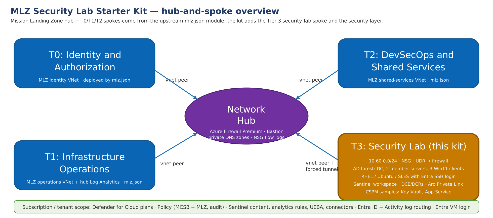

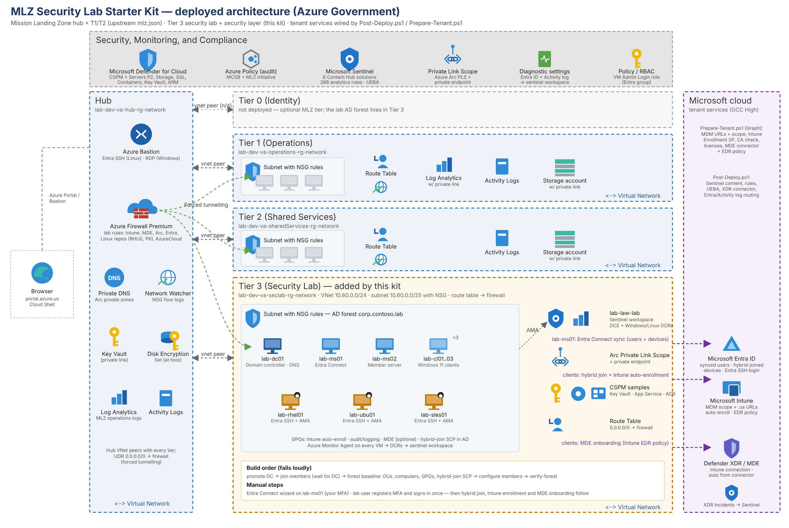

| Layer | Resources |
|---|---|
| MLZ hub | Hub VNet, Azure Firewall (Premium) with the lab rule collection groups, Bastion, hub Log Analytics, NSG flow logs |
| Tier-3 workload | `lab-dev-va-seclab-rg-network`: VNet `10.60.0.0/24`, NSG, route to the firewall |
| Identity | `lab-dc01` (new forest `corp.contoso.lab`), `lab-ms01` / `lab-ms02` member servers, `lab-cl01`–`lab-cl03` Windows 11 clients, all domain-joined; Entra VM login role for one security group |
| Linux | `lab-rhel01`, `lab-ubu01`, `lab-sles01` with Entra SSH login and Azure Monitor Agent |
| Security | Sentinel workspace `lab-law-lab`, DCE + Windows/Linux data collection rules, Defender for Cloud plans (all plans offered in Azure Government), MLZ policy set + Microsoft cloud security benchmark, Arc Private Link Scope + private DNS zones, CSPM coverage samples (Key Vault, App Service) |
| Post-deploy | Sentinel Content Hub solutions, ~265 analytics rules, UEBA, Defender XDR connector, Entra ID + Azure Activity log routing |
| Data hydration | `LAB-Hydration` scheduled task on every Windows VM and a `lab-hydrate` systemd timer on every Linux VM: hourly benign user/admin activity so Sentinel and MDE have data to hunt over (section 5.3) |

---

## 1. Before you start — inputs checklist

Collect these before opening the form; the portal form does **not** save progress if you navigate away.

| Input | Form tab | Value used in this guide |
|---|---|---|
| Subscription | Basics | Lab Subscription (`<subscription-id>`) |
| Region | Basics | `(US) USGov Virginia` |
| Resource naming identifier / environment | Basics | `lab` / `dev` |
| Workload name / short name | Basics | `seclab` / `lab` |
| Security contact e-mail | Security and Compliance | a monitored tenant mailbox |
| New Sentinel workspace name | Security and Compliance | `lab-law-lab` |
| Verified Entra UPN suffix | Lab Options | `contoso.onmicrosoft.us` |
| Lab user sAMAccountName | Lab Options | `lab.user` |
| AD domain name / NetBIOS | Identity | `corp.contoso.lab` / `CORP` |
| Admin username + two passwords (admin, DSRM) | Identity | `labadmin` (passwords are typed by the operator only) |
| Entra security group **object ID** for VM login | Identity | `<entra-group-object-id>` |
| VM sizes | Compute | `Standard_D2ads_v6` for servers, clients and Linux |

Password rules: 12+ characters, 3 of 4 character classes, no part of the username. The same rules apply
to the DSRM password. Nothing in this kit stores or echoes the passwords.

Roles you need: **Owner** on the subscription (the template assigns RBAC and Defender plans at
subscription scope) and **Global Administrator** or **Security Administrator** in the tenant (UEBA and the
Entra ID log routing in step 5 are tenant-level settings).

Licensing in the tenant (not deployed by the kit): Entra ID P1/P2 and Intune for auto-enrollment;
Defender for Endpoint if you want the optional MDE onboarding package.

---

## 2. Subscription prerequisites

### 2.1 Sign in to the Azure Government portal and pick the subscription

Open <https://portal.azure.us>, sign in with the Owner account, open **Subscriptions** and confirm the
subscription you will deploy into.

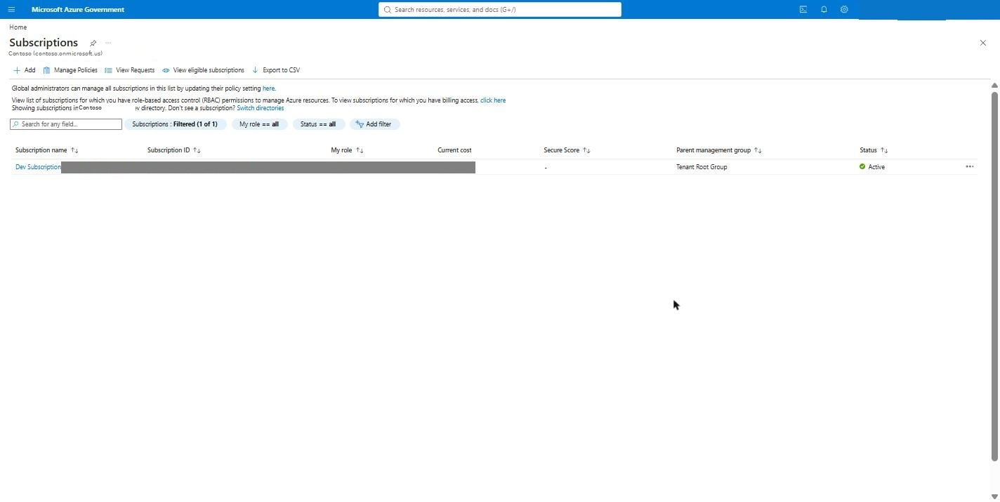

### 2.2 Open Cloud Shell (PowerShell)

Click the Cloud Shell icon in the top bar. On first use choose **PowerShell**, pick the subscription, and
select **No storage account required** — the session is ephemeral, which is fine: everything the guide
runs in Cloud Shell is re-downloadable from the repository.


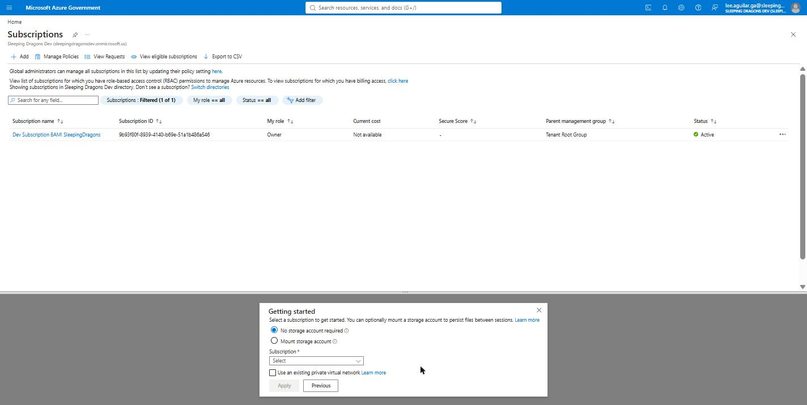
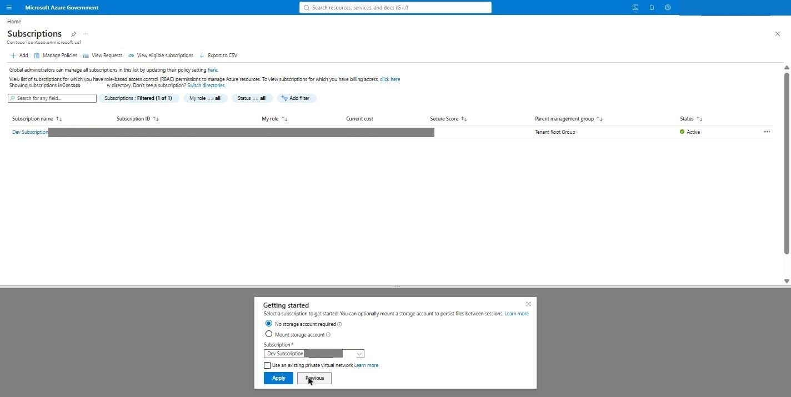
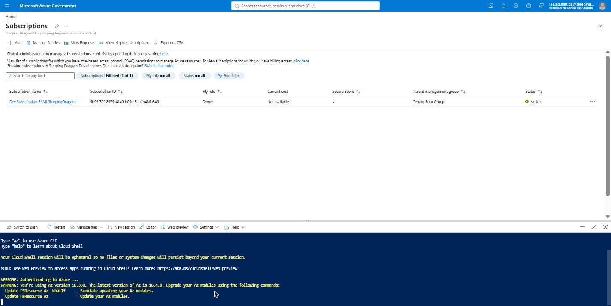

> Cloud Shell in `portal.azure.us` disconnects after a few minutes of inactivity. If the pane shows
> *Cloud Shell disconnected* or *connection could not be established*, click **Restart** in its toolbar
> and re-run the `git clone` from step 5.1 — the home directory is not kept.

### 2.3 Register the features and resource providers

Paste the block below into Cloud Shell. It is idempotent — re-running it is harmless.

```powershell
az account set --subscription <subscription-id>

# Encryption-at-host for the MLZ VMs (feature flag — takes a few minutes to flip to Registered)
az feature register --name EncryptionAtHost --namespace Microsoft.Compute
az provider register --namespace Microsoft.Compute

# Auto-shutdown schedules, Arc private link, DNS, Sentinel, Defender, policy, CSPM samples
az provider register --namespace Microsoft.DevTestLab
az provider register --namespace Microsoft.HybridCompute
az provider register --namespace Microsoft.Network
az provider register --namespace Microsoft.ContainerInstance
az provider register --namespace Microsoft.ApiManagement
az provider register --namespace Microsoft.Web
az provider register --namespace Microsoft.KeyVault
az provider register --namespace Microsoft.Security
az provider register --namespace Microsoft.OperationalInsights
az provider register --namespace Microsoft.SecurityInsights
az provider register --namespace Microsoft.PolicyInsights

# Poll until this prints "Registered"
az feature show --name EncryptionAtHost --namespace Microsoft.Compute --query "properties.state" -o tsv
```

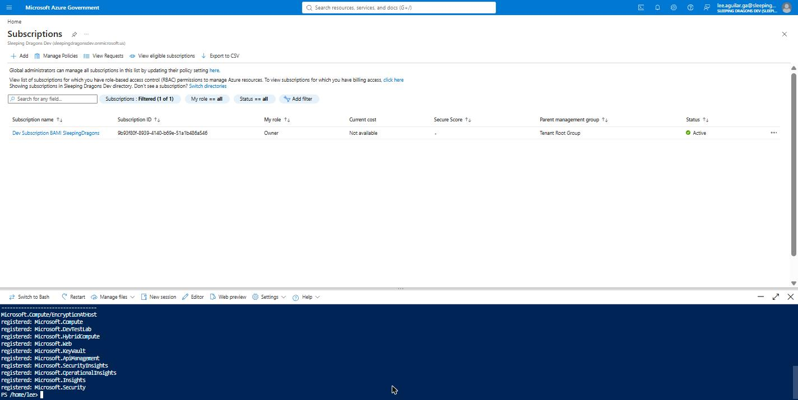
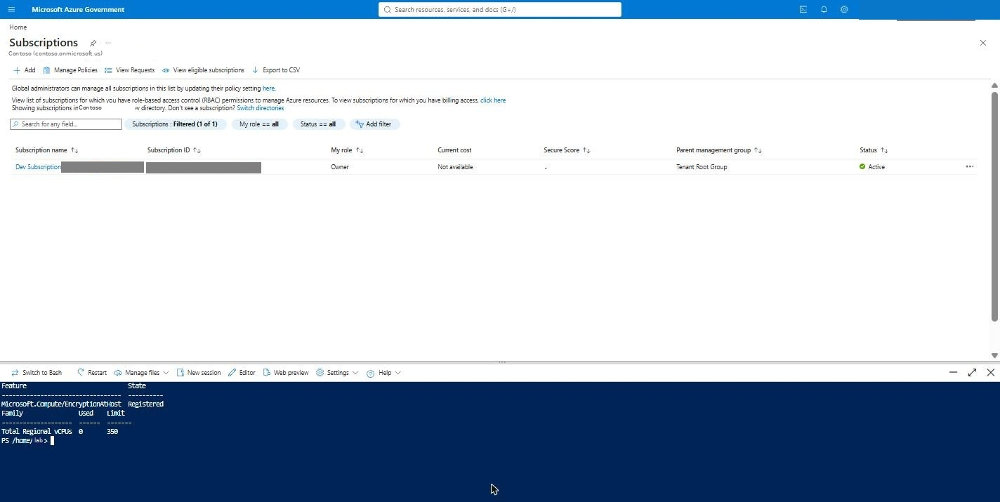

**Azure Commercial only — public IP feature.** Some Commercial subscriptions (Microsoft-internal ones, or any
subscription with a policy that adds IP tags to public IPs) refuse the MLZ firewall and Bastion public IPs with
*not registered for feature Microsoft.Network/AllowBringYourOwnPublicIpAddress* (troubleshooting #48). Register it
up front; on most subscriptions it flips to `Registered` within minutes:

```powershell
az feature register --namespace Microsoft.Network --name AllowBringYourOwnPublicIpAddress
az feature show --namespace Microsoft.Network --name AllowBringYourOwnPublicIpAddress --query "properties.state" -o tsv
az provider register --namespace Microsoft.Network
```

### 2.4 Confirm VM SKU availability and quota in the region

The lab deploys 6 Windows + 3 Linux VMs. Check the chosen size exists in the region and that the vCPU
family quota can hold 18–36 vCPUs:

```powershell
az vm list-skus -l usgovvirginia --size Standard_D2ads_v6 --output table
az vm list-usage -l usgovvirginia --query "[?contains(name.value,'DADSv6') || name.value=='cores']" -o table
```

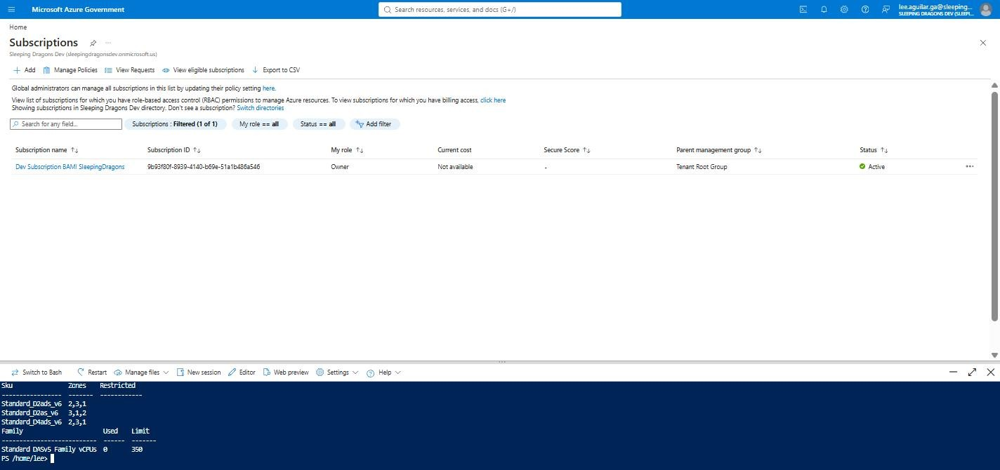

**Azure Commercial — pick the region by what the subscription may deploy, not by habit.** Commercial
subscriptions (trial, internal, sponsorship, new pay-as-you-go) commonly have *entire regions* restricted for
VM creation: on the test subscription used for this guide East US, Central US, West US and North Central US
offered **zero** deployable VM sizes, East US 2 only a handful, and West US 2 everything. `az vm list-skus`
hides this (it is slow and returns `[]`); ask the SKU API directly and count the unrestricted sizes per region
before choosing one:

```bash
SUB=$(az account show --query id -o tsv)
for l in eastus eastus2 westus2 westus3 southcentralus; do
  az rest --method get --url "https://management.azure.com/subscriptions/$SUB/providers/Microsoft.Compute/skus?api-version=2021-07-01&\$filter=location%20eq%20%27$l%27" -o json > /tmp/s-$l.json
  python3 -c "import json,sys;d=json.load(open('/tmp/s-'+sys.argv[1]+'.json'))['value'];vm=[s for s in d if s['resourceType']=='virtualMachines'];ok=[s['name'] for s in vm if not s.get('restrictions')];print(sys.argv[1],len(ok),'deployable sizes;','D2ads_v6' if 'Standard_D2ads_v6' in ok else '-')" $l
done
```

Deploy into a region that lists the size you want. The Compute tab's size pickers on Commercial use the portal's
live size selector, so a size the subscription cannot deploy in the chosen region is simply not offered
(troubleshooting #51).

---

## 3. Entra ID prerequisites

### 3.1 Security group for Entra VM login

The kit assigns **Virtual Machine Administrator Login** to one Entra security group on every VM, so
members can sign in with Entra credentials through Bastion (RDP and SSH). Create (or reuse) a group,
add the operators to it, and copy its **Object ID** — the Identity tab asks for it.

Microsoft Entra ID → Groups → *your group* → Overview (copy **Object Id**) → Members → **Add members**.

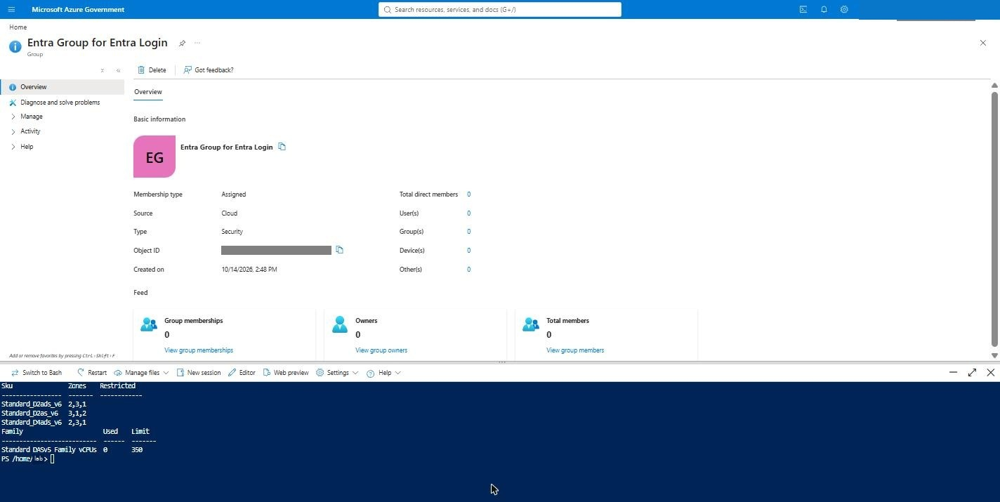
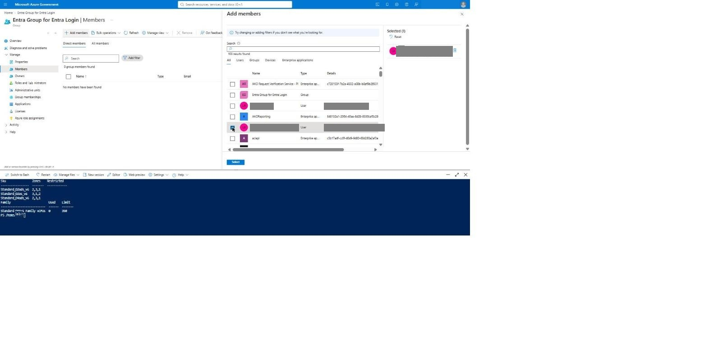
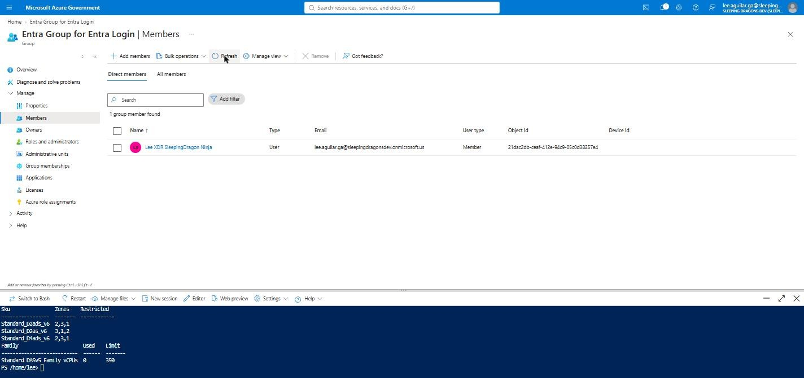

### 3.2 Break-glass (emergency access) account

Create a cloud-only Global Administrator break-glass account in the tenant **before** you enable any
Conditional Access or Entra-login enforcement in the lab, and exclude it from every CA policy. This is a
tenant task outside the template; the kit does not create it. `Post-Deploy.ps1` prints the same reminder.

---

## 4. Deploy from the portal (Deploy to Azure Gov button)

### 4.1 Open the form

In the repository README click **Deploy to Azure Gov**. It opens `portal.azure.us` with the kit's
`solution.json` and `uiDefinition.json` loaded straight from GitHub (the form title reads *MLZ Security
Lab Starter Kit*). If the portal opens on a different tab or window, you can paste the button's link
directly into the address bar.

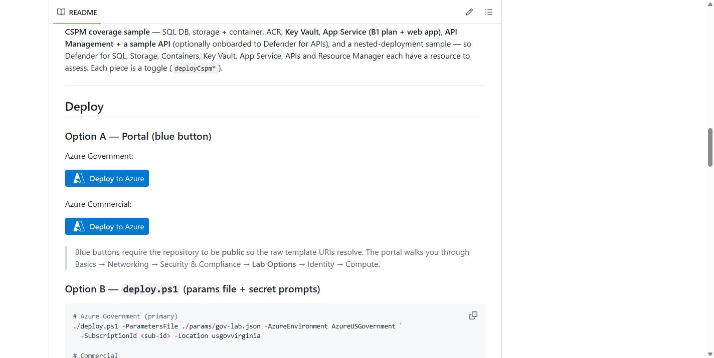

(A few screenshots from the first run still show the form's previous title, *Mission Landing Zone AD +
Entra One-Shot*; the fields are unchanged.)

The form is **cloud-aware**: when the region chosen on Basics is `usgov*` or `usdod*`, it hides the
Defender plans that Azure Government does not offer (App Service, APIs), hides VM sizes that are
commercial-only, and derives the `.us` cloud endpoints automatically.

### 4.2 Basics

Pick the subscription and region, then the naming inputs. The resource prefix is derived from identifier +
environment + region + workload, e.g. `lab-dev-va-seclab`.

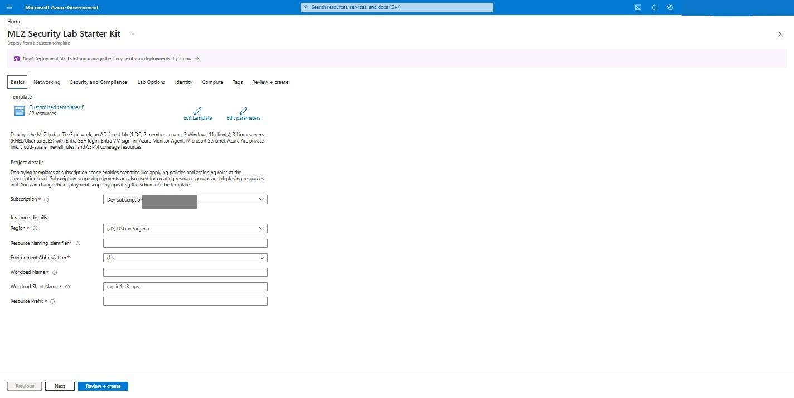
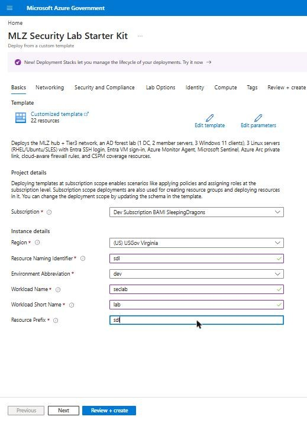

### 4.3 Networking

Leave Bastion on. The Tier-3 VNet is `10.60.0.0/24`; set the **subnet** to `10.60.0.0/25` so the
`10.60.0.128/28` resolver subnet can be added later without re-addressing. Domain controller IP
`10.60.0.10`.

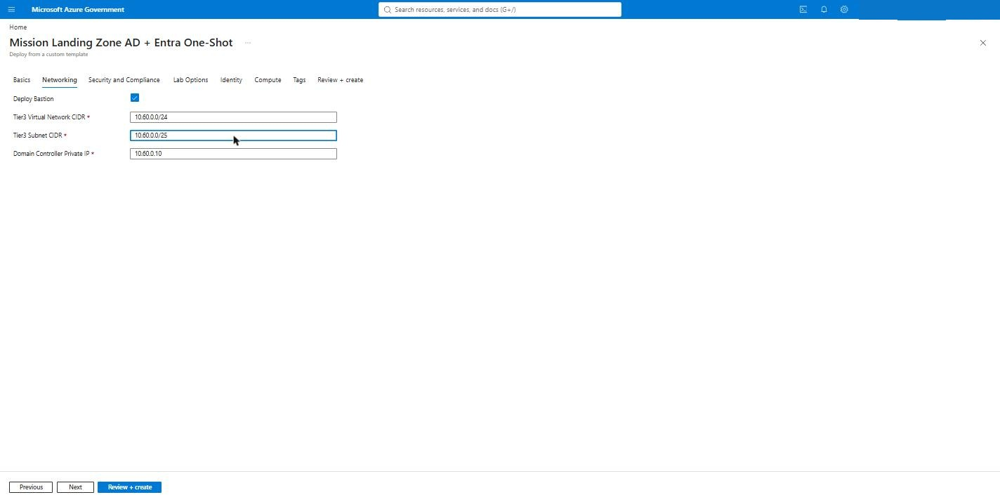

### 4.4 Security and Compliance

Enable the Defender for Cloud base plan and the plans you want (this guide turned on everything the
form offers in Azure Government: CSPM, Servers P2, Storage, SQL, Containers, Key Vault, Resource
Manager, open-source databases, Cosmos DB). Each plan is billed separately.

Policy: keep **Microsoft cloud security benchmark** (default on) and add the MLZ built-in policy set;
all initiatives are assigned in audit-only mode. Enable **Microsoft Sentinel** with a **new** workspace
named `lab-law-lab`.

CSPM coverage samples: Key Vault and App Service on; **SQL off** in this subscription (see
troubleshooting #11); API Management off (adds ~45 minutes).

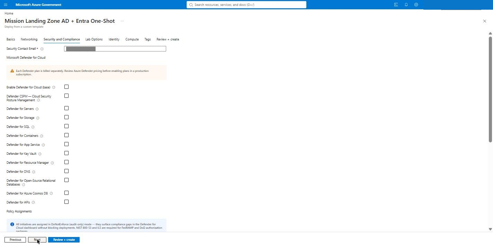
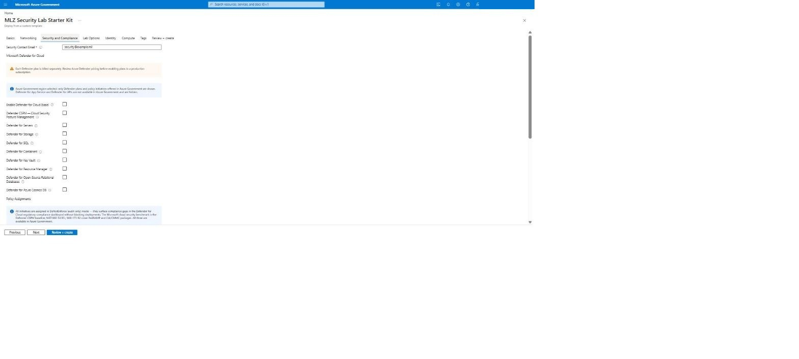
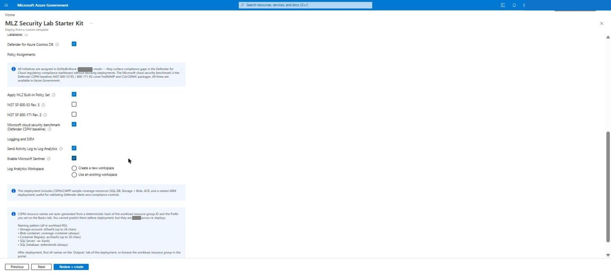
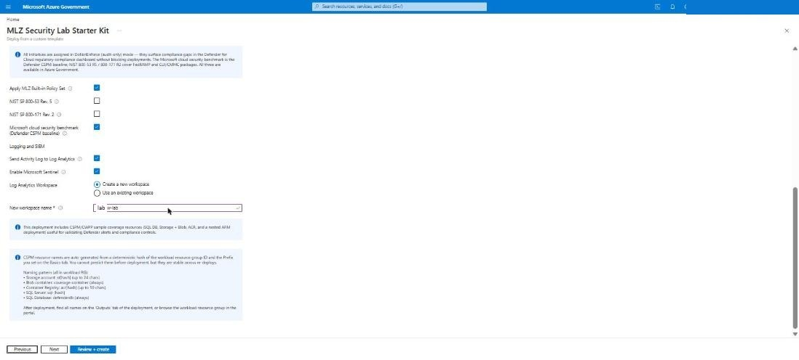

### 4.5 Lab Options

Enter the verified UPN suffix and the lab user name. Keep the three Linux servers, the lab firewall
rules, the AzureCloud service-tag allowance and **Enable all matching built-in Sentinel analytics rules
+ UEBA** on. Leave *Run the Sentinel content enablement inline* off — section 5 runs it from Cloud
Shell, where you can watch it. Turn on **Azure Arc Private Link Scope**.

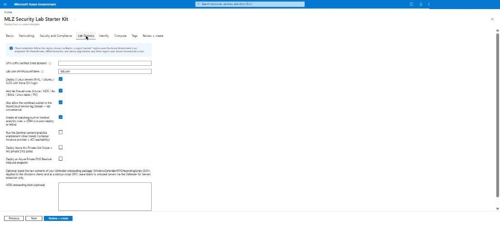
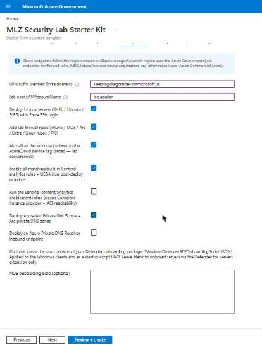

### 4.6 Identity

Admin username, the admin and DSRM passwords, the optional lab user password, AD domain and NetBIOS
name, and the Entra group **object ID** from step 3.1. Keep *Assign Virtual Machine Administrator Login
role* checked.

Which account signs in where:

| VM | Account | Password |
|---|---|---|
| `lab-dc01` | `labadmin@corp.contoso.lab` — the DC's local admin becomes the domain admin at promotion | Admin password |
| `lab-ms01`, `lab-ms02`, `lab-cl01`–`03` | `labadmin@corp.contoso.lab` (Domain Admins); local `.\labadmin` also exists | Admin password |
| `lab-rhel01`, `lab-ubu01`, `lab-sles01` | `labadmin` (local), or your Entra account through Bastion *Microsoft Entra ID* | Admin password / Entra sign-in |
| Clients, as a normal user | `lab.user@corp.contoso.lab` or `lab.user@contoso.onmicrosoft.us` | Lab user password |
| AD recovery mode | — | DSRM password |

If you leave the lab user password blank, the user is created with a random password; reset it on
the DC with `Set-ADAccountPassword lab.user -Reset -NewPassword (Read-Host -AsSecureString)`.

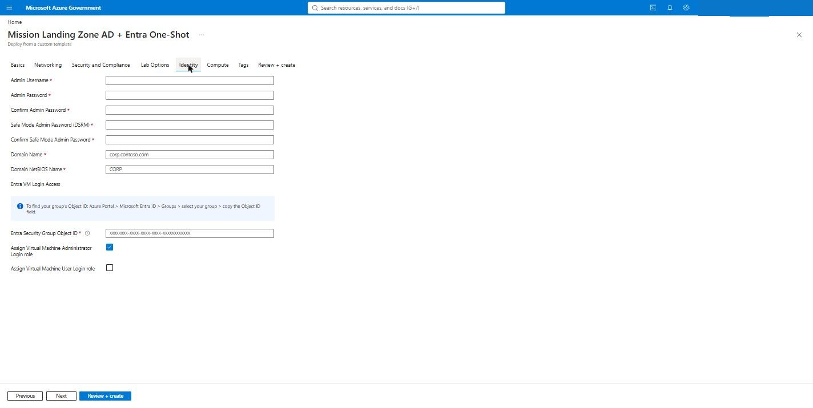
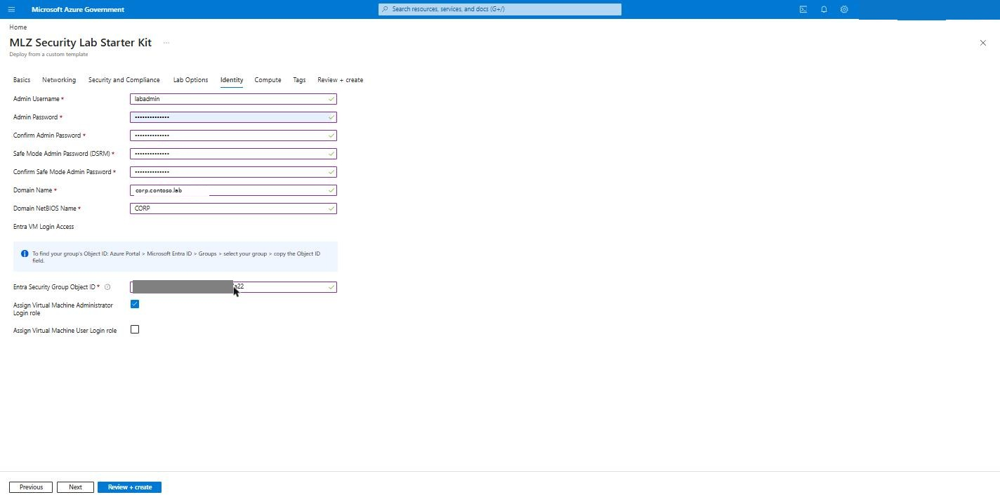

### 4.7 Compute

Server image Windows Server 2022 Gen2, client image Windows 11 24H2 (Enterprise or Pro), and the VM
sizes. In Azure Government the size lists only show sizes available there.

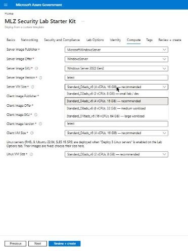
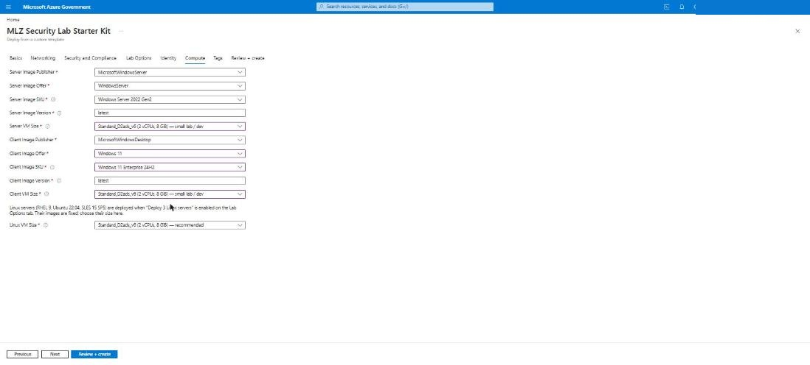

### 4.8 Review + create

Validation runs the whole subscription-scope template. When it passes, click **Create**.

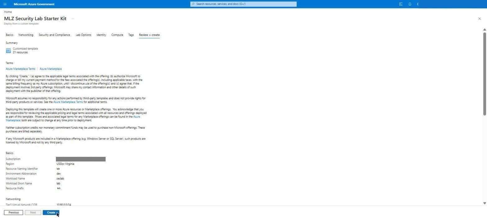

### 4.9 Watch the deployment

The top-level deployment is `CustomDeployment-<timestamp>`. It fans out into nested deployments:
`deploy-mlz-core` (hub), `deploy-tier3`, `deploy-cspm-coverage`, `deploy-ad-entra-vms` (DC promotion,
joins, Linux), `deploy-security-lab` (workspace, DCRs, Sentinel onboarding) and `deploy-arc-pls`, plus
the Defender pricing and policy assignments at subscription scope.

Expected timing on this run: hub + tier-3 ≈ 25 min; VM module ≈ 45 min (DC promotion, 5 domain joins
and configure-member, 3 Linux servers with Entra SSH login and the monitor agent); CSPM ≈ 10 min.

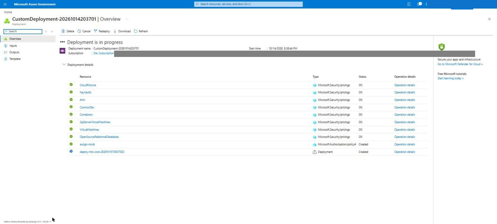
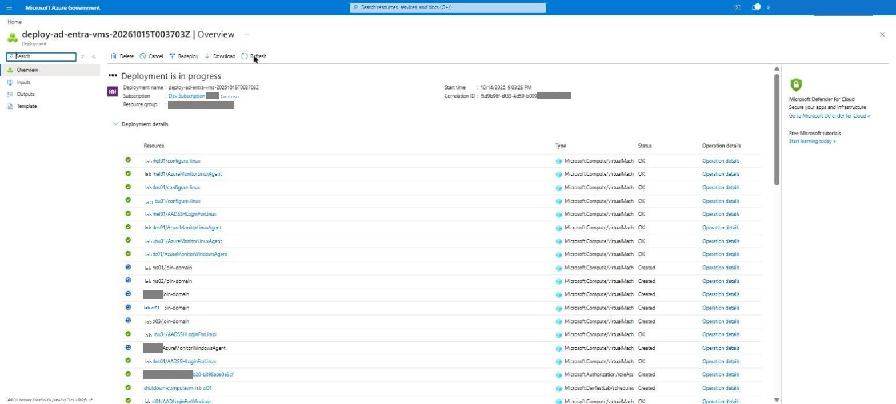
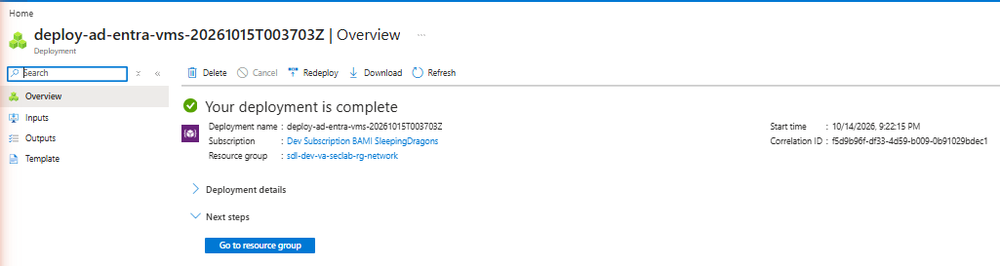
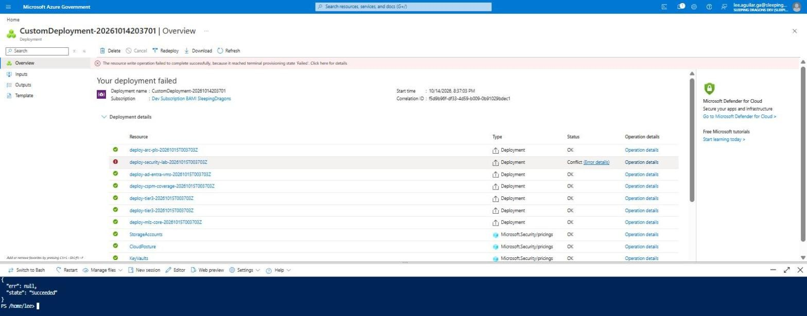

> On this run the `deploy-security-lab` module hit the Linux DCR defect (troubleshooting #13) and was
> re-deployed on its own after the fix. With the fix on `main`, a fresh deployment completes in one
> pass. If any nested deployment fails, open its **Error details**, fix the input (or the template),
> and use **Redeploy** on that nested deployment — the modules are idempotent.

---

## 5. Post-deploy — Sentinel content, connectors, analytics rules, UEBA

The template onboards the workspace to Sentinel and creates the data collection rules; the Content Hub
solutions, the analytics rules, UEBA, the Defender XDR connector and the tenant-level log routing are
done by `templates/scripts/Post-Deploy.ps1`, run from Cloud Shell under your own (Global
Administrator) sign-in.

### 5.1 Clone the kit in Cloud Shell and run the orchestrator

```powershell
git clone -q https://github.com/lee-aguilar-msft/Azure-MLZStarterKit-Security.git ~/kit
cd ~/kit/templates/scripts
./Post-Deploy.ps1 -SubscriptionId <subscription-id> `
  -ResourceGroupName lab-dev-va-seclab-rg-network -WorkspaceName <workspace-name> -EnableXdrConnector `
  *>&1 | Tee-Object -FilePath ~/postdeploy.log
```

The `*>&1 | Tee-Object` keeps every warning in `~/postdeploy.log` so you can review the per-rule
messages afterwards. The run takes 8–12 minutes. What it does, in order:

| Step | Action | Result on this run |
|---|---|---|
| 1 | Installs Content Hub solutions by deploying each solution's packaged ARM template (same as the portal's **Install**) — Microsoft Entra ID, Azure Activity, Microsoft Defender XDR, Windows Security Events, Syslog, UEBA Essentials | 6 installed; *Threat Intelligence – TAXII* is not in the Azure Government catalog and is skipped |
| 2 | Enables every built-in Scheduled/NRT analytics rule template whose required connector is one of: AzureActiveDirectory, AzureActivity, MicrosoftThreatProtection, MicrosoftDefenderAdvancedThreatProtection, SecurityEvents, WindowsSecurityEvents, Syslog, ThreatIntelligence(Taxii) | 298 matched, **263 enabled** (264 active with the built-in *Advanced Multistage Attack Detection* rule), 35 rejected by the service (they query tables or columns that do not exist yet — expected; re-run the script a day later to pick up the ones whose tables have since filled) |
| 1b | Prints the Defender for Cloud plans and re-asserts Defender for Servers P2 | see 6.4 |
| 3 | Turns on Entity Behavior Analytics (UEBA) over AuditLogs, AzureActivity, SigninLogs, SecurityEvent | enabled |
| 4 | Defender XDR data connector (incidents + alerts) | created; skipped as *already present* on later runs |
| 5 | Routes Entra ID logs (tenant diagnostic setting: AuditLogs, SignInLogs, NonInteractiveUserSignInLogs, ServicePrincipalSignInLogs, ManagedIdentitySignInLogs, ProvisioningLogs, RiskyUsers, UserRiskEvents) and the subscription Activity log to the workspace | both routed |
| — | Prints the break-glass / Conditional Access checklist and the Entra Connect + hybrid-join runbook | manual follow-up |

The script is idempotent: re-running it skips rules that already exist (and removes duplicates left by
an interrupted run), re-deploys the solutions harmlessly and leaves existing settings in place.

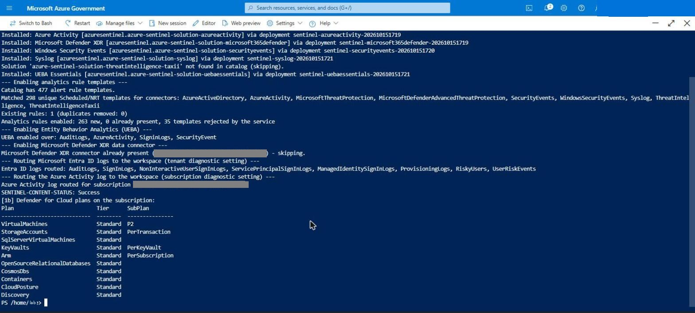

### 5.2 Identity, hybrid join, Intune and Defender for Endpoint

Most of the identity chain is automated. The deployment and two scripts do everything except two
clicks that have no API (Entra Connect's wizard needs your MFA; the Defender portal's Intune connection
toggle has no Graph endpoint).

| What | Done by | When |
|---|---|---|
| AD forest, OUs (`Users`, `Workstations`, `MemberServers`), lab user, groups | template (`configure-forest-baseline`) | deployment |
| Member servers and clients moved into their OUs | template (`configure-forest-baseline`) | deployment |
| GPO *<OU root> - Intune Auto-Enrollment* (MDM auto-enrollment with the signed-in user's Entra credential) linked to `Workstations` | template | deployment |
| GPO *<OU root> - Security Auditing and Logging* | template | deployment |
| Hybrid-join **Service Connection Point** (tenant ID + domain) written to AD | template — tenant ID comes from the subscription | deployment |
| Gate: deployment fails if any of the above is missing (`verify-forest`) | template | deployment |
| TLS 1.2 prerequisites and `C:\LabTools\README-EntraConnect.txt` on `lab-ms01` (Entra Connect itself is downloaded from the Entra admin center — see 5.2.3) | template (`configure-member`) | deployment |
| Clients retry hybrid join every 30 min and Intune enrollment hourly, for 7 days | template (scheduled tasks `LAB-HybridJoin-Retry`, `LAB-IntuneAutoEnroll-Retry`) | deployment |
| Intune MDM user scope + `.us` MDM URLs (GCC High) | `Prepare-Tenant.ps1` | once per tenant |
| *Microsoft Intune Enrollment* service principal; CA exclusion report (or `-ExcludeIntuneEnrollmentFromCa`) | `Prepare-Tenant.ps1` | once per tenant |
| Intune ↔ MDE connector (Windows), dynamic device group, EDR policy *Auto from connector* | `Prepare-Tenant.ps1 -ConfigureMde` | once per tenant |
| License for the synced lab user | `Prepare-Tenant.ps1 -LabUserUpn` | after the first sync |
| **Defender portal → Intune connection = On** | you (one toggle) | once per tenant |
| **Entra Connect wizard** on `lab-ms01` | you (needs MFA) | once per deployment |

#### 5.2.1 Prerequisites — what you need before you start (no extra GPOs from GitHub)

You do not need to import any GPO backups or third-party automation: the forest baseline creates the
GPOs above, and the MDE onboarding is driven by Intune. What you do need:

1. A **break-glass Global Administrator** (cloud-only, excluded from all Conditional Access policies).
2. **Licences**: Entra ID P1/P2 + Intune for the lab user (hybrid join's PRT and MDM auto-enrollment
   are licensed features), and Defender for Endpoint P2 for the clients (included in Microsoft 365
   E5 / G5; the servers are covered by Defender for Servers P2).
3. Your account: **Global Administrator** (or Intune Administrator + Cloud Application Administrator +
   License Administrator + Security Administrator) for `Prepare-Tenant.ps1` and the Defender toggle,
   and **Hybrid Identity Administrator** (or Global Administrator) for the Entra Connect wizard.
4. Optional: the **MDE onboarding package** — only if you want a GPO-based onboarding path in addition
   to Intune. Defender portal (`security.microsoft.us`) → Settings → Endpoints → **Onboarding** →
   Windows 10 and 11 → *Group Policy* → Download. Inside `WindowsDefenderATPOnboardingScript.cmd`
   the `OnboardingInfo` registry value is a JSON string (`{"body":"{\"previousOrgIds\"…`); paste that
   JSON into **MDE onboarding blob** on the Lab Options tab before deploying. The kit writes it to the
   clients directly and as a *<OU root> - MDE Onboarding* startup-script GPO.

#### 5.2.2 Run `Prepare-Tenant.ps1` (Intune MDM URLs, enrollment app, MDE connector)

In a GCC High / DoD tenant the Intune *Automatic Enrollment* page tells you to use the `.us`
endpoints, but the fields still default to the commercial `.com` URLs, and auto-enrollment of the lab
clients fails until they are changed:

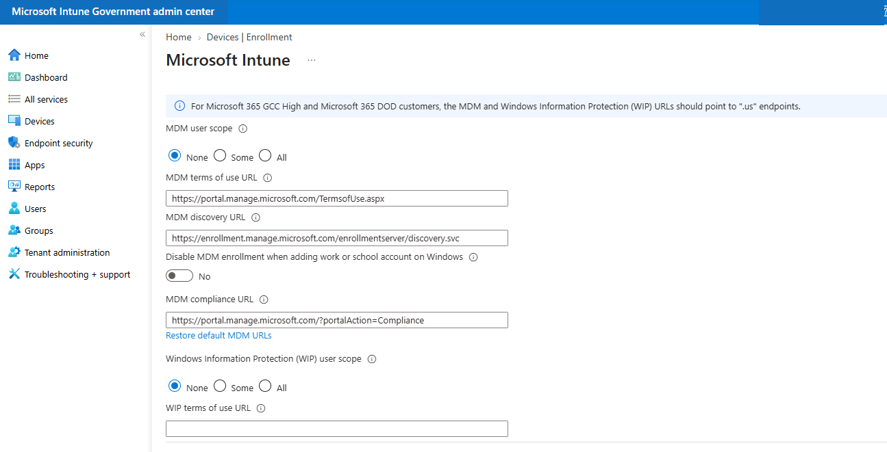

`Prepare-Tenant.ps1` sets them for you. From the same Cloud Shell session:

```powershell
cd ~/kit/templates/scripts
./Prepare-Tenant.ps1 -Cloud USGov -ConfigureMde
```

It signs in to Microsoft Graph with a **device code** (open `https://microsoft.com/deviceloginus`,
enter the code, complete MFA), then:

| Setting | Value written (GCC High / DoD) |
|---|---|
| MDM user scope | **All** (or **Some** with `-MdmScopeGroupId <group id>`) |
| MDM terms of use URL | `https://portal.manage.microsoft.us/TermsofUse.aspx` |
| MDM discovery URL | `https://enrollment.manage.microsoft.us/enrollmentserver/discovery.svc` |
| MDM compliance URL | `https://portal.manage.microsoft.us/?portalAction=Compliance` |
| *Microsoft Intune Enrollment* (`d4ebce55-015a-49b5-a083-c84d1797ae8c`) | service principal created if missing; CA policies that would block it are listed |
| Intune ↔ MDE connector | Windows devices **On** |
| Device group `LAB-Intune-Devices` | dynamic: `device.displayName -startsWith "lab-cl"` |
| EDR policy *LAB - Defender for Endpoint onboarding (auto from connector)* | Endpoint security → EDR, onboarding package **Auto from connector**, assigned to the group |

A successful run ends with `PREPARE-TENANT-STATUS: Success`. Afterwards the *Automatic Enrollment* page shows the `.us` URLs
and Endpoint security → Endpoint detection and response shows the connector enabled:

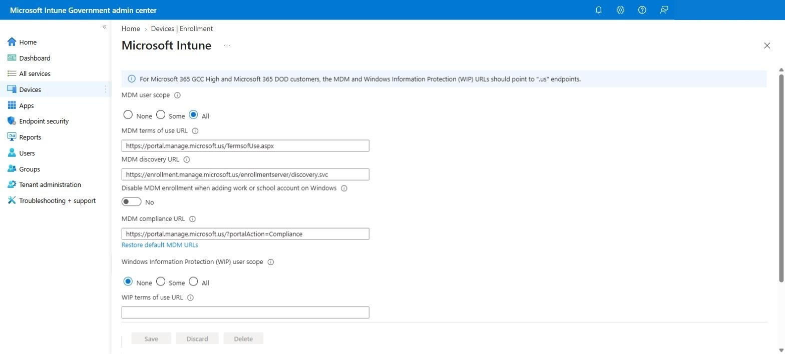
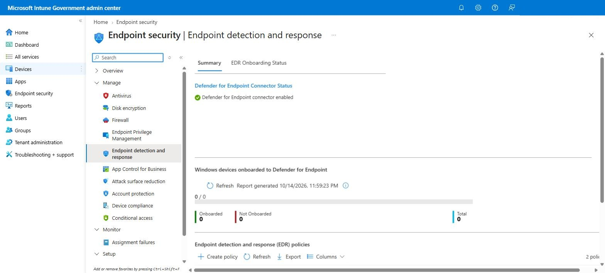

Conditional Access: the script lists enabled policies that target all cloud apps without excluding *Microsoft Intune
Enrollment*. Policies that only target guests / external users (such as the Microsoft-managed *… for Microsoft partners and
vendors* policies) are reported as not affecting the lab user and need no change.

Use `-Cloud Global` for a commercial tenant (it writes the `.com` URLs instead). To set the URLs by
hand: Intune admin center (`intune.microsoft.us`) → Devices → Enrollment → Windows → *Automatic
Enrollment*.

**The one Defender toggle.** The connector can only be switched on from the Defender side: Microsoft
Defender portal (`security.microsoft.us`) → Settings → Endpoints → **Advanced features** →
**Microsoft Intune connection = On** → Save. Do it before or after the script; the EDR policy starts
onboarding as soon as both sides are on.

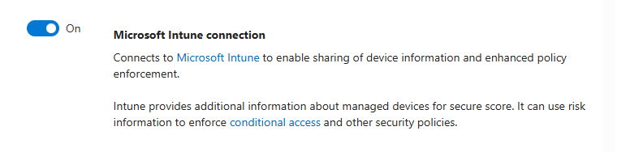

#### 5.2.3 Entra Connect on `lab-ms01` (the one wizard)

1. `lab-ms01` → **Connect → Bastion** → authentication type *VM password*; username
   `labadmin@corp.contoso.lab` (the AD admin from the Identity tab, in UPN form — the Bastion portal rejects
   `CORP\labadmin` with *Username in domain\username format is not supported*, and the session then ends with
   *Log in failed*) and its password. Plain `labadmin` (the server's local administrator, same password) also works
   and is enough to run the wizard — the wizard asks for the domain credentials separately.
2. In Edge on `lab-ms01` open the Azure portal → **Microsoft Entra ID → Microsoft Entra Connect → Get started → Manage →
   Download Connect Sync Agent**, and run it (version 2.5.79.0 or later — older builds were retired on 30 September
   2026; notes in `C:\LabTools\README-EntraConnect.txt`). In the wizard choose **Customize** (not Express) → install
   the required components.
3. Sign-in method **Password Hash Synchronization**.
4. Connect to Entra ID with a Hybrid Identity Administrator / Global Administrator (MFA prompt).
5. Add the forest `corp.contoso.lab` with `CORP\labadmin` and let the wizard create the AD DS
   Connector account.
6. **Domain/OU filtering**: the lab root OU only (it contains the lab user and the `Workstations` OU
   with `lab-cl01`–`lab-cl03`).
7. **Device options**: nothing required — the deployment already wrote the hybrid-join SCP. (Running
   *Configure Hybrid Microsoft Entra join* again is harmless.)
8. Finish with **Start the synchronization process when configuration completes**.

After the first sync, re-run `./Prepare-Tenant.ps1 -Cloud USGov -SkipMdm -LabUserUpn
lab.user@contoso.onmicrosoft.us` to license the synced user (it ends with *License EMSPREMIUM_… assigned* and
`PREPARE-TENANT-STATUS: Success`; the Conditional Access warnings for the Microsoft-managed partner/vendor policies can be ignored):

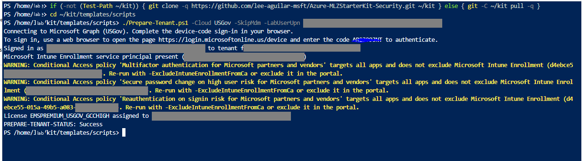

#### 5.2.4 Hybrid join, Intune enrollment and MDE onboarding

**What happens on its own.** Every client has a `LAB-HybridJoin-Retry` task (runs `dsregcmd /join` as SYSTEM every
30 minutes for 7 days) and Entra Connect runs a delta sync every 30 minutes, so within about an hour of the first sync
each client becomes *Microsoft Entra hybrid joined*. Once the lab user has signed in to a client, the Intune
auto-enrollment task (every 5 minutes, plus the kit's hourly `LAB-IntuneAutoEnroll-Retry`) enrolls it, and the EDR
policy then onboards it to Defender for Endpoint.

**What you must do once** (otherwise enrollment fails with `0xCAA9001F`, troubleshooting #45):

1. The lab user's UPN must use a **verified tenant domain** — set the *UPN suffix* Lab Option to it (for example
   `contoso.onmicrosoft.us`) before deploying, or add the suffix in AD and change the user's UPN afterwards.
2. The lab user registers **MFA** once: sign in at `myaccount.microsoft.us` (or `aka.ms/mfasetup`) and add the
   Authenticator app.
3. Sign in once to each client as the lab user (Bastion → *VM password* → `lab.user@contoso.onmicrosoft.us`) so the
   user gets a Primary Refresh Token.

**To speed up the hybrid join** (instead of waiting for the 30-minute retries), per client:

1. `lab-ms01` (signed in as the AD admin): `Start-ADSyncSyncCycle -PolicyType Delta`
2. Azure portal → the client VM → **Run command** → *RunPowerShellScript* → `dsregcmd /join` (Run command runs as
   SYSTEM, which `dsregcmd /join` needs, and needs no network path to the client).
3. Wait 2–3 minutes, run the delta sync again, then run `dsregcmd /join` once more.

A lab deployed from the current kit also has `C:\LabTools\Invoke-HybridJoinCycle.ps1` on `lab-ms01`, which does the
same for several clients over WinRM. It only works when you are signed in to `lab-ms01` as the **domain** admin
(`labadmin@corp.contoso.lab`, not the local `labadmin`) and the clients were deployed with WinRM enabled (labs built
before this fix have neither the script nor WinRM — use Run command):

```powershell
C:\LabTools\Invoke-HybridJoinCycle.ps1 -ClientNames lab-cl01,lab-cl02,lab-cl03
```

It reports `AzureAdJoined` / `DomainJoined` per client; check `AzureAdPrt` on the client itself (it is per signed-in
user, so a remote session always shows *NO*). If a client is joined but not enrolled after about 30 minutes, use the
manual enrollment below.

| Check | Where | Expected |
|---|---|---|
| Hybrid join | `dsregcmd /status` on the client | `AzureAdJoined : YES`, `DomainJoined : YES`, `AzureAdPrt : YES` |
| Entra device | Entra admin center → Devices → All devices | `lab-cl01`–`03`, join type *Microsoft Entra hybrid joined* |
| Intune | Intune admin center → Devices → Windows | `lab-cl01`–`03`, managed by Intune, compliance evaluated |
| MDE | Defender portal → Assets → Devices | `lab-cl01`–`03` *Onboarded* (plus the servers, via Defender for Servers) |

Result on `lab-cl01` in this run (`dsregcmd /status`, IDs replaced):

```text
+----------------------------------------------------------------------+
| Device State                                                         |
+----------------------------------------------------------------------+
             AzureAdJoined : YES
              DomainJoined : YES
                DomainName : CORP
               Device Name : lab-cl01.corp.contoso.lab
              TpmProtected : YES
          DeviceAuthStatus : SUCCESS
+----------------------------------------------------------------------+
| Tenant Details                                                       |
+----------------------------------------------------------------------+
                  TenantId : 00000000-0000-0000-0000-000000000000
                    MdmUrl : https://enrollment.manage.microsoft.us/enrollmentserver/discovery.svc
                 MdmTouUrl : https://portal.manage.microsoft.us/TermsofUse.aspx
          MdmComplianceUrl : https://portal.manage.microsoft.us/?portalAction=Compliance
                JoinSrvUrl : https://enterpriseregistration.microsoftonline.us/EnrollmentServer/device/
+----------------------------------------------------------------------+
| SSO State                                                            |
+----------------------------------------------------------------------+
                AzureAdPrt : YES
       AzureAdPrtAuthority : https://login.microsoftonline.us/00000000-0000-0000-0000-000000000000
                  CloudTgt : YES
```

The `MdmUrl` / `MdmTouUrl` / `MdmComplianceUrl` lines confirm the client picked up the `.us` MDM URLs that
`Prepare-Tenant.ps1` wrote; with `AzureAdPrt : YES` the Intune auto-enrollment can now run.

Enrollment errors `0x8018002b` / `0x80180026` in the *DeviceManagement-Enterprise-Diagnostics-Provider*
log almost always mean the MDM URLs are still the `.com` defaults.

**If automatic enrollment does not happen** (troubleshooting #44/#45), enroll the client by hand — it takes a minute.
Signed in as the lab user: **Win+R** →

```text
ms-device-enrollment:?mode=mdm&username=lab.user@contoso.onmicrosoft.us
```

→ sign in (MFA). *Settings → Accounts → Access work or school* then shows the MDM connection; **Info → Sync** pushes
the first check-in:

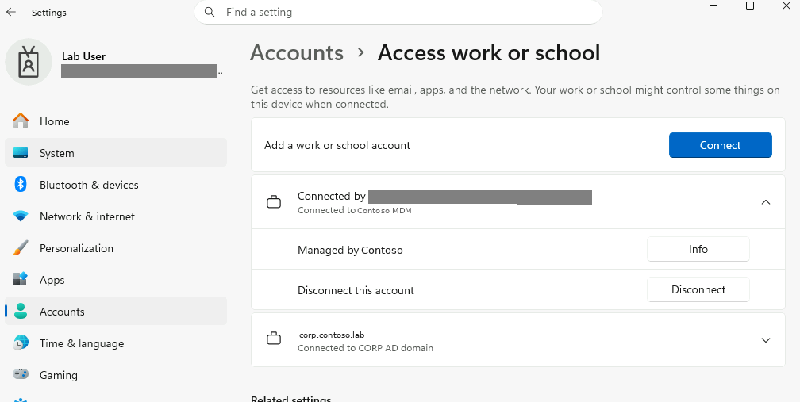
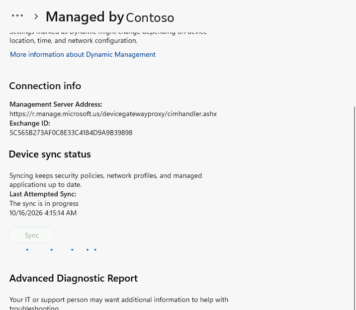

About 15 minutes later the client is listed (and evaluated compliant) in Intune, and the EDR policy has onboarded it
to Defender for Endpoint alongside the servers:

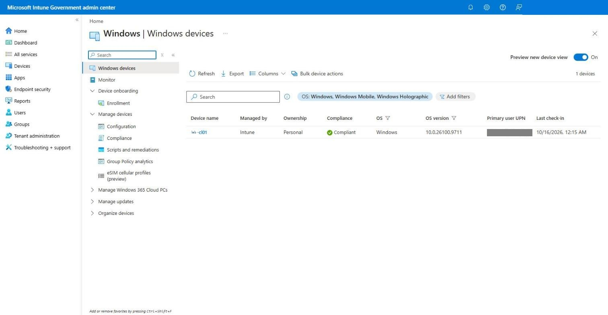
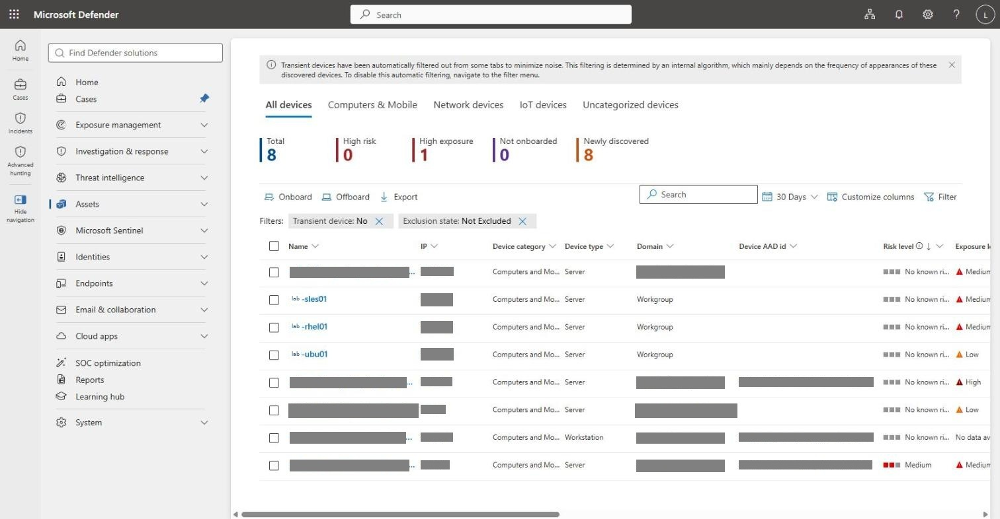

A manually enrolled device shows *Ownership: Personal*; change it to *Corporate* on the device's Properties page if
your compliance policies depend on it.

#### 5.2.5 Signing in through Bastion — which credentials work where

| VM | Bastion authentication type | Credentials |
|---|---|---|
| Linux (`lab-rhel01`, `lab-ubu01`, `lab-sles01`) | **Microsoft Entra ID** (SSH) | your Entra account — member of the step 3.1 group (Virtual Machine Administrator Login) |
| Windows (DC, member servers, clients) | **VM password** (RDP) | `labadmin@corp.contoso.lab`, or a domain user such as `lab.user@corp.contoso.lab` — **UPN form**; Bastion does not accept `CORP\user` |
| Windows client, after hybrid join | **VM password** (RDP) | `lab.user@contoso.onmicrosoft.us` — the synced user's UPN and password (same in AD and Entra through password hash sync); Windows then obtains the user's Entra PRT |

Bastion's *Microsoft Entra ID* option for **Windows RDP** only works for VMs that are *Entra-joined*
through the `AADLoginForWindows` extension. That extension Entra-joins the VM, which conflicts with
the AD domain join and hybrid join this lab is built on, so the kit does not install it on Windows
(troubleshooting #27). Linux Entra SSH is unaffected.

### 5.3 Data hydration — automatic, nothing to run

"Hydration" is the kit's background activity generator: ordinary, benign admin and user behaviour that keeps
the Sentinel workspace and Defender for Endpoint supplied with fresh telemetry, so hunting queries, analytics
rules and UEBA have something to work on in an otherwise idle lab. It is **not** an attack simulation.

It is on by default (template parameters `deployHydration = true`, `hydrationIntervalMinutes = 60`; the portal
form does not show them) and is installed during the deployment itself — there is no step for you:

| Where | Installed by | First run | Then | What it does |
|---|---|---|---|---|
| `lab-dc01` | forest baseline (deployment step *forest baseline*) | ~5 min after the baseline | every 60 min | user activity below + directory activity: reads all users/computers, creates the user `lab.churn` in *LAB → Users*, flips its membership in `LAB-SOC-Analysts` (events 4728/4729), and two failed sign-ins for it (4625/4771) |
| member servers and clients | member configuration (deployment step *configure members*) | ~15 min after configuration | every 60 min | creates and deletes temp files, lists processes/services, runs `whoami /all`, `ipconfig /all`, `nltest /dsgetdc`, one HTTPS request to microsoft.com |
| `lab-rhel01`, `lab-ubu01`, `lab-sles01` | Linux configuration | right away, and 5 min after every boot | every 60 min | file/process/network listings, `sudo -n true`, one HTTPS request, every second hour one SSH password attempt for a non-existent user against the VM's own sshd (auth failure in Syslog), tagged `lab-hydrate` in Syslog |

Everything is logged on the VM: `C:\LabTools\hydration.log` (Windows) and `journalctl -t lab-hydrate` (Linux).
To pause it, disable the `LAB-Hydration` task (Windows) or `systemctl disable --now lab-hydrate.timer` (Linux).
Section 6.5 shows how to confirm it is reaching the workspace; section 6.6 how to make the lab raise real
alerts and incidents on demand (hydration itself is meant to stay below detection thresholds).

**Hydration only runs while the VMs are on.** The kit gives every lab VM a DevTest auto-shutdown at
03:00 UTC (23:00 Eastern) and nothing starts them again, so after the first night the workspace goes quiet
until someone starts the lab. Start it with
`az vm start --ids $(az vm list -g <tier3-rg> --query "[].id" -o tsv)` (the domain controller first, if you
start them one by one); the next hourly run picks up from there.

---

## 6. Verify

### 6.1 Resource group inventory

`lab-dev-va-seclab-rg-network` holds 59 resources: the 9 VMs with NICs and disks, the workspace,
DCE/DCRs, the Arc Private Link Scope with its private endpoint and three `privatelink.*.azure.us` DNS
zones, the CSPM samples (Key Vault, App Service plan + app, container registry) and the content-script
managed identity.

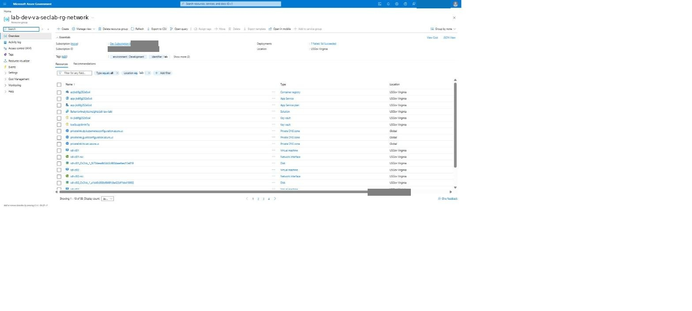

### 6.2 Microsoft Sentinel

**Data connectors** — 9 connected immediately (more once the Entra ID / Azure Activity logs arrive): Windows Security Events via AMA,
Syslog via AMA, Microsoft Defender XDR (which also lights up Defender for Endpoint / Identity / Cloud
Apps / Office 365 / Entra ID Protection / Insider Risk), plus the Entra ID and Azure Activity connectors
once their first logs arrive (10–30 minutes after step 5).

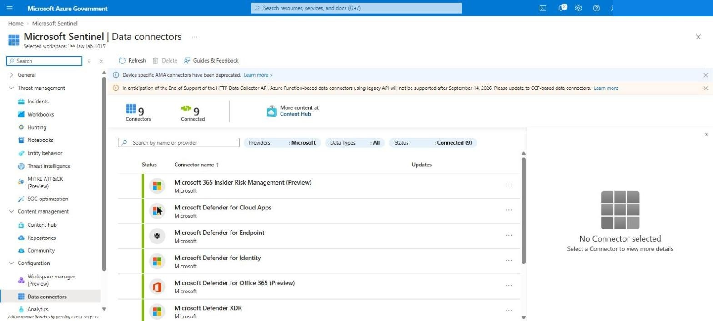

**Analytics** — 264 active rules (76 High, 158 Medium, 30 Low) created from the built-in templates.

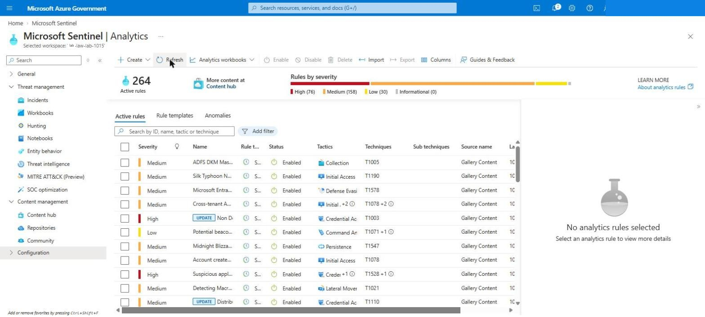

**Content hub** — 6 solutions *Installed* (Azure Activity, Microsoft Defender XDR, Microsoft Entra ID,
Windows Security Events, Syslog, UEBA Essentials).

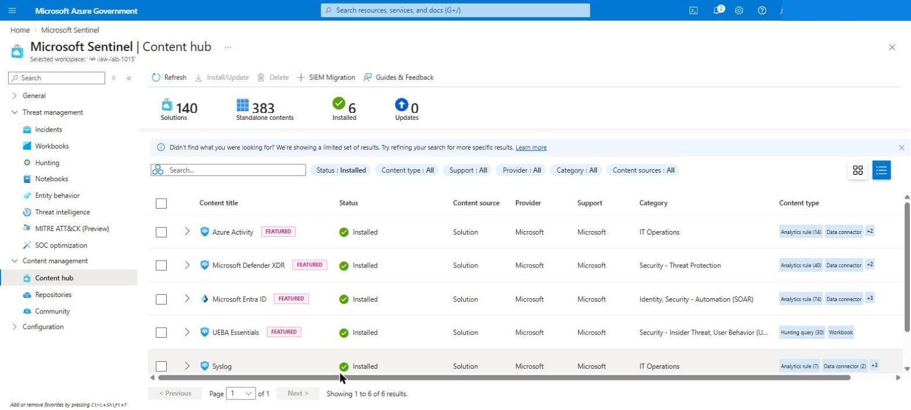

**Entity behavior** — *Entity behavior settings* shows UEBA **On** with Security Events selected; Audit
Logs, Azure Activity and Signin Logs become selectable as soon as those tables receive data.

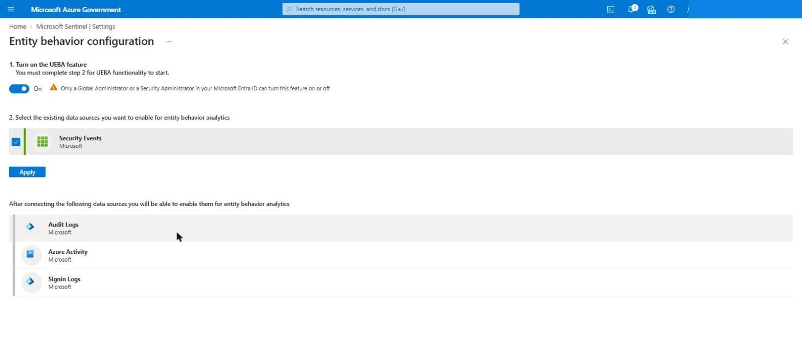

### 6.3 Bastion sign-in

Linux: open `lab-ubu01` → **Connect → Bastion** → *Microsoft Entra ID* → Connect; members of the
step 3.1 group get an administrator SSH session with their Entra account. Windows: *VM password* with
`labadmin@corp.contoso.lab` (see 5.2.5 for why Entra RDP does not apply to domain-joined VMs).

### 6.4 Defender for Cloud plans

Microsoft Defender for Cloud → Environment settings → the subscription → **Defender plans**. Expected:
Defender CSPM, Servers (Plan 2), Databases, Storage, Containers, Key Vault and Resource Manager **On**;
App Service and APIs **Off** (not offered in Azure Government).

On this run Defender for Servers read back as *Off* even though the deployment operation had succeeded
(troubleshooting #23) — `Post-Deploy.ps1` now re-asserts it, and you can always set it by hand:

```powershell
az security pricing create -n VirtualMachines --tier Standard --subplan P2
az security pricing list --query "value[?pricingTier=='Standard'].{plan:name,subPlan:subPlan}" -o table
```

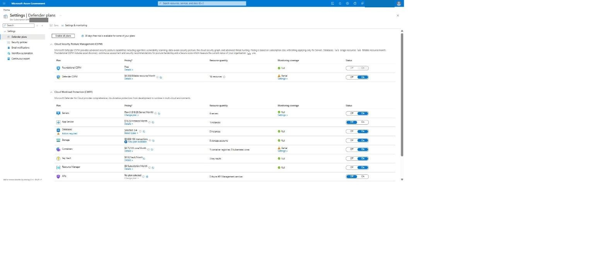

### 6.5 Data hydration reaching the workspace

About an hour after the deployment, run this in the Sentinel workspace (Logs):

```kusto
union
  (SecurityEvent | where EventID in (4728, 4729) and MemberName has "churn"
     | summarize Events = count(), Last = max(TimeGenerated) by Signal = "AD group churn (4728/4729)", Computer),
  (SecurityEvent | where EventID in (4625, 4771) and TargetUserName has "churn"
     | summarize Events = count(), Last = max(TimeGenerated) by Signal = "failed sign-in lab.churn", Computer),
  (SecurityEvent | where EventID == 4688 and CommandLine has "nltest" and CommandLine has "dsgetdc"
     | summarize Events = count(), Last = max(TimeGenerated) by Signal = "Windows user activity (nltest)", Computer),
  (Syslog | where ProcessName == "lab-hydrate" or SyslogMessage has "lab-hydrate"
     | summarize Events = count(), Last = max(TimeGenerated) by Signal = "Linux lab-hydrate", Computer)
| order by Signal asc, Computer asc
```

Expect one row per signal and computer, with *Last* within the past hour: *AD group churn* and *failed
sign-in* on the domain controller, *Windows user activity* on every Windows VM, *Linux lab-hydrate* on the three
Linux servers.

In this run (lab built before the fixes in troubleshooting #46 and #47) only the first and third signals
appeared — the group churn on the DC (22 events in 24 h, one per hour) and the user activity on all six
Windows VMs:

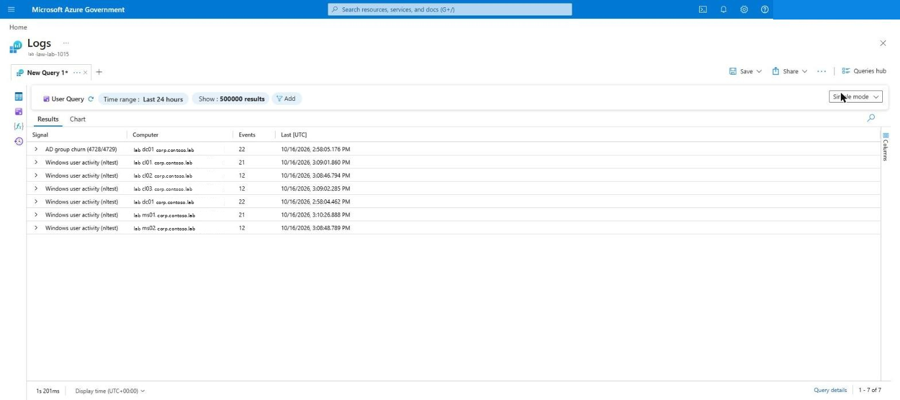

### 6.6 Detection test — prove alerts and incidents fire

Hydration (5.3) is background activity for hunting and is deliberately quiet: in normal operation it raises
almost nothing. On the Commercial test lab the only incident traced to it was a one-off *AD user enabled and password
not set within 48 hours*, raised when the domain controller's first hydration run created `lab.churn`. To
prove the detection chain (VM → agent → workspace → analytics rule or Defender → incident), run the
detection test from the same PowerShell Cloud Shell as step 5, with the VMs running:

```powershell
cd ~/kit/templates/scripts
./Test-LabDetections.ps1 -SubscriptionId <subscription-id> -ResourceGroupName lab-dev-va-seclab-rg-network `
  -WorkspaceName <workspace-name> -Cloud USGov
```

It runs ten safe, documented test actions through Run command and then lists, per test, the alert and
incident each one raised. On the domain controller the AD changes are made by a temporary admin
(`lab.detop`), because several rules ignore changes made by SYSTEM, which is what Run command runs as.
That account and the disposable test user both get random passwords that never leave the DC, and both
are deleted at the end.

| Test | Action | Expected Sentinel alert | Rule runs |
|---|---|---|---|
| AD-1 | `lab.dettest` added to *Backup Operators*, removed 20 s later | User account added to built in domain local or global group; Account added and removed from privileged groups | daily |
| AD-2 | `lab.dettest` disabled and re-enabled | User account enabled and disabled within 10 mins | daily |
| AD-3 | *Password never expires* set | AD account with Don't Expire Password | daily |
| AD-4 | 6 bad passwords, then the right one | SecurityEvent - Multiple authentication failures followed by a success | every 2 h |
| AD-5 | 25 bad passwords inside a minute | Failed logon attempts by valid accounts within 10 mins | every 10 min |
| AD-6 | `lab.dettest` deleted minutes after creation | User account created and deleted within 10 mins; AD user enabled and password not set within 48 hours | daily |
| LNX-1 | 20 SSH password attempts for a non-existent user, `lab-ubu01` → `lab-rhel01` | SSH - Potential Brute Force; Failed logon attempts in authpriv | daily |
| MDE-1 | Microsoft's documented Defender for Endpoint detection test on `lab-cl02` | Defender alert → incident | minutes |
| MDE-2 | EICAR antivirus test file on `lab-cl03` | *'EICAR_Test_File' malware was prevented* → incident | minutes |
| MDE-3 | EICAR file + on-demand scan on `lab-ubu01` | Defender alert for EICAR | minutes |

The script waits up to 25 minutes for the fast detections and prints the table every 5 minutes. A rule
marked *daily* runs once every 24 hours from when it was created (the moment Post-Deploy enabled it), so
re-run the same command with `-VerifyOnly` the next day; it remembers when the test ran. `-Only AD`,
`-Only LNX` or `-Only MDE` repeats one group. Every alert also shows up as an incident in the Defender portal
(`security.microsoft.us` → *Incidents & alerts*) and in Microsoft Sentinel → *Incidents*.

The test was written and validated on the Commercial lab (see the Commercial guide, section 6.6, for that
run's results). It uses only Run command, Az PowerShell and Log Analytics queries, all available in Azure
Government; in GCC High the Defender alerts appear in `security.microsoft.us`.

---

## 7. Teardown

`destroy.ps1` discovers every resource group by the naming prefix and deletes them in parallel. It also:
force-deletes the Log Analytics workspaces and purges them from soft-delete (otherwise the next deploy
recovers the old workspace), purges the Key Vaults, removes the policy assignments, resets the Defender
plans, and deletes the NSG flow logs the MLZ hub left in **NetworkWatcherRG** (they are not in any
lab resource group and would otherwise linger).

```powershell
Invoke-WebRequest -Uri "https://raw.githubusercontent.com/lee-aguilar-msft/Azure-MLZStarterKit-Security/main/destroy.ps1" -OutFile destroy.ps1
./destroy.ps1 -SubscriptionId <subscription-id> -Identifier lab -EnvironmentAbbreviation dev `
  -Location usgovvirginia -RemoveDefenderPlans -RemovePolicyAssignments -Force
```

Expect 20–40 minutes (the Azure Firewall and Bastion are the slow deletes). Check afterwards that
**Resource groups** shows none with the `lab-dev-va-` prefix and that NetworkWatcherRG holds only the
`NetworkWatcher_usgovvirginia` resource. Run it from a Cloud Shell session you keep active — if the
shell drops mid-run, simply run it again; it is safe to repeat.

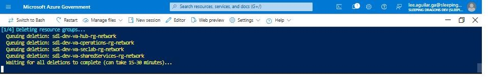
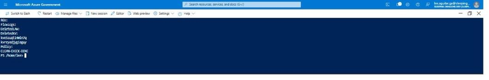

The tenant-level Entra ID diagnostic setting (`sentinel-lab`) is not removed by `destroy.ps1`: delete it
under Microsoft Entra ID → Diagnostic settings if you are not redeploying.

---

## 8. Troubleshooting — every error hit while writing this guide

All fixes below are on `main`; they are listed so you recognise them if you fork the kit.

| # | Where | Error | Cause | Fix (in the kit) |
|---|---|---|---|---|
| 1 | Review + create | `'lab-dev-va-seclab-rg-network' is not valid subscription identifier` | `resourceId(rg, type, name)` in a subscription-scope template is parsed as `(subscriptionId, type, name)` | Nested RG deployments are referenced by name in `dependsOn`; no cross-RG `resourceId()` |
| 2 | Review + create | `deploy-ad-entra-vms-… is not defined in the template` | `reference()` to a sibling nested deployment is not resolvable at validation time | `security-lab.json` derives VM names from the `prefix` parameter |
| 3 | Deployment | `Enabling Defender for APIs requires selection of a pricing plan … SubPlan … P1–P5` | `Microsoft.Security/pricings` `Api` needs `subPlan` | Parameter `defenderForApisSubPlan` (default `P1`); plan hidden in Gov |
| 4 | Deployment | `The 'Dns' plan is deprecated and can no longer be enabled` | Defender for DNS retired | Plan, parameter and checkbox removed |
| 5 | Deployment | `policy set definition '…f9a961fa-…' could not be found` | Standalone DoD IL5 initiative retired | Replaced by **Microsoft cloud security benchmark** (`deployMcsb`) |
| 6 | VM module | `MDE.Windows` extension: *You cannot call a method on a null-valued expression* | Template-declared MDE extensions need an onboarding blob Defender for Servers supplies itself | MDE extensions removed; Defender for Servers auto-provisions |
| 7 | VM module | `lab-dc01-nic` static IP `10.60.0.10` already allocated to `lab-pe-arc-nic` | Parallel NIC creation: the Arc private-endpoint NIC grabbed the DC's address first | NICs created serially; Arc module runs after the VM module |
| 8 | VM module | `AADSSHLoginForLinux` failed on RHEL | Azure RHUI (`rhui4-1.microsoft.com`) blocked by the firewall — package install could not resolve dependencies | RHUI FQDNs added to the Linux-repos rule; `prep-linux.sh` run-command refreshes repos first |
| 9 | VM module | `AADSSHLoginForLinux` failed on Ubuntu (apt lock) | cloud-init / unattended-upgrades still held the apt lock | `prep-linux.sh` waits for cloud-init and package locks |
| 10 | CSPM module | API Management operation: *One or more fields contain incorrect values* | Sample API id `echo-api` collided with APIM's built-in Echo API | Renamed `lab-echo-api` |
| 11 | CSPM module | `Location 'USGov Virginia' is not accepting creation of new Windows Azure SQL Database servers` | Subscription offer not enabled for Azure SQL in the region | `deployCspmSql` toggle (off here); open a support request to enable the offer if you want the sample |
| 12 | security-lab validation | DCR association name must be a single segment | Extension resource named with three segments | `name: '<dcr>-assoc'` with `scope` |
| 13 | security-lab module | `Rule Id …/lab-dcr-linux-syslog does not exist … InvalidAssociation` | Linux DCR condition tested a parameter that was empty while the associations used the derived VM names | Condition uses `variables('lnxNames')`; module redeployed standalone |
| 14 | Post-Deploy.ps1 | `A positional parameter cannot be found that accepts argument '-EnableXdrConnector'` | Array splat passed the switch positionally | Hashtable splat |
| 15 | Enable-SentinelContent | `InvalidAuthenticationToken: The access token is invalid` | Az.Accounts 4+ returns `Get-AzAccessToken` as a SecureString | Token unwrapped via `NetworkCredential` |
| 16 | Enable-SentinelContent | `Solution '…' not found in catalog` | Content Hub ids are publisher-prefixed (`azuresentinel.azure-sentinel-solution-…`) | Suffix match |
| 17 | Enable-SentinelContent | `The property 'requiredDataConnectors' cannot be found` | StrictMode + templates without that property | Guarded filter |
| 18 | Enable-SentinelContent | `PUT contentPackages … 400 (Bad Request)`, then `contentId … is already associated with another package` | Registering a package by PUT only flips its status; the real install is the solution's packaged ARM template, which then conflicts with the stale record | Solutions installed by deploying `packagedContent`; stale records removed first |
| 19 | Enable-SentinelContent | `The property 'name' cannot be found on this object` | Template id lives on the resource, not under `properties` | `alertRuleTemplateName = $t.name` |
| 20 | Enable-SentinelContent | Duplicate analytics rules after re-running | Rule ids were new GUIDs every run | Existing rules indexed by template; duplicates deleted; re-runs skip |
| 21 | Enable-SentinelContent | UEBA: `Update request should provide ETag` | Settings already existed | Current ETag read and sent |
| 22 | Enable-SentinelContent | `Connector kind 'MicrosoftThreatProtection' is not supported in api-version` | Defender XDR connector is preview-only in the data connectors API | `2024-01-01-preview` for connector calls; existing connector detected and skipped |
| 23 | Verify | Defender for Servers showed *Off* / `Free` although the `VirtualMachines` pricing operation succeeded | Unexplained revert after the subscription-scope deployment | `Post-Deploy.ps1` re-asserts Standard/P2 and prints the plans |
| 24 | Cloud Shell | *Cloud Shell disconnected* / *connection could not be established* mid-script | Idle timeout; ephemeral session loses the clone | **Restart**, re-clone, re-run — every script is idempotent |
| 25 | Teardown | NetworkWatcherRG keeps `lab-dev-va-*-nw-fl-vnet` flow logs; next deploy fails on the soft-deleted workspace | MLZ flow logs live outside the lab RGs; Log Analytics soft-delete | `destroy.ps1` deletes flow logs by id and purges the workspaces |
| 26 | Intune | Clients hybrid-joined but never enrolled; `deviceenroller` errors `0x8018002b` / `0x80180026` | GCC High tenant still had the commercial `.com` MDM URLs | Set the `.us` MDM terms-of-use / discovery / compliance URLs and the MDM user scope (5.2.2) |
| 27 | Forest build | Deployment *Succeeded* but the member servers and clients were still in `WORKGROUP`; `join-domain` output: *The system cannot find the file specified* | The forest baseline (OUs) ran while DC promotion was still in progress and was killed by the promotion reboot; the joins then targeted OUs that did not exist. `treatFailureAsDeploymentFailure: false` hid both failures | Joins wait for LDAP + DNS SRV on the DC (up to 50 min) and join the default container; the baseline runs after all joins and moves computers into their OUs; a final `verify-forest` run-command fails the deployment if any OU, GPO, computer placement or the SCP is missing |
| 28 | Design review | Bastion *Microsoft Entra ID* RDP to Windows needs `AADLoginForWindows`, which Entra-**joins** the VM | An Entra-joined VM cannot also be AD-joined / hybrid-joined, which this lab depends on | Extension removed from the Windows VMs (kept for Linux SSH); Windows sign-in through Bastion uses AD credentials (5.2.5) |
| 29 | Template validation | Image reference for the default client SKU `win11-23h2-pro` not found in USGov Virginia | Windows 11 23H2 images are not published in Azure Government | Default client image `win11-24h2-pro`; 23H2 removed from the form |
| 30 | Teardown | Key Vault purge: `MethodNotAllowed` | Purge protection is on (MLZ hub vault) — purge is not allowed | Expected; the vault expires after the 7-day retention. Names are unique per deployment, so redeploys are not blocked |
| 31 | Forest build (run 4) | `configure-forest-baseline`: `Get-ADOrganizationalUnit : The object name has bad syntax` — the deployment now **fails** here instead of reporting success | In PowerShell everything a function writes with `Write-Output` becomes part of its return value: `Ensure-OU` returned `@('Created OU …', 'OU=…')`, so the next OU's search base was an array | Helper functions log with `Write-Host`; the script was re-tested end-to-end against mocked AD cmdlets before redeploying |
| 32 | VM module (run 4) | `lab-ubu01/AADSSHLoginForLinux`: `Could not get lock /var/lib/apt/lists/lock. It is held by process … (apt-get)` | On first boot an Ubuntu `apt-get update` stalled for 30+ minutes; `prep-linux` waited on it without a limit, hit its 25-minute run-command timeout and left the lock held | `prep-linux.sh` time-boxes every step, kills stuck apt jobs and never exits with the lock held (log in `/var/log/lab-prep-linux.log`); Ubuntu apt-hook hosts (`*.ubuntu.com`, `contracts.canonical.com`) allowed on the firewall |
| 33 | Post-Deploy (run 4) | `Enable-SentinelContent.ps1`: `The property 'Count' cannot be found on this object` right after *Matched 298 templates* | A brand-new workspace holds exactly one rule (Advanced Multistage Attack Detection); PowerShell returns a one-item list as a scalar and `StrictMode` rejects `.Count` on it | List results are wrapped in `@()`; the script is idempotent, so just re-run `Post-Deploy.ps1` |
| 34 | Cloud Shell (Azure Government) | *Cloud Shell disconnected*, then `ConnectionFailure` / `ServiceUnavailable` when reconnecting | Service-side Cloud Shell instability; an idle tab also drops after a few minutes | Keep the tab in the foreground and active; if it will not reconnect, wait a few minutes or open Cloud Shell in a new tab. Avoid the toolbar **Restart** (it raises a browser confirmation) |
| 35 | Post-Deploy (run 4) | Every analytics rule rejected: `Log Analytics workspace '<old id>' could not be found` (the script now prints *Sentinel still maps this workspace name to an earlier, deleted workspace*) | An earlier teardown deleted a Sentinel workspace without offboarding Sentinel first. Sentinel keeps the old workspace ID for that name, so a new workspace with the **same name** inherits the stale mapping | Fixed in `destroy.ps1` (offboards Sentinel — `DELETE …/onboardingStates/default` — before deleting the workspace). The portal form now defaults to a date-stamped workspace name (`law-<short>-MMdd`); do not re-use a deleted workspace's name. Portal teardown: **Sentinel → Settings → Settings → Remove Microsoft Sentinel** before deleting the workspace |
| 36 | Security-lab redeploy (run 4) | `lab-dcr-windows-security`: `Table for output stream 'Microsoft-SecurityEvent' is not available for destination 'law'` (`InvalidOutputTable`) | The `SecurityEvent` table is created by the Sentinel solution a minute or two **after** the workspace is onboarded; the Windows DCR was written before it existed | Redeploy the same deployment (Deployments → select → **Redeploy**, same parameters) — the second run finds the table and completes. Moving Sentinel to a new workspace without touching the VMs: redeploy only `deploy-security-lab-<suffix>` with a new **Workspace Name**; the DCRs keep their names and are re-pointed, then re-run Post-Deploy against the new name |
| 37 | Prepare-Tenant (run 4) | `PATCH …/mobileDeviceManagementPolicies/0000000a-…` → 400 `Simultaneous patch requests on both URL properties and Policy properties (AppliesTo …) are currently not supported` | Graph does not accept the MDM scope (`appliesTo`) and the MDM URLs in one request | Fixed: the script sends the scope and the URLs as two separate PATCHes, each only when the value differs. Re-run `./Prepare-Tenant.ps1 -Cloud USGov -ConfigureMde` (after `git pull` in `~/kit`) |
| 38 | Bastion → Windows (run 4) | *Username in domain\username format is not supported* under the username, then *Connection Error — Log in failed, Please reconnect and try again* | The Azure portal's Bastion form only accepts domain accounts in UPN form | Use `labadmin@corp.<domain>` (or `lab.user@corp.<domain>`) instead of `CORP\labadmin`. Inside Windows and in the Entra Connect wizard `CORP\labadmin` still works |
| 39 | Entra Connect wizard (run 4) | *Cannot change configuration — Synchronization is currently in progress*; `Get-ADSyncScheduler` fails with `0x80230613 … management agent could not be found`, `Azure AD Sync 2.4.129.0`, no connectors | The public `AzureADConnect.msi` link still serves 2.4.x, retired by Microsoft on 30 Sep 2026 (minimum 2.5.79.0); the engine was installed but never configured | Download **Connect Sync Agent** from the Entra admin center (Entra Connect → Get started → Manage) on `lab-ms01` and run it (upgrade in place, or uninstall the 2.4 build first). The kit no longer pre-installs the old build |
| 40 | Entra Connect download on `lab-ms01` (run 4) | `portal.azure.us` never finishes loading inside the lab VM; the firewall log shows `aadcdn.msftauth.net` / `aadcdn.msauth.net` **denied** from the server | The Azure service tags (and the AzureCloud catch-all) cover Azure IP ranges only; the Microsoft sign-in page loads from CDN host names that no service tag contains, so they need FQDN application rules | Fixed: new application rule *Allow-Admin-Portal-EntraConnect* (Microsoft's Azure Government portal list + sign-in CDN + Entra Connect Sync endpoints). Existing labs: deploy `templates/firewall-lab-rules.json` to the hub resource group (parameter: the hub firewall policy name, e.g. `lab-dev-va-hub-afwp`) — it re-applies the whole *LAB-SecurityCollectionGroup* in about 3 minutes |
| 41 | Entra Connect first sync (run 4) | Only the two *Full Import* runs appear; `Start-ADSyncSyncCycle` fails with *A sync cycle has already being requested* and then *…unable to start a new sync cycle because Azure AD Connect wizard is open* | The wizard was still open (its *Configuration complete* page, or a leftover window); the scheduler will not run while any wizard instance is open | Click **Exit** on every Entra Connect wizard window (or `Get-Process AzureADConnect | Stop-Process -Force`), then `Start-ADSyncSyncCycle -PolicyType Initial`. Check with `Get-ADSyncRunProfileResult -NumberRequested 10`: Full Import, Full Synchronization and **Export** for both connectors should all read `success` |
| 42 | Hybrid join (run 4) | `C:\LabTools\Invoke-HybridJoinCycle.ps1` not found on `lab-ms01` | The script was never staged on the server, and Windows 11 clients have WinRM off, so its remote trigger could not work either | Fixed: the Entra Connect server now gets the script in `C:\LabTools`, the clients enable WinRM (domain profile), and the script starts the SYSTEM join tasks instead of running `dsregcmd /join` in the remote admin session. On an existing lab: `Start-ADSyncSyncCycle -PolicyType Delta` on `lab-ms01` → portal **Run command** on the client: `dsregcmd /join` → delta sync again → `dsregcmd /status` shows `AzureAdJoined : YES` (the clients' `LAB-HybridJoin-Retry` task also retries every 30 min) |
| 43 | Intune enrollment (run 4) | Client never enrolls; `dsregcmd /status` changes to `AzureAdPrt : NO`; `Microsoft-Windows-AAD/Operational` event 1098 `AADSTS50173: The provided grant has expired due to it being revoked … TokensValidFrom …` | The lab user signed in before Entra Connect's first **password hash** sync for that user had landed; the first cloud password write revokes the tokens issued before it, including the PRT that user-credential MDM auto-enrollment needs | Sign the lab user **out** of the client and back in (same password) to get a fresh PRT, then run `deviceenroller.exe /c /AutoEnrollMDM` in that user's session (or wait for the enrollment task). Avoid it next time: wait ~5 minutes after the user appears in Entra before the first client sign-in |
| 44 | Intune enrollment (run 4) | Hybrid joined, `AzureAdPrt : YES`, `AutoEnrollMDM = 1` on the client, but no *Schedule created by enrollment client…* task under `\Microsoft\Windows\EnterpriseMgmt` and no event 75/76 — enrollment is never attempted | The GPO was written with `Set-GPRegistryValue`, which registers only the Registry extension. The task is created by the **MDM Policy** client-side extension (`{7909AD9E-09EE-4247-BAB9-7029D5F0A278}`, `dmenrollengine.dll`), which the Group Policy editor registers for this ADMX setting | Fixed in `Configure-ForestBaseline.ps1` (adds `[{7909AD9E-…}{D02B1F72-…}]` to the GPO's `gPCMachineExtensionNames` and bumps the version). Existing lab: run the same on the DC (or toggle the setting Disabled → Enabled in GPMC), then `gpupdate /target:computer /force` on the client; the task enrolls within ~5 minutes |
| 45 | Intune enrollment (run 4) | The enrollment task runs every 5 minutes but `LastTaskResult` stays `3400073247` (`0xCAA9001F`, *Integrated Windows authentication supported only in federation flow*); the AAD log shows `AADSTS50079` (MFA registration required) | Two causes, in order: (1) the on-prem UPN (`lab.user@corp.<domain>`) did not match a verified cloud domain, so the synced user got a different cloud UPN than the one Windows presents; (2) user-credential auto-enrollment silently needs a token that satisfies MFA, and a PRT from a password-only sign-in does not carry the MFA claim | Set the **UPN suffix** Lab Option to the tenant's verified domain (e.g. `<tenant>.onmicrosoft.us`) so synced users match; have the lab user register MFA once. If auto-enrollment still fails, enroll manually as the lab user: **Win+R** → `ms-device-enrollment:?mode=mdm&username=<lab user UPN>` → sign in. *Settings → Accounts → Access work or school* then shows *Connected to &lt;tenant&gt; MDM* with an **Info** button. The device appears in Intune within ~15 minutes (Info → **Sync** speeds it up) |
| 46 | Data hydration (run 4) | The 6.5 query shows group churn and Windows activity but never *failed sign-in lab.churn* | `Invoke-LabHydration.ps1` tried the bad password through a WMI call with explicit credentials against the local machine; Windows rejects credentials on local WMI connections before any sign-in is attempted, so no 4625/4771 was ever logged | Fixed: the script now calls `PrincipalContext.ValidateCredentials` twice with a wrong password, which produces real failed sign-ins on the DC. Existing lab: copy the updated script over `C:\LabTools\Invoke-LabHydration.ps1` on the DC (the `LAB-Hydration` task picks it up at the next run) |
| 47 | Data hydration (run 4) | No *Linux lab-hydrate* rows; on the Linux VMs `/usr/local/bin/lab-hydrate.sh` and the `lab-hydrate` timer do not exist although `/var/log/lab-configure.log` ends with `CONFIGURE-STATUS: Success` | The template hands the hydration script to `configure-linux.sh` as a Run Command parameter (`arg2`); it never arrived as the positional `$2` the script read (the Linux Run Command handler passes named parameters as environment variables), so the script saw no hydration payload and skipped that part (the cloud suffix in `arg1` fell back to its `us` default, which hid the problem in Azure Government) | Fixed: `configure-linux.sh` accepts the parameters either way and logs what it received. Existing lab: re-run the `configure-linux` run command, or redeploy the VM module |
| 48 | MLZ core, Azure Commercial | *Subscription … is not registered for feature Microsoft.Network/AllowBringYourOwnPublicIpAddress required to carry out the requested operation* on a firewall or Bastion public IP | The MLZ public IPs are plain Standard IPs; the requirement comes from the subscription (Microsoft-internal subscriptions, or a policy that adds IP tags to public IPs) | Register the feature (section 2.3), wait for `Registered`, `az provider register -n Microsoft.Network`, then tear down and redeploy. If it stays `Pending`, the subscription needs approval through a support request (days) — use another subscription meanwhile |
| 49 | Deployment, Azure Commercial | Four of the eleven `Microsoft.Security/pricings` resources end in `Conflict` — *Another update operation is in progress. Please retry in a few minutes* | Commercial's Defender pricing API serialises plan changes per subscription; the template created all plans in parallel (Gov tolerated it) | `build/gen_solution.py` chains the plans with `dependsOn` so ARM creates them one at a time (a dependency on a toggled-off plan is still satisfied) |
| 50 | MLZ core, Azure Commercial | Azure Firewall Premium ends in provisioning state **Failed** with `InternalServerError: An error occurred.`; the rule collection group then fails with *Put on Firewall Policy … Failed with 1 faulted referenced firewalls* and the whole core deployment fails | Platform-side fault while the firewall was being built (nothing in the template; East US, Premium tier) | Tear down (`destroy.ps1`) and redeploy. Do not try to repair a firewall in `Failed` state in place — **Redeploy** on the failed deployment reuses the faulted instance |
| 51 | Compute tab / VM module, Azure Commercial | Every D-series size shows `NotAvailableForSubscription` in East US (or the deployment fails with `SkuNotAvailable`) although the quota is 100 vCPU per family | Region-level VM restrictions on the subscription (common on internal, trial and new subscriptions); the earlier hard-coded Commercial size list offered sizes regardless | Commercial size pickers replaced with `Microsoft.Compute.SizeSelector`, which lists only sizes the subscription can deploy in the selected region (D v5/v6/v7, 2-16 vCPU). Check regions with the SKU API (section 2.4) and deploy where the list is not empty — West US 2 on the test subscription |
| 52 | VM module, Azure Commercial | `lab-sles01` ends in `OSProvisioningTimedOut` (*OS provisioning … did not finish in the allotted time*), VM running, agent *Not Ready*, every other VM fine | The `SUSE:sles-15-sp5:gen2` **latest** image (version 2026.10.19, published after SLES 15 SP5 left general support) never completes provisioning — reproduced on D2as_v7, D2s_v5, with and without Trusted Launch; `sles-15-sp6` provisions in 2 min on the same size | Kit moved to `SUSE:sles-15-sp6:gen2` for the SLES server; all lab VMs now have managed boot diagnostics so the serial log is readable next time (a VM in a failed provisioning state cannot have diagnostics enabled afterwards) |

Finding blocked destinations — query the operations workspace (firewall diagnostics land in `AzureDiagnostics`):

```kusto
AzureDiagnostics
| where TimeGenerated > ago(3h) and Category in ("AzureFirewallApplicationRule", "AzureFirewallNetworkRule")
    and msg_s has "Deny" and msg_s !has "ICMP" and msg_s !has "SNI TLS"
| parse msg_s with Proto " request from " Src ":" SrcPort " to " Dst ":" DstPort "." *
| summarize Hits=count(), Last=max(TimeGenerated) by Src, Dst
| order by Last desc
```


Run 4 — #35, the rule save rejected because Sentinel still maps the workspace name to a deleted workspace, and #36, the Windows DCR written before the `SecurityEvent` table existed:


Screenshots of the defects as they appeared (runs 1 and 2):


---

## 9. Azure Commercial

The same kit deploys to Azure Commercial, but the portal, endpoints, region choice, VM sizes and several
pitfalls differ, so the Commercial walkthrough is a separate document: **`IMPLEMENTATION-COMMERCIAL.md`**
(Word: `MLZ-Security-Lab-Implementation-Guide-Commercial.docx`). Troubleshooting entries #48–#52 above
are the Commercial-only defects found while writing it.
