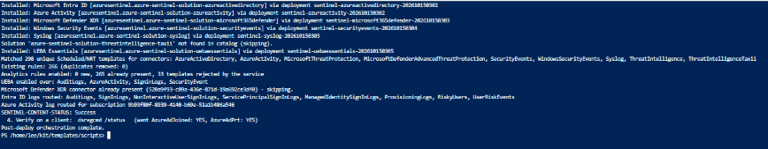
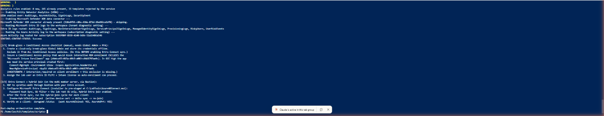
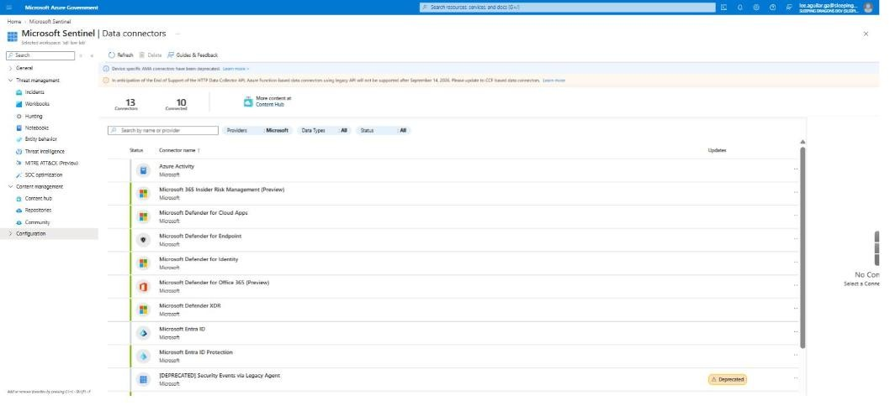
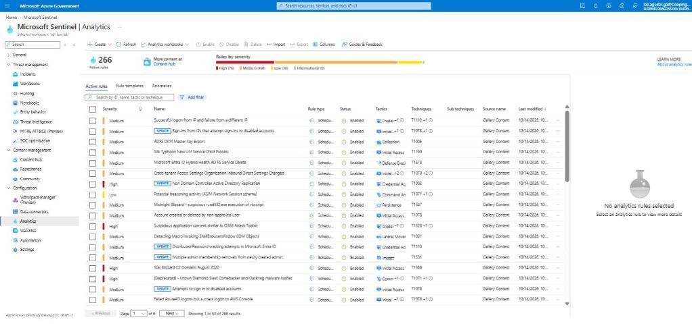
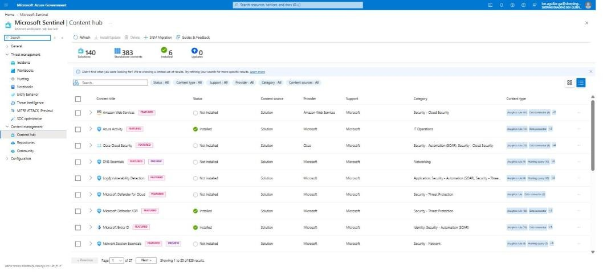
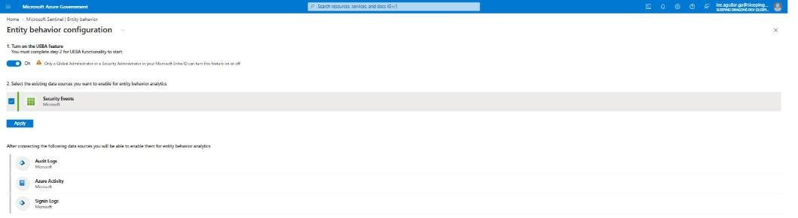
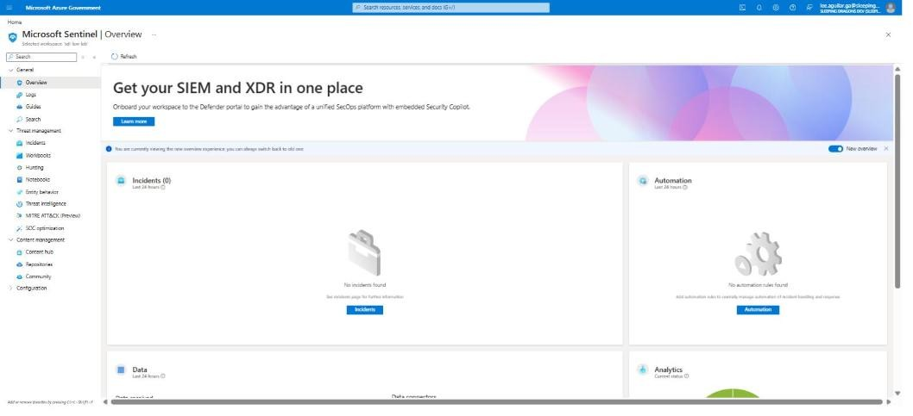

# MLZ Security Lab Starter Kit — Implementation Guide (Azure Government)

Step-by-step, from an empty Azure Government (GCC High) subscription to a running MLZ Security Lab with
Microsoft Sentinel connectors, analytics rules and UEBA enabled — using only the Azure portal, Cloud Shell
and the **Deploy to Azure Gov** button in the repository README.

Everything in this guide was performed for real in the `Dev Subscription BAMI SleepingDragons`
subscription (`usgovvirginia`, tenant `sleepingdragonsdev.onmicrosoft.us`) on 14–15 October 2026. The
screenshots are from those runs. Three deployment runs were needed to shake out the defects listed in
section 8; every fix is on `main`, so a fresh run of the kit follows the clean path described here.

Repository: <https://github.com/lee-aguilar-msft/Azure-MLZStarterKit-Security>

| Section | What you do | Time |
|---|---|---|
| 1. Before you start | Gather the inputs the form asks for | 10 min |
| 2. Subscription prerequisites | Register features and providers, confirm SKU and quota | 15 min (+ wait for EncryptionAtHost) |
| 3. Entra ID prerequisites | VM-login security group, break-glass account | 10 min |
| 4. Deploy from the portal | Blue button → 7 form tabs → Review + create | 15 min form, 60–90 min deploy |
| 5. Post-deploy | `Post-Deploy.ps1`: Sentinel content, rules, UEBA, connectors; identity checklist | 20 min |
| 6. Verify | Resource group, Sentinel, Defender plans | 15 min |
| 7. Teardown | `destroy.ps1` (includes NetworkWatcherRG flow logs and workspace purge) | 20–40 min |
| 8. Troubleshooting | Every error hit while writing this guide, with its fix | — |

## What gets deployed

The kit sits on a standard Mission Landing Zone: the upstream `mlz.json` module builds the network hub
and the T0/T1/T2 spokes, and the kit adds a Tier 3 security-lab spoke plus the subscription- and
tenant-level security layer.


| Layer | Resources |
|---|---|
| MLZ hub | Hub VNet, Azure Firewall (Premium) with the lab rule collection groups, Bastion, hub Log Analytics, NSG flow logs |
| Tier-3 workload | `sdl-dev-va-seclab-rg-network`: VNet `10.60.0.0/24`, NSG, route to the firewall |
| Identity | `sdl-dc01` (new forest `corp.sleepingdragonslab.us`), `sdl-ms01` / `sdl-ms02` member servers, `sdl-cl01`–`sdl-cl03` Windows 11 clients, all domain-joined; Entra VM login role for one security group |
| Linux | `sdl-lx-rhel`, `sdl-lx-ubuntu`, `sdl-lx-sles` with Entra SSH login and Azure Monitor Agent |
| Security | Sentinel workspace `sdl-law-lab`, DCE + Windows/Linux data collection rules, Defender for Cloud plans (all plans offered in Azure Government), MLZ policy set + Microsoft cloud security benchmark, Arc Private Link Scope + private DNS zones, CSPM coverage samples (Key Vault, App Service) |
| Post-deploy | Sentinel Content Hub solutions, ~265 analytics rules, UEBA, Defender XDR connector, Entra ID + Azure Activity log routing |

---

## 1. Before you start — inputs checklist

Collect these before opening the form; the portal form does **not** save progress if you navigate away.

| Input | Form tab | Value used in this guide |
|---|---|---|
| Subscription | Basics | Dev Subscription BAMI SleepingDragons (`9b93f80f-8939-4140-b69e-51a1b486a546`) |
| Region | Basics | `(US) USGov Virginia` |
| Resource naming identifier / environment | Basics | `sdl` / `dev` |
| Workload name / short name | Basics | `seclab` / `lab` |
| Security contact e-mail | Security and Compliance | a monitored tenant mailbox |
| New Sentinel workspace name | Security and Compliance | `sdl-law-lab` |
| Verified Entra UPN suffix | Lab Options | `sleepingdragonsdev.onmicrosoft.us` |
| Lab user sAMAccountName | Lab Options | `lee.aguilar` |
| AD domain name / NetBIOS | Identity | `corp.sleepingdragonslab.us` / `CORP` |
| Admin username + two passwords (admin, DSRM) | Identity | `labadmin` (passwords are typed by the operator only) |
| Entra security group **object ID** for VM login | Identity | `e4c5aa7c-5f56-47ef-a913-4c465c007a22` |
| VM sizes | Compute | `Standard_D2ads_v6` for servers, clients and Linux |

Password rules: 12+ characters, 3 of 4 character classes, no part of the username. The same rules apply
to the DSRM password. Nothing in this kit stores or echoes the passwords.

Roles you need: **Owner** on the subscription (the template assigns RBAC and Defender plans at
subscription scope) and **Global Administrator** or **Security Administrator** in the tenant (UEBA and the
Entra ID log routing in step 5 are tenant-level settings).

Licensing in the tenant (not deployed by the kit): Entra ID P1/P2 and Intune for auto-enrollment;
Defender for Endpoint if you want the optional MDE onboarding package.

---

## 2. Subscription prerequisites

### 2.1 Sign in to the Azure Government portal and pick the subscription

Open <https://portal.azure.us>, sign in with the Owner account, open **Subscriptions** and confirm the
subscription you will deploy into.


### 2.2 Open Cloud Shell (PowerShell)

Click the Cloud Shell icon in the top bar. On first use choose **PowerShell**, pick the subscription, and
select **No storage account required** — the session is ephemeral, which is fine: everything the guide
runs in Cloud Shell is re-downloadable from the repository.


> Cloud Shell in `portal.azure.us` disconnects after a few minutes of inactivity. If the pane shows
> *Cloud Shell disconnected* or *connection could not be established*, click **Restart** in its toolbar
> and re-run the `git clone` from step 5.1 — the home directory is not kept.

### 2.3 Register the features and resource providers

Paste the block below into Cloud Shell. It is idempotent — re-running it is harmless.

```powershell
az account set --subscription 9b93f80f-8939-4140-b69e-51a1b486a546

# Encryption-at-host for the MLZ VMs (feature flag — takes a few minutes to flip to Registered)
az feature register --name EncryptionAtHost --namespace Microsoft.Compute
az provider register --namespace Microsoft.Compute

# Auto-shutdown schedules, Arc private link, DNS, Sentinel, Defender, policy, CSPM samples
az provider register --namespace Microsoft.DevTestLab
az provider register --namespace Microsoft.HybridCompute
az provider register --namespace Microsoft.Network
az provider register --namespace Microsoft.ContainerInstance
az provider register --namespace Microsoft.ApiManagement
az provider register --namespace Microsoft.Web
az provider register --namespace Microsoft.KeyVault
az provider register --namespace Microsoft.Security
az provider register --namespace Microsoft.OperationalInsights
az provider register --namespace Microsoft.SecurityInsights
az provider register --namespace Microsoft.PolicyInsights

# Poll until this prints "Registered"
az feature show --name EncryptionAtHost --namespace Microsoft.Compute --query "properties.state" -o tsv
```


### 2.4 Confirm VM SKU availability and quota in the region

The lab deploys 6 Windows + 3 Linux VMs. Check the chosen size exists in the region and that the vCPU
family quota can hold 18–36 vCPUs:

```powershell
az vm list-skus -l usgovvirginia --size Standard_D2ads_v6 --output table
az vm list-usage -l usgovvirginia --query "[?contains(name.value,'DADSv6') || name.value=='cores']" -o table
```


---

## 3. Entra ID prerequisites

### 3.1 Security group for Entra VM login

The kit assigns **Virtual Machine Administrator Login** to one Entra security group on every VM, so
members can sign in with Entra credentials through Bastion (RDP and SSH). Create (or reuse) a group,
add the operators to it, and copy its **Object ID** — the Identity tab asks for it.

Microsoft Entra ID → Groups → *your group* → Overview (copy **Object Id**) → Members → **Add members**.


### 3.2 Break-glass (emergency access) account

Create a cloud-only Global Administrator break-glass account in the tenant **before** you enable any
Conditional Access or Entra-login enforcement in the lab, and exclude it from every CA policy. This is a
tenant task outside the template; the kit does not create it. `Post-Deploy.ps1` prints the same reminder.

---

## 4. Deploy from the portal (Deploy to Azure Gov button)

### 4.1 Open the form

In the repository README click **Deploy to Azure Gov**. It opens `portal.azure.us` with the kit's
`solution.json` and `uiDefinition.json` loaded straight from GitHub (the form title reads *MLZ Security
Lab Starter Kit*). If the portal opens on a different tab or window, you can paste the button's link
directly into the address bar.


(A few screenshots from the first run still show the form's previous title, *Mission Landing Zone AD +
Entra One-Shot*; the fields are unchanged.)

The form is **cloud-aware**: when the region chosen on Basics is `usgov*` or `usdod*`, it hides the
Defender plans that Azure Government does not offer (App Service, APIs), hides VM sizes that are
commercial-only, and derives the `.us` cloud endpoints automatically.

### 4.2 Basics

Pick the subscription and region, then the naming inputs. The resource prefix is derived from identifier +
environment + region + workload, e.g. `sdl-dev-va-seclab`.


### 4.3 Networking

Leave Bastion on. The Tier-3 VNet is `10.60.0.0/24`; set the **subnet** to `10.60.0.0/25` so the
`10.60.0.128/28` resolver subnet can be added later without re-addressing. Domain controller IP
`10.60.0.10`.


### 4.4 Security and Compliance

Enable the Defender for Cloud base plan and the plans you want (this guide turned on everything the
form offers in Azure Government: CSPM, Servers P2, Storage, SQL, Containers, Key Vault, Resource
Manager, open-source databases, Cosmos DB). Each plan is billed separately.

Policy: keep **Microsoft cloud security benchmark** (default on) and add the MLZ built-in policy set;
all initiatives are assigned in audit-only mode. Enable **Microsoft Sentinel** with a **new** workspace
named `sdl-law-lab`.

CSPM coverage samples: Key Vault and App Service on; **SQL off** in this subscription (see
troubleshooting #11); API Management off (adds ~45 minutes).


### 4.5 Lab Options

Enter the verified UPN suffix and the lab user name. Keep the three Linux servers, the lab firewall
rules, the AzureCloud service-tag allowance and **Enable all matching built-in Sentinel analytics rules
+ UEBA** on. Leave *Run the Sentinel content enablement inline* off — section 5 runs it from Cloud
Shell, where you can watch it. Turn on **Azure Arc Private Link Scope**.


### 4.6 Identity

Admin username, the two passwords, AD domain and NetBIOS name, and the Entra group **object ID** from
step 3.1. Keep *Assign Virtual Machine Administrator Login role* checked.


### 4.7 Compute

Server image Windows Server 2022 Gen2, client image Windows 11 24H2 (Enterprise or Pro), and the VM
sizes. In Azure Government the size lists only show sizes available there.


### 4.8 Review + create

Validation runs the whole subscription-scope template. When it passes, click **Create**.


### 4.9 Watch the deployment

The top-level deployment is `CustomDeployment-<timestamp>`. It fans out into nested deployments:
`deploy-mlz-core` (hub), `deploy-tier3`, `deploy-cspm-coverage`, `deploy-ad-entra-vms` (DC promotion,
joins, Linux), `deploy-security-lab` (workspace, DCRs, Sentinel onboarding) and `deploy-arc-pls`, plus
the Defender pricing and policy assignments at subscription scope.

Expected timing on this run: hub + tier-3 ≈ 25 min; VM module ≈ 45 min (DC promotion, 5 domain joins
and configure-member, 3 Linux servers with Entra SSH login and the monitor agent); CSPM ≈ 10 min.


> On this run the `deploy-security-lab` module hit the Linux DCR defect (troubleshooting #13) and was
> re-deployed on its own after the fix. With the fix on `main`, a fresh deployment completes in one
> pass. If any nested deployment fails, open its **Error details**, fix the input (or the template),
> and use **Redeploy** on that nested deployment — the modules are idempotent.

---

## 5. Post-deploy — Sentinel content, connectors, analytics rules, UEBA

The template onboards the workspace to Sentinel and creates the data collection rules; the Content Hub
solutions, the analytics rules, UEBA, the Defender XDR connector and the tenant-level log routing are
done by `templates/scripts/Post-Deploy.ps1`, run from Cloud Shell under your own (Global
Administrator) sign-in.

### 5.1 Clone the kit in Cloud Shell and run the orchestrator

```powershell
git clone -q https://github.com/lee-aguilar-msft/Azure-MLZStarterKit-Security.git ~/kit
cd ~/kit/templates/scripts
./Post-Deploy.ps1 -SubscriptionId 9b93f80f-8939-4140-b69e-51a1b486a546 `
  -ResourceGroupName sdl-dev-va-seclab-rg-network -WorkspaceName sdl-law-lab -EnableXdrConnector `
  *>&1 | Tee-Object -FilePath ~/postdeploy.log
```

The `*>&1 | Tee-Object` keeps every warning in `~/postdeploy.log` so you can review the per-rule
messages afterwards. The run takes 8–12 minutes. What it does, in order:

| Step | Action | Result on this run |
|---|---|---|
| 1 | Installs Content Hub solutions by deploying each solution's packaged ARM template (same as the portal's **Install**) — Microsoft Entra ID, Azure Activity, Microsoft Defender XDR, Windows Security Events, Syslog, UEBA Essentials | 6 installed; *Threat Intelligence – TAXII* is not in the Azure Government catalog and is skipped |
| 2 | Enables every built-in Scheduled/NRT analytics rule template whose required connector is one of: AzureActiveDirectory, AzureActivity, MicrosoftThreatProtection, MicrosoftDefenderAdvancedThreatProtection, SecurityEvents, WindowsSecurityEvents, Syslog, ThreatIntelligence(Taxii) | 298 matched, **265 enabled**, 33 rejected by the service (they query tables that do not exist yet — expected) |
| 1b | Prints the Defender for Cloud plans and re-asserts Defender for Servers P2 | see 6.4 |
| 3 | Turns on Entity Behavior Analytics (UEBA) over AuditLogs, AzureActivity, SigninLogs, SecurityEvent | enabled |
| 4 | Defender XDR data connector (incidents + alerts) | created; skipped as *already present* on later runs |
| 5 | Routes Entra ID logs (tenant diagnostic setting: AuditLogs, SignInLogs, NonInteractiveUserSignInLogs, ServicePrincipalSignInLogs, ManagedIdentitySignInLogs, ProvisioningLogs, RiskyUsers, UserRiskEvents) and the subscription Activity log to the workspace | both routed |
| — | Prints the break-glass / Conditional Access checklist and the Entra Connect + hybrid-join runbook | manual follow-up |

The script is idempotent: re-running it skips rules that already exist (and removes duplicates left by
an interrupted run), re-deploys the solutions harmlessly and leaves existing settings in place.




### 5.2 What still needs a person

The script prints these; they need interactive MFA and are intentionally not automated:

1. Create the cloud-only **break-glass Global Admin** and exclude it from all Conditional Access policies.
2. Exclude the **Microsoft Intune Enrollment** app (`d4ebce55-015a-49b5-a083-c84d1797ae8c`) from any CA policy that would block interactive MDM enrollment; in GCC High its service principal may need to be created first (`New-MgServicePrincipal -AppId …` with `Connect-MgGraph -Environment USGov`).
3. Assign the lab user an Entra ID P1/P2 + Intune license.
4. On `sdl-ms01` (RDP through Bastion with your Entra account) configure **Microsoft Entra Connect** from `C:\LabTools\AzureADConnect.msi`: password hash sync, OU filter = the lab root OU, hybrid Entra join; then run `Invoke-HybridJoinCycle.ps1` for each client and verify with `dsregcmd /status`.

---

## 6. Verify

### 6.1 Resource group inventory

`sdl-dev-va-seclab-rg-network` holds 59 resources: the 9 VMs with NICs and disks, the workspace,
DCE/DCRs, the Arc Private Link Scope with its private endpoint and three `privatelink.*.azure.us` DNS
zones, the CSPM samples (Key Vault, App Service plan + app, container registry) and the content-script
managed identity.


### 6.2 Microsoft Sentinel

**Data connectors** — 13 connectors listed, 10 connected immediately: Windows Security Events via AMA,
Syslog via AMA, Microsoft Defender XDR (which also lights up Defender for Endpoint / Identity / Cloud
Apps / Office 365 / Entra ID Protection / Insider Risk), plus the Entra ID and Azure Activity connectors
once their first logs arrive (10–30 minutes after step 5).



**Analytics** — 266 active rules (76 High, 160 Medium, 30 Low) created from the built-in templates.



**Content hub** — 6 solutions *Installed* (Azure Activity, Microsoft Defender XDR, Microsoft Entra ID,
Windows Security Events, Syslog, UEBA Essentials).



**Entity behavior** — *Entity behavior settings* shows UEBA **On** with Security Events selected; Audit
Logs, Azure Activity and Signin Logs become selectable as soon as those tables receive data.




### 6.3 Entra VM login through Bastion

Open any VM → **Bastion** → authentication type *Microsoft Entra ID* → Connect. Members of the group
from step 3.1 get an administrator session on the Windows VMs (RDP) and the Linux servers (SSH).

### 6.4 Defender for Cloud plans

Microsoft Defender for Cloud → Environment settings → the subscription → **Defender plans**. Expected:
Defender CSPM, Servers (Plan 2), Databases, Storage, Containers, Key Vault and Resource Manager **On**;
App Service and APIs **Off** (not offered in Azure Government).

On this run Defender for Servers read back as *Off* even though the deployment operation had succeeded
(troubleshooting #23) — `Post-Deploy.ps1` now re-asserts it, and you can always set it by hand:

```powershell
az security pricing create -n VirtualMachines --tier Standard --subplan P2
az security pricing list --query "value[?pricingTier=='Standard'].{plan:name,subPlan:subPlan}" -o table
```


---

## 7. Teardown

`destroy.ps1` discovers every resource group by the naming prefix and deletes them in parallel. It also:
force-deletes the Log Analytics workspaces and purges them from soft-delete (otherwise the next deploy
recovers the old workspace), purges the Key Vaults, removes the policy assignments, resets the Defender
plans, and deletes the NSG flow logs the MLZ hub left in **NetworkWatcherRG** (they are not in any
lab resource group and would otherwise linger).

```powershell
Invoke-WebRequest -Uri "https://raw.githubusercontent.com/lee-aguilar-msft/Azure-MLZStarterKit-Security/main/destroy.ps1" -OutFile destroy.ps1
./destroy.ps1 -SubscriptionId 9b93f80f-8939-4140-b69e-51a1b486a546 -Identifier sdl -EnvironmentAbbreviation dev `
  -Location usgovvirginia -RemoveDefenderPlans -RemovePolicyAssignments -Force
```

Expect 20–40 minutes (the Azure Firewall and Bastion are the slow deletes). Check afterwards that
**Resource groups** shows none with the `sdl-dev-va-` prefix and that NetworkWatcherRG holds only the
`NetworkWatcher_usgovvirginia` resource. Run it from a Cloud Shell session you keep active — if the
shell drops mid-run, simply run it again; it is safe to repeat.


The tenant-level Entra ID diagnostic setting (`sentinel-lab`) is not removed by `destroy.ps1`: delete it
under Microsoft Entra ID → Diagnostic settings if you are not redeploying.

---

## 8. Troubleshooting — every error hit while writing this guide

All fixes below are on `main`; they are listed so you recognise them if you fork the kit.

| # | Where | Error | Cause | Fix (in the kit) |
|---|---|---|---|---|
| 1 | Review + create | `'sdl-dev-va-seclab-rg-network' is not valid subscription identifier` | `resourceId(rg, type, name)` in a subscription-scope template is parsed as `(subscriptionId, type, name)` | Nested RG deployments are referenced by name in `dependsOn`; no cross-RG `resourceId()` |
| 2 | Review + create | `deploy-ad-entra-vms-… is not defined in the template` | `reference()` to a sibling nested deployment is not resolvable at validation time | `security-lab.json` derives VM names from the `prefix` parameter |
| 3 | Deployment | `Enabling Defender for APIs requires selection of a pricing plan … SubPlan … P1–P5` | `Microsoft.Security/pricings` `Api` needs `subPlan` | Parameter `defenderForApisSubPlan` (default `P1`); plan hidden in Gov |
| 4 | Deployment | `The 'Dns' plan is deprecated and can no longer be enabled` | Defender for DNS retired | Plan, parameter and checkbox removed |
| 5 | Deployment | `policy set definition '…f9a961fa-…' could not be found` | Standalone DoD IL5 initiative retired | Replaced by **Microsoft cloud security benchmark** (`deployMcsb`) |
| 6 | VM module | `MDE.Windows` extension: *You cannot call a method on a null-valued expression* | Template-declared MDE extensions need an onboarding blob Defender for Servers supplies itself | MDE extensions removed; Defender for Servers auto-provisions |
| 7 | VM module | `sdl-dc01-nic` static IP `10.60.0.10` already allocated to `sdl-pe-arc-nic` | Parallel NIC creation: the Arc private-endpoint NIC grabbed the DC's address first | NICs created serially; Arc module runs after the VM module |
| 8 | VM module | `AADSSHLoginForLinux` failed on RHEL | Azure RHUI (`rhui4-1.microsoft.com`) blocked by the firewall — package install could not resolve dependencies | RHUI FQDNs added to the Linux-repos rule; `prep-linux.sh` run-command refreshes repos first |
| 9 | VM module | `AADSSHLoginForLinux` failed on Ubuntu (apt lock) | cloud-init / unattended-upgrades still held the apt lock | `prep-linux.sh` waits for cloud-init and package locks |
| 10 | CSPM module | API Management operation: *One or more fields contain incorrect values* | Sample API id `echo-api` collided with APIM's built-in Echo API | Renamed `lab-echo-api` |
| 11 | CSPM module | `Location 'USGov Virginia' is not accepting creation of new Windows Azure SQL Database servers` | Subscription offer not enabled for Azure SQL in the region | `deployCspmSql` toggle (off here); open a support request to enable the offer if you want the sample |
| 12 | security-lab validation | DCR association name must be a single segment | Extension resource named with three segments | `name: '<dcr>-assoc'` with `scope` |
| 13 | security-lab module | `Rule Id …/sdl-dcr-linux-syslog does not exist … InvalidAssociation` | Linux DCR condition tested a parameter that was empty while the associations used the derived VM names | Condition uses `variables('lnxNames')`; module redeployed standalone |
| 14 | Post-Deploy.ps1 | `A positional parameter cannot be found that accepts argument '-EnableXdrConnector'` | Array splat passed the switch positionally | Hashtable splat |
| 15 | Enable-SentinelContent | `InvalidAuthenticationToken: The access token is invalid` | Az.Accounts 4+ returns `Get-AzAccessToken` as a SecureString | Token unwrapped via `NetworkCredential` |
| 16 | Enable-SentinelContent | `Solution '…' not found in catalog` | Content Hub ids are publisher-prefixed (`azuresentinel.azure-sentinel-solution-…`) | Suffix match |
| 17 | Enable-SentinelContent | `The property 'requiredDataConnectors' cannot be found` | StrictMode + templates without that property | Guarded filter |
| 18 | Enable-SentinelContent | `PUT contentPackages … 400 (Bad Request)`, then `contentId … is already associated with another package` | Registering a package by PUT only flips its status; the real install is the solution's packaged ARM template, which then conflicts with the stale record | Solutions installed by deploying `packagedContent`; stale records removed first |
| 19 | Enable-SentinelContent | `The property 'name' cannot be found on this object` | Template id lives on the resource, not under `properties` | `alertRuleTemplateName = $t.name` |
| 20 | Enable-SentinelContent | Duplicate analytics rules after re-running | Rule ids were new GUIDs every run | Existing rules indexed by template; duplicates deleted; re-runs skip |
| 21 | Enable-SentinelContent | UEBA: `Update request should provide ETag` | Settings already existed | Current ETag read and sent |
| 22 | Enable-SentinelContent | `Connector kind 'MicrosoftThreatProtection' is not supported in api-version` | Defender XDR connector is preview-only in the data connectors API | `2024-01-01-preview` for connector calls; existing connector detected and skipped |
| 23 | Verify | Defender for Servers showed *Off* / `Free` although the `VirtualMachines` pricing operation succeeded | Unexplained revert after the subscription-scope deployment | `Post-Deploy.ps1` re-asserts Standard/P2 and prints the plans |
| 24 | Cloud Shell | *Cloud Shell disconnected* / *connection could not be established* mid-script | Idle timeout; ephemeral session loses the clone | **Restart**, re-clone, re-run — every script is idempotent |
| 25 | Teardown | NetworkWatcherRG keeps `sdl-dev-va-*-nw-fl-vnet` flow logs; next deploy fails on the soft-deleted workspace | MLZ flow logs live outside the lab RGs; Log Analytics soft-delete | `destroy.ps1` deletes flow logs by id and purges the workspaces |

Screenshots of the defects as they appeared (runs 1 and 2):


